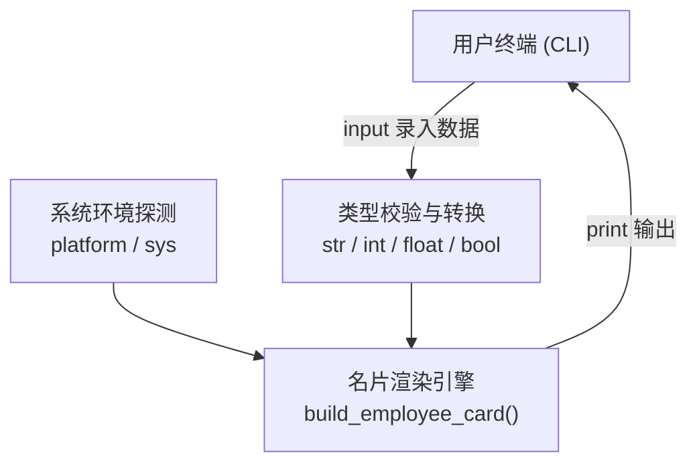

# Day 01 需求文档（PRD）、架构设计与 GitLab 协作记录

## 1. 旁白：为什么从“数字名片”开始？

> **讲师旁白**：很多同学刚学编程时最容易犯的错，就是只看视频不敲代码，或者一上来就想直接写复杂的智能体。但在真实的企业（比如我们模拟的**星辰数科**）里，任何一个庞大的 AI 平台，第一天做的事情永远只有两件：**第一，把团队每个人的开发环境和 Git 仓库拉齐（避免“在我电脑上是好的”）；第二，跑通最小闭环（MVP）**。今天的“数字名片”程序，表面上是练习 `int/float/str/bool` 和 `input/print`，实际上它就是未来智枢平台「Agent 身份注册中心（Agent Profile Registry）」的最初雏形！

---

## 2. GitLab Issue #001：研发环境标准化与数字名片 CLI

- **提出人**：产品经理 林晓 / Tech Lead 张工
- **指派给**：AI 应用开发工程师 陈默
- **关联分支**：`feature/day-01-user-profile`
- **目标版本**：`v0.1.0-day01`

### 2.1 业务需求描述
1. 团队成员统一安装 Python 3.10+ 与 VS Code，并配置国内镜像源（清华源/阿里云源），解决内网/国内下载依赖慢的问题。
2. 编写命令行入职向导程序，采集员工基础信息（姓名、岗位、经验年数、预算、API 权限状态），并输出标准化企业名片。
3. 必须包含环境自检功能，输出当前 Python 版本与操作系统，方便后续排查依赖冲突。

### 2.2 系统架构图（Day 01 极简版）

---

## 3. GitLab Merge Request !001 评审记录

- **提交说明**：`feat(day-01): 初始化开发环境自检与员工数字名片 CLI 模块`
- **Tech Lead 张工 Review 意见**：
  - `[通过]` 变量命名清晰，严格区分了 `int`（年数）与 `float`（预算）。
  - `[建议]` 保留 `¥{hourly_cost:.2f}` 两位小数格式化，后续接大模型计费账单时同样需要精确到分。
- **QA 李婷 测试结果**：`pytest project_iterations/day_01/tests -v` 3 个用例全部 PASS。
