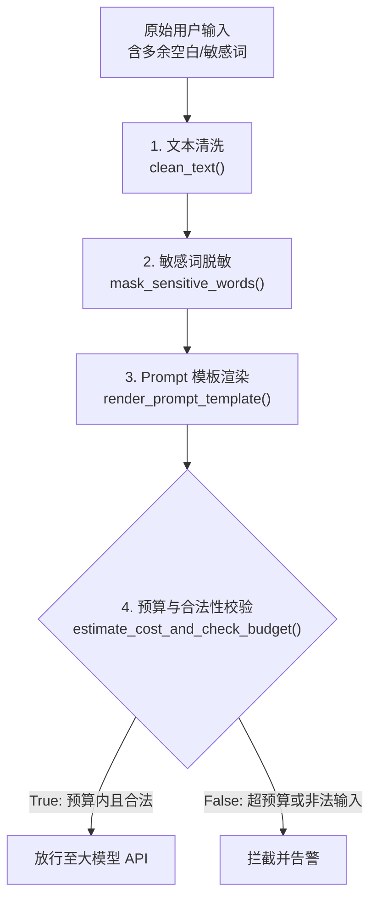

# Day 02 需求文档（PRD）、架构设计与 GitLab 协作记录

## 1. 旁白：为什么大模型平台需要“文本安检门”？

> **讲师旁白**：昨天我们搭好了环境，拿到了数字名片，正式入职“星辰数科”。今天一早刚坐到工位，产品经理林晓就发来一条紧急需求：昨晚有测试同事把公司的内部测试密钥 `sk-secret-...` 和保密项目代号直接粘贴进测试框发给了第三方大模型，差点引发安全事故！而且很多用户复制粘贴过来的提问里全是乱七八糟的空格、换行，直接拼接进 Prompt 既浪费 Token 费，又影响模型理解。所以今天，我们要把 Python 的**运算符**、**字符串方法与切片**、以及 **f-string 模板**用起来，给智枢平台装上第一道「Prompt 清洗与安全脱敏闸门（Prompt Sanitizer）」！

---

## 2. GitLab Issue #002：用户输入清洗、敏感词脱敏与预算熔断模块

- **提出人**：产品经理 林晓
- **Tech Lead**：张工
- **指派给**：AI 应用开发工程师 陈默
- **关联分支**：`feature/day-02-prompt-sanitizer`
- **目标版本**：`v0.1.0-day02`

### 2.1 业务需求描述
1. **文本规范化清洗 (`clean_text`)**：去除用户输入首尾多余空白，将连续多个空格、制表符、换行折叠为单个空格，并支持可选的英文全小写转换，减少无效 Token 消耗。
2. **敏感信息脱敏 (`mask_sensitive_words`)**：在文本发往外部大模型前，扫描并把敏感词元组中的高危词（如 API Key、内部项目代号）统一替换为 `***`。
3. **标准化 Prompt 模板渲染 (`render_prompt_template`)**：使用 Python `f-string` 将系统角色（`role`）、核心任务（`task`）与安全文本（`user_input`）组装为结构化 Prompt。
4. **调用成本估算与预算校验 (`estimate_cost_and_check_budget`)**：利用算术、比较与逻辑运算符，根据字符数估算 Token 费用，若输入非法或超出单次预算则返回 `False` 拦截请求。

### 2.2 系统架构图（Day 02 安全预处理流水线）

---

## 3. GitLab Merge Request !002 评审记录

- **提交说明**：`feat(day-02): 新增 Prompt 清洗、敏感词脱敏、f-string 模板与预算校验模块`
- **Tech Lead 张工 Review 意见**：
  - `[通过]` `clean_text` 使用 `" ".join(text.split())` 非常地道，一次性搞定首尾空白、连续空格、`\t` 和 `\n`。
  - `[通过]` `mask_sensitive_words` 中增加了 `if word:` 判空保护，防止传入空字符串时 `replace("", "***")` 破坏整段文本。
  - `[建议]` 预算校验函数同时覆盖了 `char_count >= 0 and budget > 0` 的边界保护，逻辑运算符使用清晰，后续 Day 03 接入 `if/else` 控制流后可以直接用于熔断拦截。
- **QA 李婷 测试结果**：`pytest project_iterations/day_02/tests -v` 8 个用例全部 PASS。
