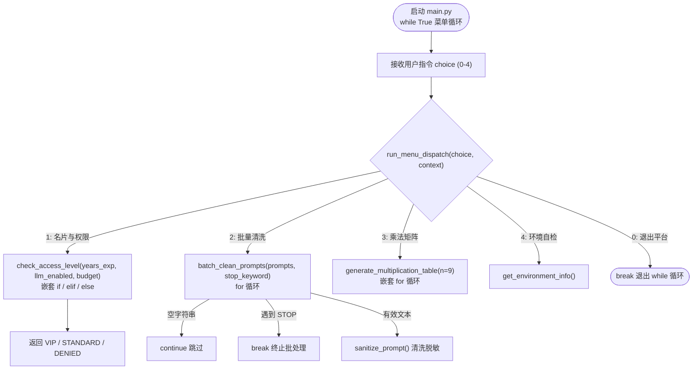

# Day 03 需求文档（PRD）、架构设计与 GitLab 协作记录

## 1. 旁白：为什么 Agent 需要“控制流与路由调度”？

> **讲师旁白**：前两天我们完成了员工数字名片（Day 01）和 Prompt 敏感词脱敏（Day 02），但程序目前还只能“从头跑到尾”，跑完一次就退出了。在真实的企业环境里，智枢平台必须能做两件事：**第一，根据员工的权限、工龄和算力预算做分支决策（谁能用 VIP 大模型？谁被拒绝？）；第二，像一个真正的命令行调度中心一样，持续等待用户指令（`while True`），批量清洗多条 Prompt（`for` + `continue` + `break`），直到用户主动选择退出**。这就是今天控制流（`if/elif/else`、`for`、`while`）在企业工程中的真实落地场景！

---

## 2. GitLab Issue #003：多轮交互路由与企业菜单调度器

- **提出人**：产品经理 林晓 / Tech Lead 张工
- **指派给**：AI 应用开发工程师 陈默
- **关联分支**：`feature/day-03-router-dispatch`
- **目标版本**：`v0.1.0-day03`

### 2.1 业务需求描述
1. **权限分级校验（`check_access_level`）**：使用嵌套 `if/elif/else` 逻辑，根据 `llm_enabled`、`years_exp` 与 `budget` 将员工访问等级划分为 `"VIP"`、`"STANDARD"` 或 `"DENIED"`。
2. **批量 Prompt 清洗引擎（`batch_clean_prompts`）**：使用 `for` 循环批量处理原始 Prompt 列表，遇到空字符串使用 `continue` 跳过，遇到停止关键词（默认 `"STOP"`）使用 `break` 立即终止批处理，其余有效文本复用 Day 02 的 `sanitize_prompt()` 完成清洗与脱敏。
3. **企业菜单调度器（`run_menu_dispatch` + `main.py`）**：提供 `while True` 交互式 CLI 菜单，支持名片与权限核验（`1`）、批量 Prompt 清洗（`2`）、9×9 乘法口诀表矩阵练习（`3`）、环境自检（`4`）及退出（`0`）。
4. **嵌套循环标准训练（`generate_multiplication_table`）**：使用经典双层 `for` 循环生成下三角乘法口诀表。

### 2.2 系统架构与控制流程图

---

## 3. GitLab Merge Request !003 评审记录

- **提交说明**：`feat(day-03): 实现权限分级校验、批量 Prompt 清洗与 CLI 菜单路由调度器`
- **Tech Lead 张工 Review 意见**：
  - `[通过]` `check_access_level` 采用先判断 `llm_enabled` 再细分等级的嵌套结构，逻辑边界清晰，杜绝了未授权用户误入 `VIP`/`STANDARD` 分支的风险。
  - `[通过]` `batch_clean_prompts` 合理运用 `continue` 与 `break` 控制批处理生命周期，并复用了 Day 02 的 `sanitizer` 模块，体现了良好的模块化思想。
  - `[建议]` `run_menu_dispatch` 将调度逻辑与 `input()` 交互解耦，使得单元测试无需 mock 标准输入即可 100% 覆盖核心分支。
- **QA 李婷 测试结果**：`pytest project_iterations/day_03/tests -v` 17 个测试用例全部 PASS。
