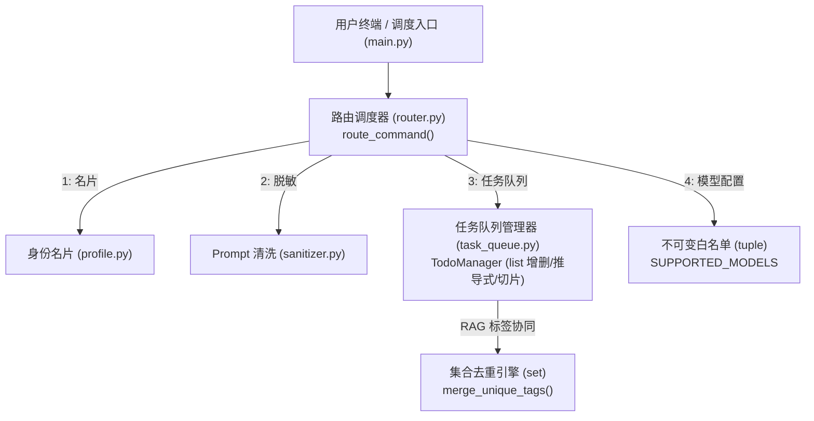

# Day 04 需求文档（PRD）、架构设计与 GitLab 协作记录

## 1. 旁白：为什么 Agent 离不开 `list`、`tuple` 和 `set`？

> **讲师旁白**：前三天我们分别完成了员工数字名片（`profile.py`）、Prompt 清洗脱敏（`sanitizer.py`）和菜单功能路由（`router.py`）。到了第四天，星辰数科的业务部门提出了一个非常真实的痛点：**“智能体不能只聊一句话就结束，它得能记住待办任务队列、锁定合规的模型白名单、并且能把多路检索回来的知识标签去重！”** 这正好对应 Python 最常用的三大容器数据结构——**可变列表 `list`**（任务队列与切片 Top-K）、**不可变元组 `tuple`**（系统模型白名单）和**无序不重复集合 `set`**（RAG 标签去重与交集分析）。

---

## 2. GitLab Issue #004：Agent 任务队列、不可变模型配置与标签去重引擎

- **提出人**：产品经理 林晓 / Tech Lead 张工
- **指派给**：AI 应用开发工程师 陈默
- **关联分支**：`feature/day-04-task-queue`
- **目标版本**：`v0.1.0-day04`

### 2.1 业务需求描述
1. **任务队列管理（`list`）**：实现 `TodoManager` 与列表操作函数，支持 `add_task`（追加任务）、`remove_task`（移除任务）、`complete_task`（标记完成）、`get_pending_tasks`（使用列表推导式筛选未完成任务）以及 `top_k_tasks`（使用列表切片获取前 K 个任务）。
2. **模型白名单配置（`tuple`）**：定义全局常量 `SUPPORTED_MODELS: tuple[str, ...]`，确保运行期间任何业务代码都无法意外修改系统允许调用的模型列表。
3. **知识库标签去重（`set`）**：实现 `merge_unique_tags(tags_a, tags_b)` 与交集分析函数，解决后续 RAG 多路召回（向量检索 + 关键词检索）时标签重复、空白污染的问题。

### 2.2 系统架构图（Day 04 演进版）

---

## 3. GitLab Merge Request !004 评审记录

- **提交说明**：`feat(day-04): 新增 TodoManager 任务队列、不可变模型配置与集合标签去重模块`
- **Tech Lead 张工 Review 意见**：
  - `[通过]` `SUPPORTED_MODELS` 使用 `tuple` 非常恰当，在测试中用 `pytest.raises(TypeError)` 验证了不可变性，这是良好的防御性编程习惯。
  - `[通过]` `get_pending_tasks` 使用列表推导式 `[t for t in tasks if not t["done"]]`，简洁且可读性高；`top_k_tasks` 对 `k <= 0` 做了边界防护，避免负切片导致意料之外的结果。
  - `[建议]` `TodoManager.tasks` 属性返回 `list(self._tasks)` 浅拷贝，防止外部调用方直接 `.clear()` 破坏内部状态，点赞！
- **QA 李婷 测试结果**：`pytest project_iterations/day_04/tests -v` 6 个测试用例全部 PASS。
