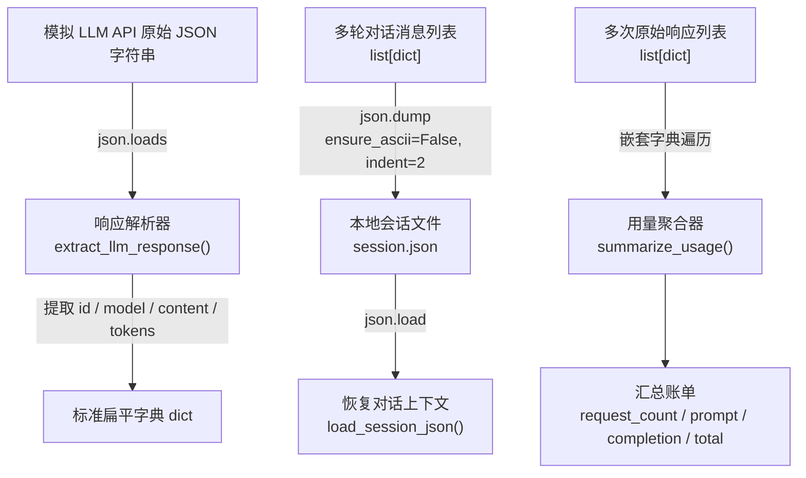

# Day 05 需求文档（PRD）、架构设计与 GitLab 协作记录

## 1. 旁白：为什么说 JSON 是大模型 API 的基石？

> **讲师旁白**：很多同学以为调用大模型 API 很神秘，其实剥开 HTTP 网络壳子，大模型和你的 Python 程序之间**只靠一种语言沟通——JSON**。你发给 DeepSeek/OpenAI 的 `messages` 列表是 JSON；模型返回给你的 `choices[0].message.content` 和 `usage` 计费账单也是 JSON；甚至后面我们做 Agent 工具调用（Function Calling）和结构化输出（Structured Output），全都是嵌套的 JSON 字典与列表。今天我们在**智枢平台（ZhiShu-Agent）**中落地 `zhishu_agent/json_parser.py`，把“JSON 响应解析 + 中文会话持久化 + Token 用量聚合”这三件事做扎实，明天接入真实大模型接口就能直接复用！

---

## 2. GitLab Issue #005：LLM JSON 响应解析与会话持久化模块

- **提出人**：产品经理 林晓 / Tech Lead 张工
- **指派给**：AI 应用开发工程师 陈默
- **关联分支**：`feature/day-05-json-parser`
- **目标版本**：`v0.1.0-day05`

### 2.1 业务需求描述
1. **响应解析器 (`extract_llm_response`)**：使用 `json.loads()` 解析标准 OpenAI/DeepSeek Chat Completions 格式的 JSON 字符串，提取 `id`、`model`、`content`（位于 `choices[0]["message"]["content"]`）以及 `prompt_tokens`、`completion_tokens`、`total_tokens`。若遇到非法 JSON 或空 `choices` 列表，需抛出清晰的 `ValueError`。
2. **会话持久化 (`save_session_json` / `load_session_json`)**：使用 `json.dump()` 与 `json.load()` 将多轮对话列表持久化到本地 JSON 文件，**必须**使用 `ensure_ascii=False` 与 `indent=2` 保证中文内容可读且格式整齐。
3. **Token 用量聚合器 (`summarize_usage`)**：遍历多次 API 调用的原始响应字典列表，从嵌套的 `usage` 字段中累计 `request_count`、`prompt_tokens`、`completion_tokens` 与 `total_tokens`，为后续企业级成本核算提供数据支撑。

### 2.2 系统架构图（Day 05 JSON 解析与持久化流转）

---

## 3. GitLab Merge Request !005 评审记录

- **提交说明**：`feat(day-05): 新增 LLM JSON 响应解析、中文会话持久化与 Token 用量统计模块`
- **Tech Lead 张工 Review 意见**：
  - `[通过]` 严格使用 `ensure_ascii=False` 与 `encoding="utf-8"`，彻底规避 Windows/Linux 下中文变 `\uXXXX` 或乱码的经典坑。
  - `[通过]` 对 `choices` 为空、JSON 语法错误、文件不存在等异常做了显式防御，错误信息清晰可读。
  - `[建议]` `save_session_json` 中使用 `target.parent.mkdir(parents=True, exist_ok=True)` 自动建目录非常工程化，后续日志模块也保持此规范。
- **QA 李婷 测试结果**：`pytest project_iterations/day_05/tests -v` 10 个用例（含 `tmp_path` 临时目录测试）全部 PASS。
