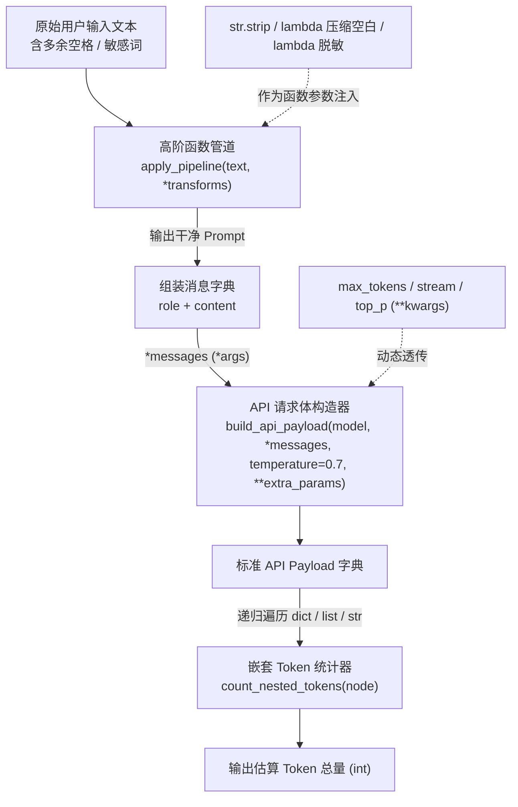

# Day 06 需求文档（PRD）、架构设计与 GitLab 协作记录

## 1. 旁白：为什么工程代码必须从“脚本式”重构为“函数式管道”？

> **讲师旁白**：前 5 天，我们已经能写出环境检测、Prompt 模板拼接和 JSON 解析逻辑了。但如果你打开早期的脚本代码，会发现一个通病：**所有逻辑都写死在主流程里**——想改一下清洗规则要改主函数，想多传一个 `top_p` 或 `stream=True` 参数要改函数签名，想统计嵌套对话树里的字符数还要手写好几层 `for` 循环。今天我们在**智枢平台（ZhiShu-Agent）**发起第一次核心重构：用 Python 的**函数参数体系（`*args` / `**kwargs`）、高阶函数与 `lambda` 管道、以及递归函数**，把零散脚本升级为可插拔的 `zhishu_agent/pipeline_fn.py`！

---

## 2. GitLab Issue #006：将早期脚本重构为函数式 Prompt 与 Payload 处理管道

- **提出人**：产品经理 林晓 / Tech Lead 张工
- **指派给**：AI 应用开发工程师 陈默
- **关联分支**：`feature/day-06-pipeline-fn`
- **目标版本**：`v0.1.0-day06`

### 2.1 业务需求描述
1. **动态 API 请求体构造器 (`build_api_payload`)**：
   - 使用位置参数 `model: str` 指定模型名；
   - 使用 `*messages: dict` 接收任意条数的对话消息字典；
   - 使用默认关键字参数 `temperature: float = 0.7` 控制采样温度（校验 `[0.0, 2.0]` 区间）；
   - 使用 `**extra_params` 透传 `max_tokens`、`stream`、`top_p` 等扩展参数，无需频繁修改函数签名即可适配 OpenAI / DeepSeek / Qwen 等不同厂商。
2. **高阶函数与 `lambda` 清洗流水线 (`apply_pipeline`)**：
   - 接收原始文本 `text: str` 与任意多个文本转换函数 `*transforms`；
   - 支持传入内置方法（如 `str.strip`）与 `lambda` 匿名函数（如压缩多余空格、敏感词脱敏），按顺序执行管道变换。
3. **嵌套 JSON / 消息树递归统计器 (`count_nested_tokens`)**：
   - 面对多轮对话、Tool Calling 嵌套字典或任意深度的 JSON 树，使用递归遍历 `dict` / `list` / `str`，累加所有文本节点的字符数作为估算 Token 总量，忽略 `int` / `float` / `bool` / `None` 等非文本标量。

### 2.2 系统架构图（Day 06 函数式管道流转）

---

## 3. GitLab Merge Request !006 评审记录

- **提交说明**：`refactor(day-06): 新增 zhishu_agent/pipeline_fn.py，重构为函数式清洗管道与动态 Payload 构造器`
- **Tech Lead 张工 Review 意见**：
  - `[通过]` `build_api_payload` 巧妙利用 `*messages` 将 `temperature` 自然变为 Keyword-Only 参数，避免了位置传参混淆。
  - `[通过]` `apply_pipeline` 显式检查 `callable(fn)` 与 `isinstance(text, str)`，比隐式报错更易于排查线上问题。
  - `[建议]` `count_nested_tokens` 对非文本标量（`int`/`bool`/`None`）返回 `0` 的设计非常稳健，能直接安全扫描完整的 OpenAI 响应 JSON 树；后续接入 `tiktoken` 时只需替换基准条件 `len(node)` 即可。
- **QA 李婷 测试结果**：`pytest project_iterations/day_06/tests -v` 全部单元测试 100% PASS。
