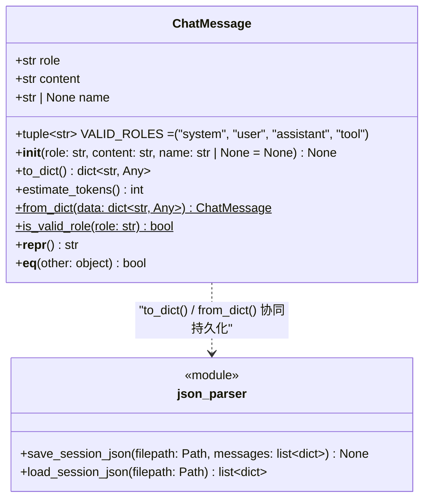

# Day 08 需求文档（PRD）、架构设计与 GitLab 协作记录

## 1. 旁白：为什么我们要告别“裸字典”，拥抱面向对象（OOP）？

> **讲师旁白**：在 Day 05 中，我们用 `{"role": "user", "content": "你好"}` 这样的裸字典快速跑通了 JSON 序列化与解析。但随着**智枢平台（ZhiShu-Agent）**进入多轮对话管理、工具调用（Function Calling）和上下文预算控制阶段，裸字典的隐患立刻暴露出来：如果某位同事手抖把 `"user"` 写成了 `"usr"`，字典不会报错，直到发送给大模型 API 才在线上返回 400 Bad Request；而且“估算单条消息 Token 数”这种逻辑只能散落在各处工具函数里，无法内聚在消息本身。今天（Day 08），我们正式迈入**面向对象编程（OOP）**：用 `ChatMessage` 类把**数据（role / content / name）**与**行为（校验 / 序列化 / Token 估算）**封装在一起，让智枢平台的代码从“脚本级”升级到“企业架构级”！

---

## 2. GitLab Issue #008：将裸字典消息升级为 OOP `ChatMessage` 实体类

- **提出人**：产品经理 林晓 / Tech Lead 张工
- **指派给**：AI 应用开发工程师 陈默
- **关联分支**：`feature/day-08-oop-chat-message`
- **目标版本**：`v0.1.0-day08`

### 2.1 业务需求描述
1. **消息实体建模 (`ChatMessage`)**：在 `zhishu_agent/message.py` 中定义 `ChatMessage` 类，构造函数 `__init__(self, role: str, content: str, name: str | None = None)` 必须在实例化瞬间校验 `role` 是否属于 `("system", "user", "assistant", "tool")`，非法角色直接抛出 `ValueError`；同时校验 `content` 与 `name` 类型。
2. **实例方法 (`to_dict` & `estimate_tokens`)**：
   - `to_dict(self) -> dict[str, Any]`：导出兼容 OpenAI / DeepSeek Chat Completions API 的字典，仅当 `name` 不为 `None` 时才附加 `"name"` 字段。
   - `estimate_tokens(self) -> int`：基于中英文字符特征估算当前消息的 Token 消耗，为后续上下文窗口裁剪（Sliding Window）提供依据。
3. **类方法工厂 (`from_dict`)**：使用 `@classmethod` 实现 `from_dict(cls, data: dict[str, Any]) -> "ChatMessage"`，支持从 JSON 反序列化字典直接还原 `ChatMessage` 对象。
4. **静态方法校验器 (`is_valid_role`)**：使用 `@staticmethod` 实现 `is_valid_role(role: str) -> bool`，无需创建实例即可供外部模块快速校验角色字符串。

### 2.2 类图架构设计（Mermaid Class Diagram）

---

## 3. GitLab Merge Request !008 评审记录

- **提交说明**：`feat(day-08): 新增 OOP ChatMessage 消息实体类及完整单元测试`
- **Tech Lead 张工 Review 意见**：
  - `[通过]` 构造阶段即校验（Fail-Fast 原则）：`__init__` 直接调用 `self.is_valid_role(role)`，把非法角色拦截在源头，避免污染上下文历史。
  - `[通过]` `to_dict()` 对 `name is None` 的处理非常精准，符合 OpenAI/DeepSeek API 对可选字段的严格要求（不传多余的 `"name": null`）。
  - `[通过]` 区分清晰：`to_dict` / `estimate_tokens` 用实例方法（依赖 `self` 状态），`from_dict` 用 `@classmethod`（需要 `cls` 构造实例），`is_valid_role` 用 `@staticmethod`（纯校验逻辑，不依赖实例或类状态）。
  - `[建议]` 已实现 `__repr__` 与 `__eq__`，后续 Day 09 实现 `Conversation` 容器类时可直接比较两个会话的 `messages` 列表是否相等。
- **QA 李婷 测试结果**：`pytest project_iterations/day_08/tests -v` 27 个用例（含 `ChatMessage` 参数化角色校验、往返序列化、Token 估算及 Day 05 集成测试）全部 PASS。
