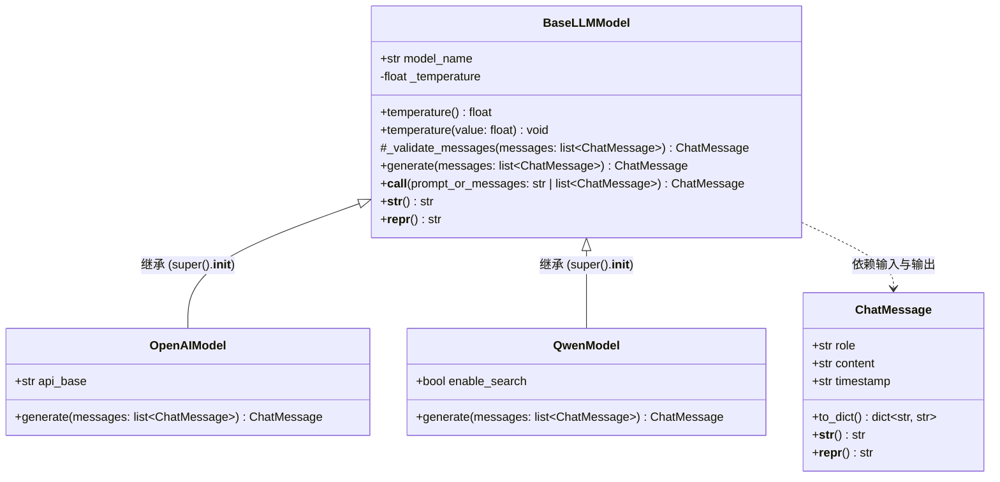

# Day 09 需求文档（PRD）、架构设计与 GitLab 协作记录

## 1. 旁白：为什么需要“继承、多态与 `@property`”？

> **讲师旁白**：欢迎来到星辰数科《智枢企业级智能体平台》第 9 天！昨天（Day 08）我们用 `ChatMessage` 把零散的消息字典封装成了健壮的对象。但今天产品经理林晓带来了一个更棘手的需求：**公司既要接 OpenAI，又要接阿里的通义千问（Qwen），下周可能还要接 DeepSeek**。如果每个模型写一套完全不同的调用函数，业务代码里就会充斥着 `if vendor == "openai": ... elif vendor == "qwen": ...` 的意大利面条代码！今天我们用面向对象最核心的三大武器——**继承（`BaseLLMModel -> OpenAIModel / QwenModel`）、多态（统一的 `generate()`）、魔术方法（`__str__`/`__repr__`/`__call__`）以及 `@property` 参数守卫**——打造智枢平台可插拔的「多厂商大模型统一适配器」。

---

## 2. GitLab Issue #009：基于 OOP 继承的多厂商大模型统一适配器

- **提出人**：产品经理 林晓 / Tech Lead 张工
- **指派给**：AI 应用开发工程师 陈默
- **关联分支**：`feature/day-09-llm-adapter-oop`
- **目标版本**：`v0.1.0-day09`

### 2.1 业务需求描述
1. **统一抽象基类 `BaseLLMModel`**：
   - 维护公共属性 `model_name` 与采样温度 `temperature`。
   - 使用 `@property` 与 `@temperature.setter` 严格校验温度范围 `0.0 <= t <= 2.0`，拦截非法类型或越界参数，防止大模型 API 报错。
   - 实现 `__str__`（日志/展示友好）与 `__repr__`（调试精确还原），并实现 `__call__` 支持 `model("你好")` 与 `model(messages)` 两种调用方式。
   - 定义标准推理契约 `generate(messages: list[ChatMessage]) -> ChatMessage`。
2. **多态子类适配器 `OpenAIModel` 与 `QwenModel`**：
   - 继承 `BaseLLMModel`，通过 `super().__init__` 复用基类初始化与参数校验逻辑。
   - 各自扩展厂商专属配置（`api_base`、`enable_search`），并多态重写 `generate()` 返回标准 `ChatMessage(role="assistant", ...)`。
3. **离线可测性**：
   - 在未配置真实 API Key 的本地研发/CI 环境下，提供确定性的离线模拟推理输出，确保 `pytest` 毫秒级全量通过。

### 2.2 系统架构图（类图 `classDiagram`）

---

## 3. GitLab Merge Request !009 评审记录

- **提交说明**：`feat(day-09): 实现 BaseLLMModel 基类及 OpenAIModel / QwenModel 多态适配器`
- **Tech Lead 张工 Review 意见**：
  - `[通过]` `BaseLLMModel.__init__` 中直接通过 `self.temperature = temperature` 赋值，确保构造阶段就触发 `@temperature.setter` 校验，避免“半成品脏对象”流入后续流程。
  - `[通过]` `OpenAIModel` 与 `QwenModel` 均通过 `super().__init__` 复用父类逻辑，无重复校验代码，符合 DRY 原则。
  - `[建议]` 注意在 `temperature.setter` 中显式排除 `bool`（因为 Python 中 `isinstance(True, int)` 为 `True`），当前代码已正确拦截，值得点赞！
- **QA 李婷 测试结果**：`pytest project_iterations/day_09/tests -v` 19 个用例全部 PASS（覆盖边界值 `0.0`/`2.0`、越界异常、多态分发及 `__call__`）。
