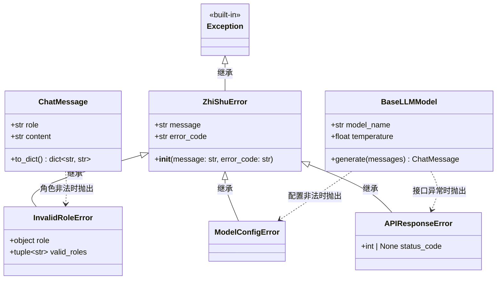

# Day 10 需求文档（PRD）、架构设计与 GitLab 协作记录

## 1. 旁白：为什么需要“模块化包管理与自定义异常体系”？

> **讲师旁白**：欢迎来到星辰数科《智枢企业级智能体平台》第 10 天！昨天（Day 09）我们打造了多厂商大模型统一适配器，但随着代码量增长，两个工程隐患浮出水面：第一，所有参数校验都只抛出 Python 内置的 `ValueError` 和 `TypeError`，在生产日志里根本分不清“是消息角色填错了，还是模型温度超限了，还是上游 OpenAI 接口超时了”；第二，团队新来的实习生把所有代码塞进一个文件，且没有 `requirements.txt` 锁定依赖，导致“在我电脑上能跑，上测试环境就缺包”。今天我们就用 **Python 包模块化（`__init__.py`）、虚拟环境与 `requirements.txt`、自定义异常继承树（`ZhiShuError`）以及 `try/except/else/finally` 四段式容错**，把智枢平台升级到工程化可运维的 `v0.1.0-day10`！

---

## 2. GitLab Issue #010：构建 `zhishu_agent` 统一异常体系与依赖规范

- **提出人**：产品经理 林晓 / Tech Lead 张工
- **指派给**：AI 应用开发工程师 陈默
- **关联分支**：`feature/day-10-modules-exceptions`
- **目标版本**：`v0.1.0-day10`

### 2.1 业务与工程需求描述
1. **自定义异常体系（`zhishu_agent/exceptions.py`）**：
   - 定义平台统一异常基类 `ZhiShuError(Exception)`，内置 `error_code` 与标准格式化消息 `[ERROR_CODE] message`。
   - 定义三大业务子类：
     - `InvalidRoleError(ZhiShuError)`：拦截非法消息角色（如 `"admin"`），携带 `role` 与 `valid_roles` 上下文。
     - `ModelConfigError(ZhiShuError)`：拦截非法 `model_name`、`temperature` 越界或类型错误（含 `bool`）、空 `messages` 等配置问题。
     - `APIResponseError(ZhiShuError)`：拦截上游大模型接口超时、限流或服务异常，支持携带 HTTP `status_code`。
2. **存量模块重构（`message.py` & `models.py`）**：
   - 重构 `ChatMessage`、`BaseLLMModel`、`OpenAIModel`、`QwenModel`，将零散的 `ValueError`/`TypeError` 替换为精准的自定义异常。
   - 在 `OpenAIModel` / `QwenModel` 中支持 `simulate_error` 与 `[SIMULATE_ERROR]` 触发模拟接口异常，保障离线可测性。
3. **包导出与容错入口（`__init__.py` & `main.py`）**：
   - 通过 `zhishu_agent/__init__.py` 统一暴露核心类与异常，支持 `from zhishu_agent import ...`。
   - 在 `main.py` 中编写 `safe_invoke()`，完整演示 `try / except / else / finally` 执行链路与审计收尾。
4. **依赖清单规范（`requirements.txt`）**：
   - 明确项目核心依赖与版本下限，支撑新成员通过 `venv` + `pip install -r requirements.txt` 一键复现环境。

### 2.2 系统架构图（异常继承与模块依赖 `classDiagram`）

---

## 3. GitLab Merge Request !010 评审记录

- **提交说明**：`feat(day-10): 建立 ZhiShuError 异常体系、重构消息与模型校验并补充 requirements.txt`
- **Tech Lead 张工 Review 意见**：
  - `[通过]` 所有领域异常统一继承自 `ZhiShuError`，上层网关既可以按细粒度分别 `except InvalidRoleError` / `except APIResponseError`，也可以用 `except ZhiShuError` 统一兜底，架构非常清晰。
  - `[通过]` `main.py` 中 `try / except / else / finally` 分工明确：成功后的统计放在 `else`（避免把正常逻辑和异常逻辑混在 `try` 里），审计日志放在 `finally` 确保必达。
  - `[建议]` 在 `zhishu_agent/__init__.py` 中维护好 `__all__`，方便外部调用方使用静态类型检查与 IDE 自动补全。
- **QA 李婷 测试结果**：`pytest project_iterations/day_10/tests -v` 20 个用例全部 PASS（覆盖异常继承链、错误码、角色/温度/消息校验、模拟 API 503/504 异常以及 `else`/`finally` 分支执行顺序）。
