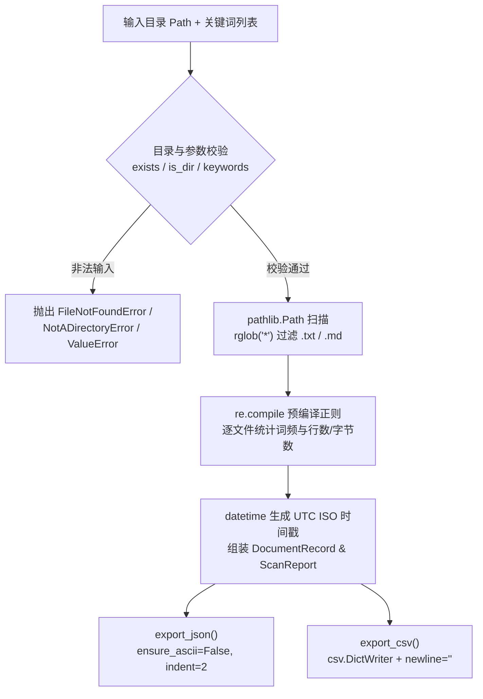

# Day 11 需求文档（PRD）、架构设计与 GitLab 协作记录

## 1. 旁白：为什么 RAG 之前必须先练好“文件操作与标准库”？

> **讲师旁白**：欢迎来到星辰数科《智枢企业级智能体平台》第 11 天！很多同学一听到 RAG（检索增强生成），第一反应就是装 LangChain、连向量数据库；但在真实企业项目里，80% 的脏活累活都在**数据预处理阶段**——客户丢给你一个嵌套十几层的共享文件夹，里面混着 `.md`、`.txt`、`.py`、`.json` 甚至损坏编码的文件。如果你还在用 `os.path.join` 拼字符串、手动 `open()` 忘记关文件句柄，代码在 Windows 和 Linux 之间一迁移就崩。今天我们用 Python 最硬核的五大标准库——**`pathlib.Path`、`re`、`csv`、`json`、`datetime`**——打造智枢平台的「知识库文档扫描与词频统计引擎」，为后续 RAG 切片入库打下坚实的工程基石！

---

## 2. GitLab Issue #011：企业知识库文档扫描与关键词统计引擎

- **提出人**：产品经理 林晓 / Tech Lead 张工
- **指派给**：AI 应用开发工程师 陈默
- **关联分支**：`feature/day-11-doc-scanner-stdlib`
- **目标版本**：`v0.1.0-day11`

### 2.1 业务需求描述
1. **跨平台路径扫描（`pathlib.Path`）**：
   - 支持递归（`rglob("*")`）与非递归（`iterdir()`）扫描指定目录。
   - 仅纳入 `.txt` 与 `.md` 后缀文本文件，自动跳过代码、图片、JSON 等无关文件，并按相对路径排序保证输出确定性。
   - 校验目标目录是否存在及是否为目录，分别抛出 `FileNotFoundError` 与 `NotADirectoryError`。
2. **正则关键词统计与脱敏基础（`re`）**：
   - 使用 `re.compile` 预编译关键词正则，支持 `case_sensitive`（大小写敏感）与 `whole_word`（英文全词边界 `\b`）开关，同时兼容中文关键词检索。
   - 对空关键词列表或空白关键词抛出 `ValueError`，并自动去重。
3. **文件元数据与审计时间戳（`datetime`）**：
   - 记录每个文件的 `size_bytes`、`line_count`、`char_count` 及 UTC ISO-8601 格式的修改时间 `modified_at`；汇总报告记录 `scanned_at` 扫描时间戳。
4. **结构化报告双格式导出（`csv` & `json`）**：
   - `export_json()`：使用 `json.dumps(..., ensure_ascii=False, indent=2)` 导出包含 `summary` 与 `files` 明细的嵌套报告。
   - `export_csv()`：使用 `csv.DictWriter(..., newline="")` 导出扁平化逐文件统计表，动态生成 `kw:<关键词>` 列头。

### 2.2 系统架构图（流程图 `flowchart TD`）

---

## 3. GitLab Merge Request !011 评审记录

- **提交说明**：`feat(day-11): 实现基于标准库的 DocScanner 文档扫描与 CSV/JSON 报告导出引擎`
- **Tech Lead 张工 Review 意见**：
  - `[通过]` 全程使用 `pathlib.Path` 替代 `os.path`，并使用 `as_posix()` 统一相对路径分隔符，彻底消除了 Windows (`\`) 与 Linux (`/`) 跨平台测试差异。
  - `[通过]` `_compile_patterns` 中先用 `re.escape(kw)` 转义特殊字符（如 `C++`、`v0.1`），再按需拼接 `\b`，避免正则元字符注入导致崩溃。
  - `[通过]` `export_csv` 显式传入 `newline=""` 且自动调用 `out.parent.mkdir(parents=True, exist_ok=True)`，细节到位。
- **QA 李婷 测试结果**：`pytest project_iterations/day_11/tests -v` 11 个用例全部 PASS（基于 `tmp_path` 覆盖递归过滤、大小写/全词边界、中文关键词、异常处理及 CSV/JSON 导出校验）。
