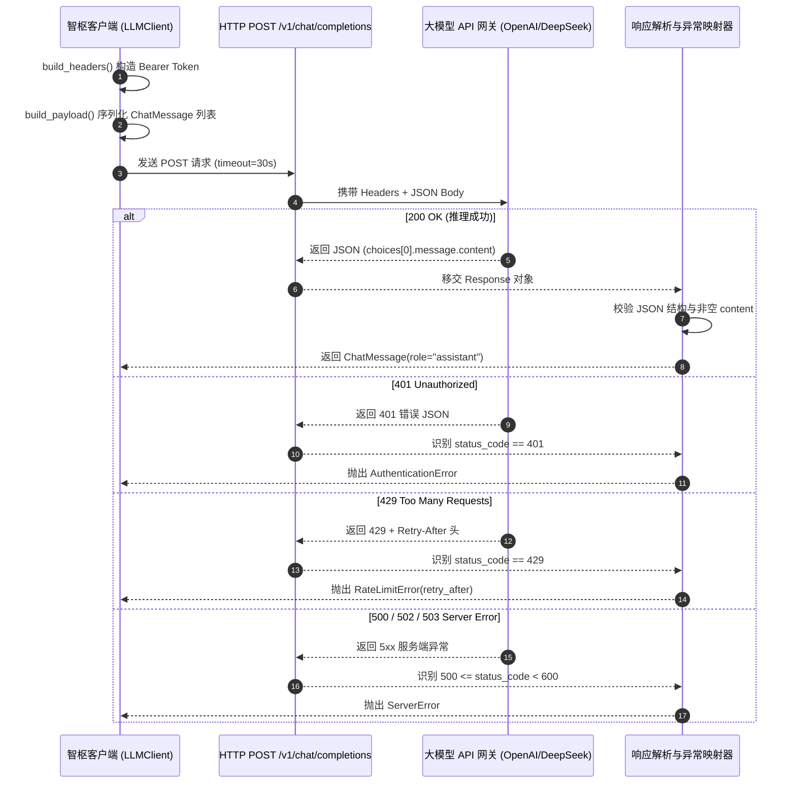

# Day 12 需求文档（PRD）、架构设计与 GitLab 协作记录

## 1. 旁白：为什么今天是第一阶段的“关键一天（Key Day）”？

> **讲师旁白**：欢迎来到星辰数科《智枢企业级智能体平台》第 12 天！前 11 天我们打好了 Python 基础、数据结构、异常体系、文件与 JSON 解析、面向对象模型抽象。但说到底，之前的大模型回复都是本地字符串拼接出来的“假动作”。今天我们要真正打通**「本地 Python 程序」到「云端大模型网关」的最后一公里**！无论未来你用的是 OpenAI、DeepSeek、通义千问还是本地 vLLM，底层本质上都是**发一个 HTTP POST 请求，带上 `Authorization: Bearer <API_KEY>` 请求头和标准 JSON 请求体，再把返回的 JSON 解析出来**。今天我们用现代工程级 HTTP 库 `httpx` 封装 `LLMClient`，并通过 `httpx.MockTransport` 依赖注入实现 100% 离线确定性测试——既能真枪实弹连线上网，又能在无网 CI 流水线里毫秒级跑通全量测试！

---

## 2. GitLab Issue #012：基于 httpx 的大模型 HTTP 客户端封装

- **提出人**：产品经理 林晓 / Tech Lead 张工
- **指派给**：AI 应用开发工程师 陈默
- **关联分支**：`feature/day-12-llm-http-client`
- **目标版本**：`v0.1.0-day12`

### 2.1 业务需求描述
1. **标准协议兼容（OpenAI / DeepSeek `/v1/chat/completions`）**：
   - `LLMClient` 支持配置 `api_key`、`base_url`（默认 `https://api.deepseek.com`）、`model`（默认 `deepseek-chat`）与 `timeout`。
   - 统一构造 `Authorization: Bearer <api_key>` 与 `Content-Type: application/json` 请求头。
   - 将 `list[ChatMessage]` 与 `temperature`、`max_tokens`、`stream` 序列化为标准 JSON 请求体。
2. **精准 HTTP 状态码与异常映射**：
   - `200 OK`：校验响应 JSON 与 `choices[0].message.content`，封装为 `ChatMessage(role="assistant", ...)` 返回。
   - `401 Unauthorized`：抛出 `AuthenticationError`（提示检查 API Key，不可盲目重试）。
   - `429 Too Many Requests`：抛出 `RateLimitError`（解析 `Retry-After` 响应头，提示限流退避）。
   - `5xx Server Error`：抛出 `ServerError`（厂商服务端/网关异常）。
   - 畸形 JSON / 缺少 `choices`：抛出 `InvalidResponseError`；网络超时抛出 `NetworkTimeoutError`。
3. **可测试性与资源管理**：
   - 支持注入 `httpx.BaseTransport`（如 `httpx.MockTransport`），确保单元测试不依赖外网与真实余额。
   - 实现 `__enter__` / `__exit__` 上下文管理器协议，自动释放底层 HTTP 连接池。

### 2.2 系统架构图（时序图 `sequenceDiagram`）

---

## 3. GitLab Merge Request !012 评审记录

- **提交说明**：`feat(day-12): 实现基于 httpx 的 LLMClient 及 MockTransport 离线单测体系`
- **Tech Lead 张工 Review 意见**：
  - `[通过]` 将 `transport: httpx.BaseTransport | None = None` 暴露在 `LLMClient.__init__` 中非常规范，符合“依赖倒置”原则——生产环境默认真实网络，测试环境一键注入 `httpx.MockTransport`，业务代码零修改。
  - `[通过]` 异常体系继承清晰（`ZhiShuError -> LLMAPIError -> AuthenticationError / RateLimitError / ServerError / InvalidResponseError / NetworkTimeoutError`），并保留了 `status_code` 和 `response_body` 便于线上排查日志。
  - `[建议]` 在 `LLMClient` 中设置 `trust_env=False`（或显式可控）可避免某些受限代理环境下 `NO_PROXY` 解析异常；已确认代码已妥善处理并支持上下文管理器 `with LLMClient(...) as client:` 自动关闭连接池。
- **QA 李婷 测试结果**：`pytest project_iterations/day_12/tests -v` 共 15 个用例 100% PASS（覆盖 Header 构造、Payload 序列化、200 解析、401/429/500/400 状态码映射、畸形 JSON 拦截与网络超时模拟）。
