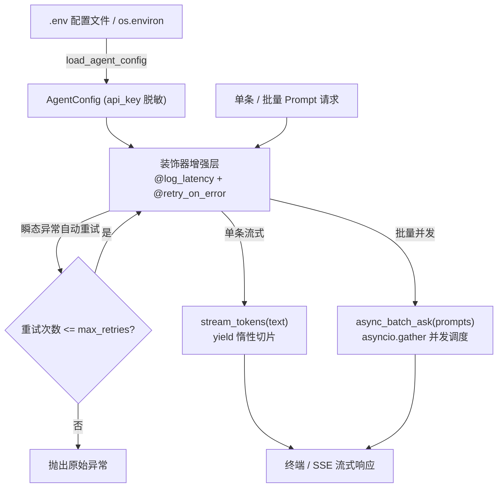

# Day 13 需求文档（PRD）、架构设计与 GitLab 协作记录

## 1. 旁白：为什么需要“装饰器、生成器、`asyncio` 与安全配置”？

> **讲师旁白**：欢迎来到星辰数科《智枢企业级智能体平台》第 13 天！前几天我们已经用面向对象把多厂商模型适配器搭了起来，但今天一早产品经理林晓和运维团队同步了三大线上痛点：第一，大模型 API 偶发网络抖动或 429 限流，业务代码里到处复制粘贴 `try...except` 重试和耗时统计；第二，用户发一条长文本或批量跑 20 个评测 Prompt，串行阻塞导致界面卡死、内存飙升；第三，有实习生差点把明文 `API_KEY` 硬编码提交到 Git 仓库！今天我们就用 Python 最核心的四大高阶工程武器——**装饰器（`@retry_on_error` / `@log_latency`）、生成器 `yield`（`stream_tokens`）、异步并发（`asyncio.gather`）与纯标准库 `.env` 安全配置加载**——把智枢平台升级为高可用、流式、并发的企业级底座！

---

## 2. GitLab Issue #013：高可用装饰器、流式生成器、`asyncio` 并发与 `.env` 安全配置

- **提出人**：产品经理 林晓 / Tech Lead 张工
- **指派给**：AI 应用开发工程师 陈默
- **关联分支**：`feature/day-13-advanced-python-async`
- **目标版本**：`v0.1.0-day13`

### 2.1 业务需求描述
1. **横切关注点抽离（`zhishu_agent/decorators.py`）**：
   - 实现带参数的 `@retry_on_error(max_retries=3, delay=0.01)` 装饰器：自动捕获瞬态异常并按指定延迟重试，耗尽后保留原异常堆栈抛出。
   - 实现 `@log_latency` 装饰器：使用 `time.perf_counter()` 精确测量函数耗时（毫秒），并使用 `@functools.wraps` 保留原函数签名与文档字符串。
2. **流式输出与异步并发（`zhishu_agent/streaming.py`）**：
   - 实现基于 `yield` 的惰性生成器 `stream_tokens(text: str, chunk_size: int = 1)`，避免一次性构造巨大字符串列表占用内存。
   - 实现异步批量推理 `async def async_batch_ask(...)`，通过 `asyncio.gather` 并发调度多条 Prompt 请求并保持返回顺序一致。
3. **零第三方依赖的安全配置（`zhishu_agent/config.py`）**：
   - 不依赖 `python-dotenv`，使用标准库 `os.environ` 与 `pathlib.Path` 实现 `.env` 解析器 `load_env_file()`（支持注释、空行、引号剥离、`export` 前缀及 `override` 控制）。
   - 提供 `AgentConfig` 不可变配置对象，在 `__repr__` 中对 `api_key` 自动脱敏（`****...xxxx`），严防密钥泄露到日志。

### 2.2 系统架构流程图（`flowchart TD`）

---

## 3. GitLab Merge Request !013 评审记录

- **提交说明**：`feat(day-13): 实现 @retry_on_error/@log_latency 装饰器、yield 流式生成器、asyncio.gather 并发与 .env 安全加载`
- **Tech Lead 张工 Review 意见**：
  - `[通过]` 两个装饰器均严格使用了 `@functools.wraps(func)`，保证了 `__name__`、`__doc__` 与调试信息不丢失。
  - `[通过]` `load_env_file` 默认 `override=False`，符合“容器/CI 环境变量优先级高于本地 `.env`”的 12-Factor App 最佳实践。
  - `[通过]` `AgentConfig.__repr__` 对 `api_key` 进行了 `mask_secret` 脱敏处理，即使整对象直接 `print` 到日志也不会泄露明文密钥。
- **QA 李婷 测试结果**：`pytest project_iterations/day_13/tests -v` 12 个用例全部 PASS（覆盖瞬态重试成功、重试耗尽抛错、生成器惰性切片、`asyncio.run` 并发保序、`.env` 解析与密钥脱敏）。
