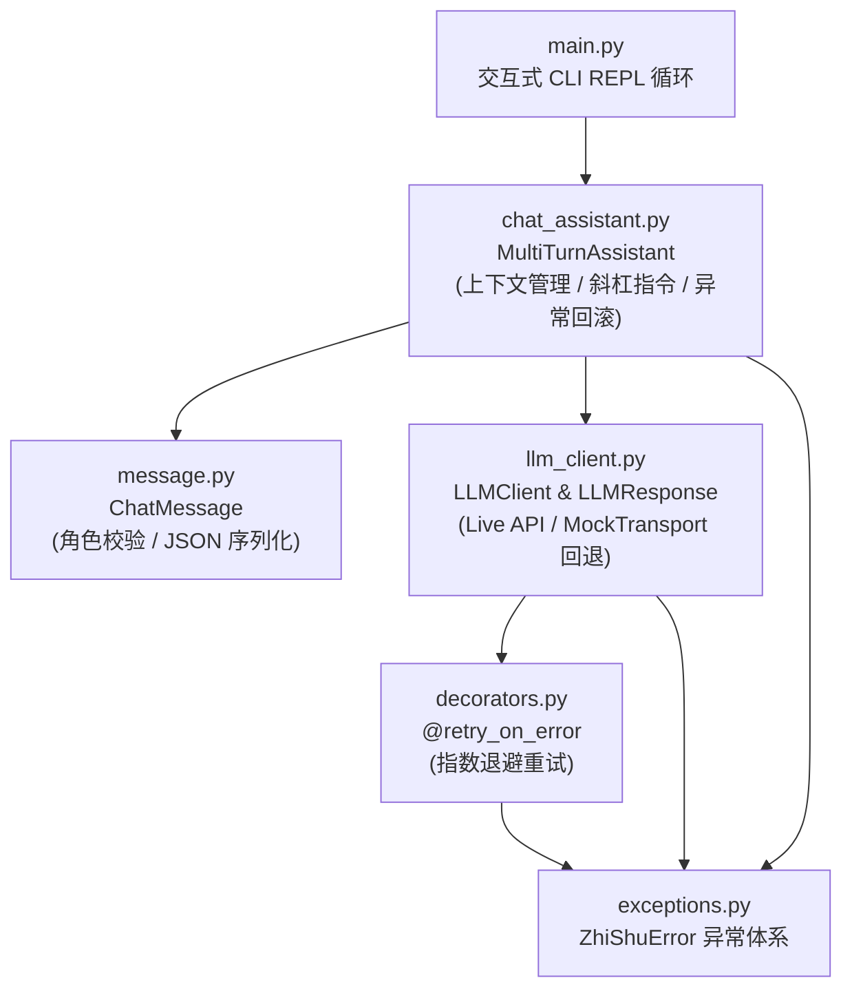
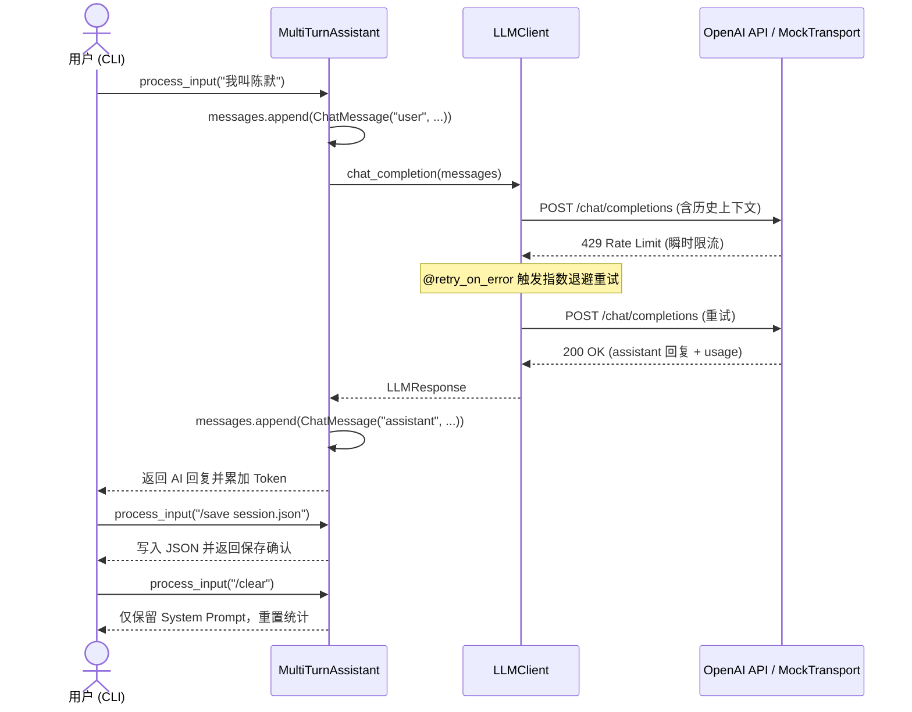

# Day 14 需求文档（PRD）、架构设计与 GitLab 协作记录

## 1. 旁白：第一阶段收官，从“零散脚本”到“可交付项目一”

> **讲师旁白**：欢迎来到星辰数科《智枢企业级智能体平台》第 14 天，也是**第一阶段（Python 编程基础）的里程碑收官日**！回顾过去两周：Day 01 我们写下第一行数字名片代码，Day 02-05 攻克了 Prompt 清洗与结构化 JSON 解析，Day 06-09 完成了函数式重构与面向对象多模型抽象，Day 10-13 补齐了 `httpx` HTTP 通信、装饰器重试与自定义异常体系。今天，产品经理林晓正式发起**项目一《命令行多轮对话 AI 助手》**的封版交付（`v0.1.0-day14`）：我们要把所有积木组装成一个支持多轮上下文记忆、斜杠命令治理、JSON 会话持久化、Token 统计与异常自动回滚的生产级 CLI 智能体！

---

## 2. GitLab Issue #014：第一阶段里程碑项目一《命令行多轮对话 AI 助手》交付

- **提出人**：产品经理 林晓 / Tech Lead 张工
- **指派给**：AI 应用开发工程师 陈默
- **关联分支**：`feature/day-14-cli-multi-turn-assistant`
- **目标版本**：`v0.1.0-day14`（Phase 1 Capstone Milestone）

### 2.1 业务需求描述
1. **统一异常与重试基础设施（`exceptions.py` & `decorators.py`）**：
   - 建立 `ZhiShuError` 分层异常体系，区分可重试异常（`LLMRateLimitError` 429、`LLMTimeoutError`、5xx）与不可重试异常（401 鉴权失败、400 参数错误）。
   - 提供 `@retry_on_error` 指数退避装饰器，对瞬时网络抖动或限流自动退避重试，对不可重试错误快速失败（Fail-Fast）。
2. **双模式 HTTP 大模型客户端（`llm_client.py`）**：
   - 基于 `httpx.Client` 对接标准 OpenAI `/chat/completions` 协议。
   - 当未配置 `OPENAI_API_KEY` 时自动回退至 `httpx.MockTransport` 离线模拟通道，保证无网络/无 Key 环境下教学与 CI 100% 可运行、可验证。
3. **多轮对话核心引擎（`chat_assistant.py` -> `MultiTurnAssistant`）**：
   - 维护标准 `messages: list[ChatMessage]` 上下文队列，默认注入 `system` 角色人设。
   - 事务性异常回滚：若单轮推理失败，自动回滚未提交的 `user` 消息，杜绝上下文“半截脏状态”。
   - 完整斜杠指令集：
     - `/clear`：清空多轮历史，保留初始 `System Prompt` 并重置统计计数。
     - `/save <path>`：将对话历史与 Token 统计序列化为 UTF-8 JSON 文件。
     - `/load <path>`：从 JSON 文件反序列化恢复对话历史与统计。
     - `/stats`：实时输出模型模式、对话轮数、消息条数与 Prompt/Completion/Total Token 消耗。
     - `/help` 与 `/exit`：指令帮助与优雅退出。
4. **交互式 CLI 入口与全量自动化测试（`main.py` & `tests/test_chat_assistant.py`）**：
   - `main.py` 提供健壮的 REPL 交互循环，优雅捕获 `KeyboardInterrupt`、`EOFError` 与业务异常。
   - `pytest` 单元测试覆盖多轮记忆、所有斜杠命令、边界报错与瞬时故障重试恢复。

---

### 2.2 系统架构图（模块分层与依赖关系）

---

### 2.3 核心交互时序图（多轮对话、重试与斜杠命令）

---

## 3. GitLab Merge Request !014 评审记录

- **提交说明**：`feat(day-14): 完成第一阶段里程碑项目一命令行多轮对话 AI 助手 (v0.1.0-day14)`
- **Tech Lead 张工 Review 意见**：
  - `[通过]` `MultiTurnAssistant.ask()` 中的 `try...except ZhiShuError: self.messages.pop(); raise` 设计非常严谨，保证了失败请求不会污染多轮上下文。
  - `[通过]` `LLMClient` 将 `429`/`5xx`/超时标记为 `retryable=True`，将 `400`/`401` 标记为 `retryable=False`，配合 `@retry_on_error` 实现了“瞬时故障自愈 + 鉴权错误快速失败”。
  - `[通过]` `MockTransport` 默认回退机制让整个项目在无外部 API Key 的 CI 流水线中依然能跑通端到端真实 HTTP 请求链路。
- **QA 李婷 测试结果**：
  - `pytest project_iterations/day_14/tests -v` 全部测试用例 100% PASS。
  - `verify_day.py` 端到端校验（Notebook 从头运行 + 单元测试）通过，准予合并至 `main` 并打标 `v0.1.0-day14`！
