# Day 15 需求文档（PRD）、架构设计与 GitLab 协作记录

## 1. 旁白：第二阶段启航，从“Python 工程地基”迈向“大模型原理与 Web 智能体”

> **讲师旁白**：欢迎来到星辰数科《智枢企业级智能体平台》**第二阶段（大模型原理与 Web 服务工程）**的第一天——Day 15！在第一阶段（Day 01-14），我们已经从零交付了 `v0.1.0-day14` 命令行多轮对话助手。今天开启 `v0.2.0-day15` 迭代：在把 CLI 助手升级为企业级 FastAPI Web 服务之前，产品经理林晓给我们带来了一项紧迫的工程前置需求——**理解大语言模型（LLM）底层运行原理，并建立企业 API 预算管控与 Token 成本核算机制**。只有算得清每一个 Token 的来龙去脉，智能体才能在生产环境安全、可控地运行！

---

## 2. GitLab Issue #015：企业 API 预算管控与 Token 成本核算

- **提出人**：产品经理 林晓
- **协同评审**：Tech Lead 张工
- **指派给**：AI 应用开发工程师 陈默
- **关联分支**：`feature/day-15-llm-principles-tokenizer`
- **目标版本**：`v0.2.0-day15`

### 2.1 业务需求描述
1. **多语言 Token 估算引擎（`estimate_tokens`）**：
   - 在不依赖外部在线分词接口的前提下，实现本地高精度离线 Token 估算函数 `estimate_tokens(text: str) -> int`。
   - 必须区分 **CJK 中日韩字符**（约 1.5 tokens/字符）与 **ASCII 字符/空白字符**（约 0.25 tokens/字符与 0.1 tokens/空白符），准确反映中文语境下 Token 密度更高的真实 BPE 分词规律。
2. **主流大模型定价表（`MODEL_PRICING`）**：
   - 统一维护企业备选的 5 大主流模型定价字典：`DeepSeek-V3`、`Qwen-Plus`、`GPT-4o`、`Claude-3.5-Sonnet`、`Llama-3.1-70B`，涵盖厂商信息、每百万输入/输出 Token 单价（USD）与上下文窗口大小。
3. **单次调用成本核算（`estimate_api_cost`）**：
   - 接收 `model`、`prompt_text`、`completion_text`，输出包含 `prompt_tokens`、`completion_tokens`、`total_tokens` 以及美元（USD）与人民币（RMB，默认汇率 7.25）双币种费用明细的字典。
4. **多模型横向对比（`compare_models_cost`）**：
   - 支持对同一组业务 Prompt 与 Completion 在全部模型或指定模型子集间一键横向比价，并按 `total_cost_usd` 升序排列，辅助架构选型与财务预算审批。

---

### 2.2 技术原理与 Token 成本流水线（Mermaid 架构图）

```mermaid
flowchart LR
    subgraph Principles["大模型演进与底层原理"]
        NLP["传统 NLP<br/>规则 / N-gram / RNN"] --> Trans["Transformer 架构<br/>Self-Attention (Q, K, V)<br/>+ 位置编码"]
        Trans --> Pretrain["1. Pretrain 预训练<br/>海量语料 Next-Token 预测"]
        Pretrain --> SFT["2. SFT 有监督微调<br/>指令遵循能力对齐"]
        SFT --> RLHF["3. RLHF / DPO 对齐<br/>人类偏好与安全护栏"]
    end

    subgraph CostFlow["智枢 Token 成本核算流水线 (day_15)"]
        Input["Prompt + Completion<br/>中英文混合文本"] --> Tokenizer["estimate_tokens()<br/>CJK (1.5) vs ASCII (0.25)"]
        Tokenizer --> Pricing["MODEL_PRICING<br/>5 大模型百万 Token 单价"]
        Pricing --> Cost["estimate_api_cost()<br/>USD & RMB 费用明细"]
        Cost --> Compare["compare_models_cost()<br/>按总成本升序选型建议"]
    end

    RLHF --> Input
```

---

## 3. GitLab Merge Request !015 评审记录

- **提交说明**：`feat(day-15): 实现大模型 Token 估算器与多模型 API 成本核算模块 (v0.2.0-day15)`
- **Tech Lead 张工 Review 意见**：
  - `[通过]` `estimate_tokens()` 清晰区分了 CJK 统一表意文字（`0x4E00-0x9FFF` 等区间）、ASCII 字符与空白符，并处理了空字符串返回 `0`、非字符串抛出 `TypeError` 的边界条件。
  - `[通过]` `MODEL_PRICING` 覆盖了 DeepSeek-V3、Qwen-Plus、GPT-4o、Claude-3.5-Sonnet、Llama-3.1-70B 五个企业核心模型，且 `estimate_api_cost()` 对未知模型与非法汇率均有明确的 `ValueError` 防御。
  - `[通过]` `compare_models_cost()` 默认按 `total_cost_usd` 升序排列，方便产品与财务直观比较不同模型的单位请求成本差距。
- **QA 李婷 测试结果**：
  - `pytest project_iterations/day_15/tests -v` 全部测试用例 100% PASS。
  - `verify_day.py` 自动化校验（Notebook 执行 + 单元测试）通过，准予合并并打标 `v0.2.0-day15`。
