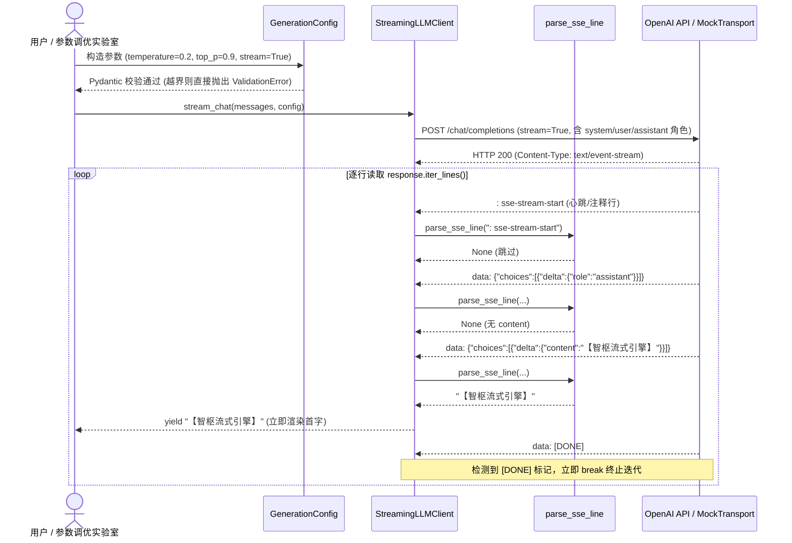

# Day 16 需求文档（PRD）、架构设计与 GitLab 协作记录

## 1. 旁白：告别“白屏干等”，迈入 SSE 流式交互与参数精细化时代

> **🎙️ 讲师旁白**：欢迎来到星辰数科《智枢企业级智能体平台》第二阶段第 16 天！在第一阶段（`v0.1.0-day14`）中，我们的 CLI 助手每次调用大模型都要等整段回答生成完毕才一次性打印，一旦模型输出 500 字，终端就会卡顿 5~10 秒——在真实企业 Web 产品中，这种“白屏干等”会直接导致用户流失。今天，我们将正式升级到 `v0.2.0-day16`：一方面引入 **SSE（Server-Sent Events）流式传输（`stream=True`）**，实现毫秒级首字响应（TTFT）的打字机体验；另一方面，通过 **`GenerationConfig` 参数调优实验室**，精准掌控 `temperature`、`top_p`、`max_tokens` 与 `frequency_penalty`，让同一套智枢底座既能胜任“零幻觉财务客服”，也能胜任“高发散营销文案”。

---

## 2. GitLab Issue #016：流式打字机体验（SSE）与生成参数调优实验室

- **提出人**：产品经理 林晓 / Tech Lead 张工
- **指派给**：AI 应用开发工程师 陈默
- **关联分支**：`feature/day-16-llm-params-and-sse-streaming`
- **目标版本**：`v0.2.0-day16`

### 2.1 业务需求描述
1. **强校验生成参数模型（`GenerationConfig`）**：
   - 使用 Pydantic `BaseModel` 封装核心采样与控制参数：
     - `temperature` (`[0.0, 2.0]`，默认 `0.7`)：控制输出随机性（概率分布平滑度）。
     - `top_p` (`(0.0, 1.0]`，默认 `1.0`)：核采样（Nucleus Sampling），截断低概率长尾词表。
     - `max_tokens` (`[1, 128000]`，默认 `1024`)：硬性限制单次响应长度，防止 Token 账单失控。
     - `frequency_penalty` (`[-2.0, 2.0]`，默认 `0.0`)：抑制模型复读机现象。
     - `stream` (`bool`，默认 `True`)：开启 OpenAI 兼容 SSE 流式传输。
   - 任何越界参数必须在发起 HTTP 请求前被本地拦截（Fail-Fast），避免无效网络往返。
2. **标准 SSE 行解析器（`parse_sse_line`）**：
   - 逐行解析 `text/event-stream` 数据帧：`data: {"choices":[{"delta":{"content":"..."}}]}`。
   - 准确识别空行、`: keep-alive` 心跳注释、仅含 `role` 的首帧，以及流终止信号 `data: [DONE]`。
3. **双通道流式客户端（`StreamingLLMClient`）**：
   - 基于 `httpx.Client.stream("POST", "/chat/completions", ...)` 实现惰性生成器 `stream_chat()`，每收到一个有效分片立即 `yield`，实现打字机效果。
   - 提供 `chat_aggregated()` 辅助方法，支持将流式分片聚合为完整字符串（便于日志落库与单元测试）。
   - 无 `OPENAI_API_KEY` 时自动回退至 `create_mock_sse_transport()` 离线 SSE 模拟通道，确保 CI 与本地教学 100% 可复现。

---

### 2.2 核心交互时序图（SSE 流式推送与 `[DONE]` 终止）

---

## 3. GitLab Merge Request !016 评审记录

- **提交说明**：`feat(day-16): 实现 GenerationConfig 参数校验、SSE 行解析器与 StreamingLLMClient 流式客户端 (v0.2.0-day16)`
- **Tech Lead 张工 Review 意见**：
  - `[通过]` `GenerationConfig` 采用 Pydantic v2 `Field(ge=..., le=...)` 约束边界，在请求发出前即可拦截非法 `temperature` 或 `top_p`，工程防御性极佳。
  - `[通过]` `StreamingLLMClient.stream_chat()` 在遇到 `data: [DONE]` 时显式 `break`，即使上游异常网关在 `[DONE]` 后附带脏数据也不会泄漏到业务层。
  - `[建议]` 后续在 Day 18 接入 FastAPI 时，可直接复用 `stream_chat()` 作为 `StreamingResponse` 的底层异步/同步数据源。
- **QA 李婷 测试结果**：
  - `pytest project_iterations/day_16/tests -v` 全部 18 个用例 100% PASS（覆盖参数边界、SSE 解析、`[DONE]` 截断、角色消息透传与分片聚合）。
  - `verify_day.py` 端到端校验（Notebook 全量执行 + 单元测试）通过，准予合并并打标 `v0.2.0-day16`！
