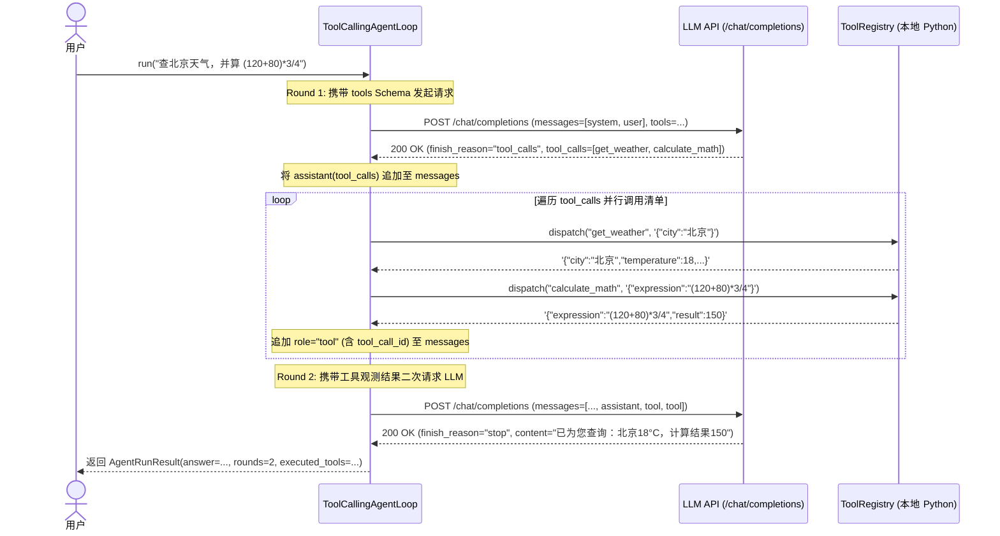

# Day 19 需求文档（PRD）、架构设计与 GitLab 协作记录

## 1. 旁白：告别“黑盒框架”，手写纯 API Function Calling 引擎

> **🎙️ 讲师旁白**：欢迎来到星辰数科《智枢企业级智能体平台》第二阶段第 19 天！很多初学者一上来就用 LangChain 或各类重型 Agent 框架，却完全不清楚大模型到底是如何“调用工具”的——甚至误以为是 OpenAI 服务器在云端执行了我们的 Python 函数。今天，产品经理林晓和 Tech Lead 张工正式下发 **Issue #019**：我们不依赖任何第三方 Agent 框架，也不引入 `openai` 官方 SDK，而是直接用 `httpx` 原生 HTTP 协议，手写出标准 OpenAI Function Calling 两轮闭环引擎（`v0.2.0-day19`），彻底揭开智能体“手脚协同”的底层协议真相！

---

## 2. GitLab Issue #019：Pure-API Function Calling 引擎研发

- **提出人**：产品经理 林晓 / Tech Lead 张工
- **指派给**：AI 应用开发工程师 陈默
- **关联分支**：`feature/day-19-pure-api-tool-calling`
- **目标版本**：`v0.2.0-day19`

### 2.1 业务与技术需求描述
1. **标准工具 JSON Schema 定义（`TOOL_SCHEMAS`）**：
   - 为智枢平台预置 3 个企业高频工具：`get_weather`（城市实时天气查询）、`calculate_math`（数学表达式计算）、`query_employee_info`（星辰数科内部员工通讯录查询）。
   - 严格遵循 OpenAI `tools` 参数规范（`type: "function"`, `parameters` JSON Schema, `required`, `additionalProperties: false`）。
2. **安全工具注册与分发中心（`ToolRegistry` + AST 安全求值）**：
   - 支持 `register()` 动态注册 Python 函数与 Schema、`get_schemas()` 导出全部 Schema、`dispatch(name, arguments)` 安全反序列化 JSON 参数并执行对应函数。
   - **安全红线**：`calculate_math` 严禁使用 Python 内置 `eval()` 执行任意字符串，必须基于 `ast.parse(..., mode="eval")` 白名单实现纯算术求值器，彻底拦截 `__import__`、`open()`、属性访问等注入攻击。
   - **容错机制**：当模型幻觉输出未知工具名或畸形 JSON 参数时，`dispatch()` 不得崩溃，而是返回结构化 JSON 错误信息作为 `role="tool"` 观测结果回传给模型。
3. **Pure-API 两轮/多轮循环引擎（`ToolCallingAgentLoop`）**：
   - 基于 `httpx.Client` 直接请求 `/v1/chat/completions`，支持注入 `httpx.MockTransport` 实现 100% 离线确定性测试。
   - 设置 `max_iterations` 上限防止模型陷入工具调用死循环。

---

### 2.2 核心交互时序图（2 轮 Function Calling 闭环）

---

## 3. GitLab Merge Request !019 评审记录

- **提交说明**：`feat(day-19): 实现零框架 Pure-API Function Calling 引擎与 AST 安全求值器 (v0.2.0-day19)`
- **Tech Lead 张工 Review 意见**：
  - `[通过]` `safe_calculate_math` 显式排除了 `isinstance(node.value, bool)`（因为 Python 中 `bool` 是 `int` 的子类），并限制了幂运算指数上限，安全工程意识很到位。
  - `[通过]` `ToolCallingAgentLoop.run()` 严格遵守 OpenAI 协议约束：先将带有 `tool_calls` 的 `assistant` 消息原样写入 `messages`，再为每个 `tool_call_id` 对应追加 `role="tool"` 消息，缺一不可。
  - `[通过]` `ToolRegistry.dispatch()` 对未知工具和非法 JSON 返回结构化错误 JSON，让模型在 Round 2 有机会自我纠错或向用户解释原因。
- **QA 李婷 测试结果**：
  - `pytest project_iterations/day_19/tests -v` 全部 17 项用例 100% PASS（覆盖 AST 注入拦截、并行多工具调用、未知工具恢复、最大轮数熔断）。
  - `verify_day.py` 端到端校验通过，准予合并至 `main` 并打标 `v0.2.0-day19`！
