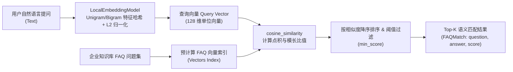

# Day 20 需求文档（PRD）、架构设计与 GitLab 协作记录

## 1. 旁白：让智能体“看懂图片”并“听懂语义”

> **🎙️ 讲师旁白**：欢迎来到星辰数科《智枢企业级智能体平台》第二阶段第 20 天！昨天我们用纯 API 打通了 Function Calling，但企业真实场景远不止纯文本问答：员工经常会直接发来一张**报销发票截图**，或者用口语化的方式提问（例如问“出差票据怎么报”，而知识库里写的是“差旅费用和发票怎么提交报销？”）。如果只靠传统关键词 `LIKE '%xxx%'` 匹配，根本搜不到答案！今天，产品经理林晓和 Tech Lead 张工正式下发 **Issue #020**：为智枢平台补齐**多模态 Vision 消息封装**与**基于 Embedding 余弦相似度的语义 FAQ 检索引擎**（`v0.2.0-day20`），为下一阶段的企业级 RAG 知识库奠定向量计算基石！

---

## 2. GitLab Issue #020：多模态输入与语义 FAQ 检索研发

- **提出人**：产品经理 林晓 / Tech Lead 张工
- **指派给**：AI 应用开发工程师 陈默
- **关联分支**：`feature/day-20-multimodal-embedding`
- **目标版本**：`v0.2.0-day20`

### 2.1 业务与技术需求描述
1. **多模态 Vision 消息构造器（`build_multimodal_message`）**：
   - 严格遵循 OpenAI Chat Completions Vision 协议：将 `role="user"` 的 `content` 从纯字符串升级为多模态内容块列表（`[{"type": "text", ...}, {"type": "image_url", ...}]`）。
   - 支持 `detail` 参数（`auto` / `low` / `high`）控制图像 Token 消耗与解析精度，并对空文本、空图片 URL 及非法 `detail` 值做前置校验。
2. **纯 Python 确定性本地向量模型（`LocalEmbeddingModel`）**：
   - 不依赖 `numpy` 或外部在线 Embedding API，仅使用 Python 标准库 `hashlib` 与 `math` 实现字符 Unigram + Bigram 特征哈希与 L2 单位向量归一化。
   - **工程要求**：严禁使用 Python 内置 `hash()`（因跨进程 `PYTHONHASHSEED` 随机化），必须使用 `hashlib.md5` 保证跨进程、跨机器 100% 确定性输出。
3. **余弦相似度引擎（`cosine_similarity`）与语义 FAQ 检索器（`SemanticFAQMatcher`）**：
   - 实现标准余弦相似度公式 $\cos(\theta) = \frac{A \cdot B}{\|A\|\|B\|}$，处理零向量返回 `0.0`、维度不一致抛出 `ValueError`、浮点溢出钳位至 `[-1.0, 1.0]`。
   - `SemanticFAQMatcher` 支持批量索引企业 FAQ，并在 `search(query, top_k=3, min_score=0.0)` 中返回按得分降序排列的 `FAQMatch` 列表。

---

### 2.2 语义检索核心数据流（Flowchart）

---

## 3. GitLab Merge Request !020 评审记录

- **提交说明**：`feat(day-20): 实现多模态 Vision 消息构建与纯 Python 确定性 Embedding 语义 FAQ 检索器 (v0.2.0-day20)`
- **Tech Lead 张工 Review 意见**：
  - `[通过]` `LocalEmbeddingModel` 采用 `hashlib.md5` 替代内置 `hash()`，彻底消除了多进程部署或 CI 测试时向量漂移的隐患。
  - `[通过]` `cosine_similarity` 对零向量和浮点边界（如 `1.0000000000000002`）做了安全防御，不会导致上层业务 `ValueError` 或 `NaN`。
  - `[通过]` `build_multimodal_message` 完整对齐 OpenAI Vision 请求载荷格式，后续接入 `gpt-4o` / `qwen-vl` 无需改动上层调用契约。
- **QA 李婷 测试结果**：
  - `pytest project_iterations/day_20/tests -v` 全部 9 项单元测试 100% PASS（覆盖多模态结构校验、余弦相似度精确值、维度异常拦截、确定性与单位范数验证、Top-K 语义检索排序）。
  - `verify_day.py` 端到端校验通过，准予合并至 `main` 并打标 `v0.2.0-day20`！
