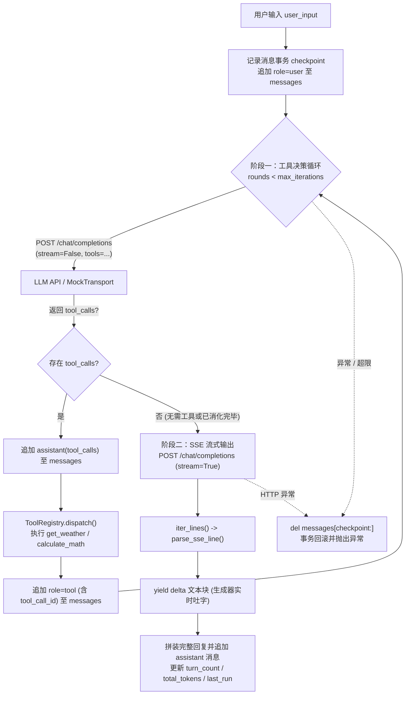

# Day 21 需求文档（PRD）、架构设计与 GitLab 协作记录

## 1. 旁白：第三周收官，把“大脑、手脚与实时声带”合为一体

> **🎙️ 讲师旁白**：欢迎来到星辰数科《智枢企业级智能体平台》第二阶段第 21 天，也是**第三周（大模型原理、Prompt 工程、Function Calling 与向量检索）的里程碑考核与综合实战日**！在过去一周里，我们分别拆解了 Token 成本与上下文窗口（Day 15）、SSE 流式传输（Day 16）、Prompt 模板与防注入（Day 17-18）、Pure-API Function Calling 工具闭环（Day 19）以及 Embedding 语义向量检索（Day 20）。今天，产品经理林晓和 Tech Lead 张工正式下发 **Issue #021**：不仅要完成第三周核心理论与编码考核，更要把**多轮上下文记忆、工具调用（`get_weather` / `calculate_math`）与生成器流式输出（`stream_reply`）**三者融合进统一的 `IntegratedAgent` 引擎（`v0.2.0-day21`）！

---

## 2. GitLab Issue #021：Week 3 综合集成智能体（Multi-turn + Tool Calling + Streaming）

- **提出人**：产品经理 林晓 / Tech Lead 张工
- **指派给**：AI 应用开发工程师 陈默
- **关联分支**：`feature/day-21-integrated-agent`
- **目标版本**：`v0.2.0-day21`（Week 3 Capstone Mini-Project）

### 2.1 业务与技术需求描述
1. **多轮对话上下文记忆与事务回滚（`IntegratedAgent`）**：
   - 维护标准 OpenAI `messages` 队列（`system` / `user` / `assistant` / `tool`），支持跨轮次记忆用户身份与历史工具查询结果。
   - 提供 `clear_history()` 重置会话但保留 `System Prompt`，并提供 `get_history()` 只读副本导出。
   - **事务性异常回滚**：若单轮请求在工具决策或 SSE 流式阶段发生 HTTP/网络异常，自动回滚至本轮开始前的 `checkpoint`，防止上下文出现“半截脏状态”。
2. **安全工具注册与 AST 白名单求值（`ToolRegistry` + `get_weather` + `calculate_math`）**：
   - 预置 `get_weather`（城市实时天气查询）与 `calculate_math`（基于 `ast.parse(..., mode="eval")` 白名单的安全算术求值器，严禁 `eval()`）。
   - 支持并行多工具调用与 `max_iterations` 死循环熔断。
3. **生成器流式输出（`stream_reply`）与全离线 `MockTransport` 支持**：
   - `stream_reply(user_input) -> Iterator[str]` 作为 Python 生成器，在完成前置工具调用决策后，通过 `httpx.Client.stream("POST", ...)` + `parse_sse_line()` 逐块 `yield` 文本增量，并在流结束后将完整回复写回 `messages` 与 `last_run`。
   - 未配置 `OPENAI_API_KEY` 时自动启用 `create_integrated_mock_transport()`，完整模拟多轮记忆、并行工具调用与 SSE 分片流式响应。

---

### 2.2 系统架构流程图（Multi-turn + Tool Calling + Streaming）

---

## 3. GitLab Merge Request !021 评审记录

- **提交说明**：`feat(day-21): 完成 Week 3 综合集成智能体（多轮记忆 + 工具调用 + 流式输出）(v0.2.0-day21)`
- **Tech Lead 张工 Review 意见**：
  - `[通过]` 将阶段一（工具调用决策，非流式）与阶段二（最终自然语言回复，SSE 流式）解耦，既避免了流式分片拼接 `tool_calls` JSON 的复杂度，又确保了用户端获得真实的逐块流式体验。
  - `[通过]` `stream_reply` 中的 `checkpoint = len(self.messages)` 与 `except Exception: del self.messages[checkpoint:]; raise` 完美继承并升级了第一阶段的事务性回滚设计。
  - `[通过]` `safe_calculate_math` 保持了 AST 白名单与 `bool` 排除，零安全隐患。
- **QA 李婷 测试结果**：
  - `pytest project_iterations/day_21/tests -v` 全部 8 项测试用例 100% PASS（覆盖 AST 防注入、工具容错、SSE 解析、生成器流式输出、并行工具调用、多轮记忆、HTTP 500 回滚与最大轮数熔断）。
  - `verify_day.py` 端到端校验（Notebook 执行 + 单元测试）通过，准予合并至 `main` 并打标 `v0.2.0-day21`！
