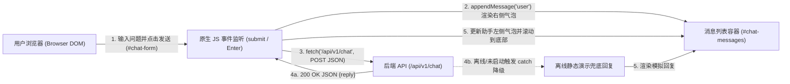

# Day 22 需求文档（PRD）、架构设计与 GitLab 协作记录

## 1. 旁白：告别纯命令行，打造企业级 Web 对话前端

> **🎙️ 讲师旁白**：欢迎来到星辰数科《智枢企业级智能体平台》第二阶段第 22 天！在前面几天里，我们的 RAG 检索、Memory 记忆与 Function Calling 引擎一直运行在冰冷的终端命令行里——显然，业务部门的同事和企业客户不可能打开黑框框来和智能体对话。今天，产品经理林晓和 Tech Lead 张工正式下发 **Issue #022**：在正式引入 FastAPI 后端服务之前，我们先用 **零构建工具、零前端框架** 的原生 HTML5 + CSS3 + JavaScript `fetch()`，手写出响应式中文企业级 Web 对话台（`v0.2.0-day22`），并配套 Python 静态结构校验器保证交付质量！

---

## 2. GitLab Issue #022：智枢 Web Chat 静态对话台研发

- **提出人**：产品经理 林晓 / Tech Lead 张工
- **指派给**：AI 应用开发工程师 陈默
- **关联分支**：`feature/day-22-static-chat-ui`
- **目标版本**：`v0.2.0-day22`

### 2.1 业务与技术需求描述
1. **响应式企业级中文对话台（`frontend/index.html`）**：
   - 页面标题为 `智枢企业级智能体对话台`，必须声明 `<meta charset="UTF-8">` 与移动端 `<meta name="viewport">` 适配。
   - **三段式 Flexbox 布局**：顶部品牌栏（含连接状态徽章与清空会话按钮）、中部可滚动消息区（`#chat-messages`）、底部快捷提示词与输入表单（`#chat-form`、`#user-input`、`#send-btn`）。
   - **气泡视觉区分**：用户消息右对齐蓝色气泡（`.message.user`），助手消息左对齐白色卡片气泡（`.message.assistant`）。
2. **原生 JavaScript `fetch()` 前后端通信逻辑**：
   - 拦截表单 `submit` 与输入框 `Enter` 快捷键，禁用重复提交并展示加载态。
   - 构造标准 `POST /api/v1/chat` JSON 请求（`Content-Type: application/json`，携带 `session_id` 与 `message`）。
   - 当离线直接打开静态 HTML 或后端尚未启动时，自动触发优雅降级，展示离线模拟回复，确保前端可独立演示。
3. **Python 前端质量门禁（`zhishu_agent/ui_validator.py`）**：
   - 基于标准库 `html.parser.HTMLParser` 实现 `validate_frontend_file()` 与 `validate_html_content()`，自动校验 UTF-8、`viewport`、核心 DOM ID（`chat-messages`、`chat-form`、`user-input`、`send-btn`）及 `fetch()` 调用。
   - 提供 `describe_static_serving()` 输出静态目录路径与本地 `http.server` 预览命令。

---

### 2.2 前端交互与 API 通信架构图

---

## 3. GitLab Merge Request !022 评审记录

- **提交说明**：`feat(day-22): 实现智枢响应式静态 Web 对话台与 HTML 结构校验器 (v0.2.0-day22)`
- **Tech Lead 张工 Review 意见**：
  - `[通过]` `frontend/index.html` 采用 CSS 变量 + Flexbox 三段式布局，无需 Node.js / Webpack 即可在任意浏览器双击或 `python -m http.server` 秒级预览，非常适合快速打通前后端联调。
  - `[通过]` JS `fetch()` 严格设置了 `headers: { "Content-Type": "application/json" }` 并用 `try / catch / finally` 恢复 `#send-btn` 按钮状态，避免了网络异常导致界面假死。
  - `[通过]` `ui_validator.py` 仅使用 Python 标准库解析 DOM，零额外依赖，既能在 CI 中做静态门禁，也能为后续 Day 23 FastAPI 托管静态目录提供路径辅助。
- **QA 李婷 测试结果**：
  - `pytest project_iterations/day_22/tests -v` 全部 7 项用例 100% PASS（覆盖文件存在性、UTF-8 与视口声明、核心 DOM ID、JS `fetch` POST JSON、响应式气泡 CSS、异常 HTML 负向拦截）。
  - `verify_day.py` 端到端校验通过，准予合并至 `main` 并打标 `v0.2.0-day22`！
