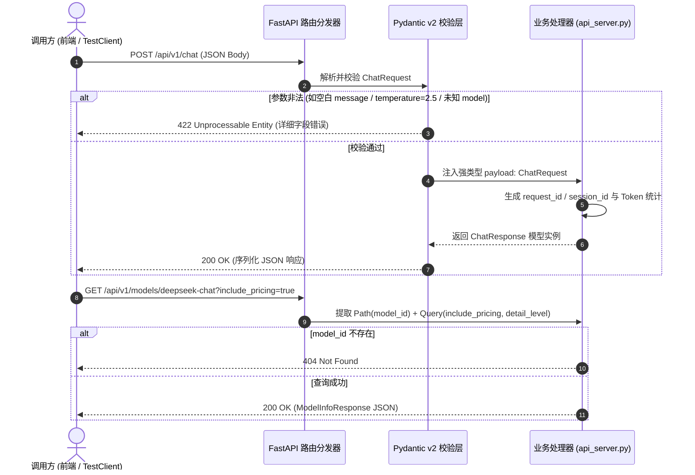

# Day 23 需求文档（PRD）、架构设计与 GitLab 协作记录

## 1. 旁白：从“本地脚本引擎”跃迁为“企业级 FastAPI Web 服务”

> **讲师旁白**：欢迎来到星辰数科《智枢企业级智能体平台》**第二阶段 Day 23**！在前面的迭代中，我们已经打通了大模型底层原理、Prompt 工程、Pure-API Function Calling 以及上下文记忆管理，但它们目前都还运行在本地 Python 进程或命令行里。今天开启 **`v0.2.0-day23`（FastAPI 后端服务开发 Part 1）**——产品经理林晓正式下发需求：把智枢智能体封装成标准的 **RESTful HTTP API 服务**，让前端网页、企业微信机器人和外部业务系统都能通过规范的接口与 Pydantic 契约安全接入！

---

## 2. GitLab Issue #023：智枢智能体 REST API 基础设施建设

- **提出人**：产品经理 林晓
- **协同评审**：Tech Lead 张工
- **指派给**：AI 应用开发工程师 陈默
- **关联分支**：`feature/day-23-fastapi-rest-api`
- **目标版本**：`v0.2.0-day23`

### 2.1 业务需求描述
1. **服务实例与自动文档**：
   - 使用 `FastAPI(title="ZhiShu-Agent API", version="0.2.0-day23")` 构建 Web 服务入口，自动生成 `/docs`（Swagger UI）与 `/redoc` 交互式接口文档。
2. **系统健康检查端点（`GET /api/v1/health`）**：
   - 返回服务运行状态（`status: "ok"`）、服务名称、当前迭代版本号 `0.2.0-day23` 与 UTC ISO-8601 时间戳，供 K8s 探针与网关监控使用。
3. **模型元信息查询端点（`GET /api/v1/models/{model_id}`）**：
   - 通过**路径参数（Path Parameter）** `model_id` 定位指定模型（如 `deepseek-chat`、`qwen-plus`、`gpt-4o`），若模型不存在则返回 `404 Not Found`。
   - 支持**查询参数（Query Parameters）** `include_pricing: bool = False` 与 `detail_level: Literal["basic", "full"] = "basic"`，按需控制是否暴露百万 Token 单价明细。
4. **智能体对话端点（`POST /api/v1/chat`）**：
   - 基于 **Pydantic v2** 定义强类型请求体 `ChatRequest` 与响应体 `ChatResponse`：
     - `message`（1~4000 字符，禁止纯空白字符）、`model`（校验是否在支持列表内）、`temperature`（`[0.0, 2.0]`）、`max_tokens`（`[1, 8192]`）、可选 `session_id`。
     - 非法输入由 FastAPI 自动拦截并返回标准化 `422 Unprocessable Entity` 校验错误。

---

### 2.2 请求生命周期与校验流转（Mermaid 时序图）

---

## 3. GitLab Merge Request !023 评审记录

- **提交说明**：`feat(day-23): 实现 FastAPI REST API 路由、路径/查询参数与 Pydantic v2 契约校验 (v0.2.0-day23)`
- **Tech Lead 张工 Review 意见**：
  - `[通过]` `ChatRequest` 使用 `Field(...)` 约束边界并配合 `@field_validator` 过滤纯空白消息与非法模型名，契约清晰、零脏数据穿透到业务逻辑层。
  - `[通过]` `GET /api/v1/models/{model_id}` 合理区分了 Path 参数（资源定位）与 Query 参数（投影/详情过滤），`404` 与 `422` 状态码语义准确。
  - `[通过]` `main.py` 提供标准化 Uvicorn CLI 启动入口，同时 `api_server.py` 保持无状态纯路由定义，便于 `TestClient` 进程内零端口冲突测试。
- **QA 李婷 测试结果**：
  - `pytest project_iterations/day_23/tests -v` 全部测试用例（200 OK、404、422 边界校验、Path/Query 参数）100% PASS。
  - `verify_day.py` 自动化校验（Notebook 执行 + 单元测试）通过，准予合并并打标 `v0.2.0-day23`。
