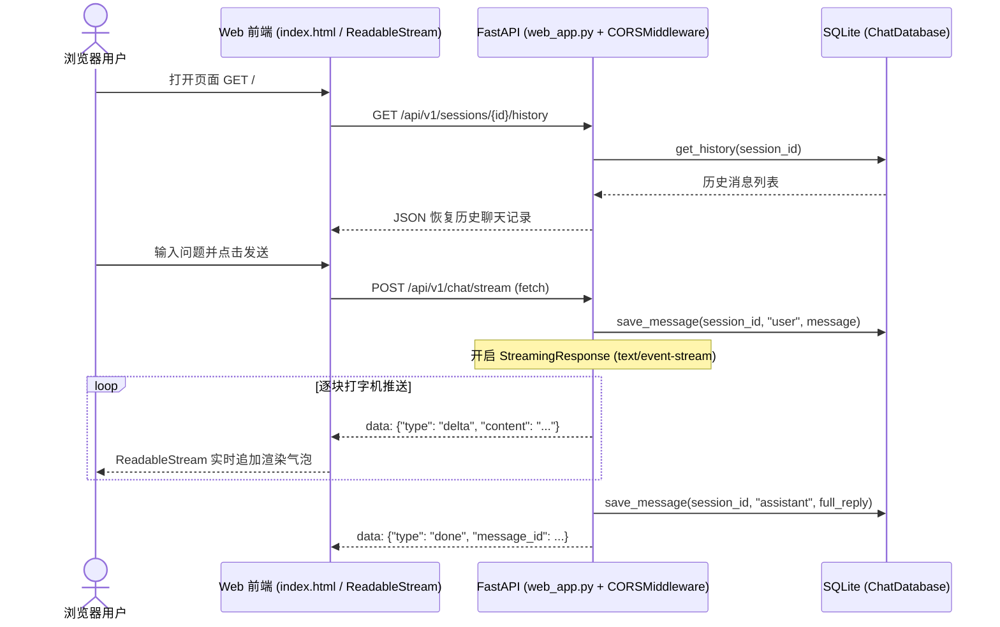

# Day 24 需求文档（PRD）、架构设计与 GitLab 协作记录

## 1. 旁白：第二阶段收官之战——从命令行迈向全栈 Web ChatGPT

> **🎙️ 讲师旁白**：欢迎来到星辰数科《智枢企业级智能体平台》第二阶段最后一天（Day 24）！在过去的 9 天里，我们从原生 HTTP 请求大模型、手写 Function Calling 引擎、到 FastAPI 路由与 Pydantic 校验，已经打下了扎实的工程底座。今天，产品经理林晓和 Tech Lead 张工正式下发 **Issue #024（第二阶段收官 Capstone）**：我们要把命令行里的智能体，升级为一个真正可交付给业务团队使用的**全栈 Web ChatGPT 克隆版（`v0.2.0-day24`）**——支持打字机流式输出（SSE）、浏览器跨域（CORS）、以及 SQLite 多轮对话持久化！

---

## 2. GitLab Issue #024：全栈 Web ChatGPT 克隆版研发（Stage 2 Capstone）

- **提出人**：产品经理 林晓 / Tech Lead 张工
- **指派给**：AI 应用开发工程师 陈默
- **关联分支**：`feature/day-24-fullstack-web-chatgpt`
- **目标版本**：`v0.2.0-day24`

### 2.1 业务与技术需求描述
1. **SQLite 持久化仓储（`zhishu_agent/database.py`）**：
   - 基于 Python 标准库 `sqlite3` 实现 `ChatDatabase`，建表 `sessions`（会话元信息）与 `messages`（多轮消息明细，外键级联删除）。
   - 提供 `init_db()`、`save_message()`、`get_history()`、`list_sessions()`、`clear_session()` 五大核心方法，确保服务重启后对话历史不丢失。
2. **FastAPI SSE 流式后端与 CORS 中间件（`zhishu_agent/web_app.py`）**：
   - 挂载 `CORSMiddleware` 解决前后端分离调试时的浏览器跨域与 `OPTIONS` 预检请求问题。
   - `GET /`：直接托管并返回单页前端 `frontend/index.html`。
   - `POST /api/v1/chat/stream`：接收 `{session_id, message, delay_ms}`，先将用户消息写入 SQLite，再通过 `StreamingResponse(..., media_type="text/event-stream")` 按 SSE 协议逐块推送 `data: {"type": "delta", "content": "..."}` 打字机片段，流式结束后落库助手完整回复并发送 `done` 事件。
   - `GET /api/v1/sessions/{session_id}/history` 与 `DELETE /api/v1/sessions/{session_id}`：分别提供历史记录恢复与会话清空能力。
3. **Web ChatGPT 前端界面（`frontend/index.html`）**：
   - 零外部构建工具依赖的原生 HTML5/CSS/JS 单页应用（左侧会话栏 + 右侧消息气泡区 + 底部输入框）。
   - 使用原生 `fetch()` + `response.body.getReader()` (`ReadableStream`) 实时解码 SSE 字节流，实现毫秒级打字机渲染。

---

### 2.2 全栈架构与 SSE 流式持久化时序图

---

## 3. GitLab Merge Request !024 评审记录

- **提交说明**：`feat(day-24): 完成 FastAPI SSE 流式接口、SQLite 持久化与 Web ChatGPT 全栈前端 (v0.2.0-day24)`
- **Tech Lead 张工 Review 意见**：
  - `[通过]` `ChatDatabase` 使用 `with self._get_conn() as conn:` 上下文管理并开启 `PRAGMA foreign_keys = ON;`，同时对 `role` 枚举和空 `session_id` 做了严格校验，数据一致性有保障。
  - `[通过]` SSE 流式生成器在所有 `delta` 片段发送完毕后再将完整 `assistant` 回复落库，并在 `done` 事件中回传 `message_id`，兼顾了流式首字延迟（TTFT）与数据完整性。
  - `[通过]` `create_app(db_path=..., frontend_dir=...)` 工厂函数设计非常利于 `pytest` 结合 `tmp_path` 做隔离测试。
- **QA 李婷 测试结果**：
  - `pytest project_iterations/day_24/tests -v` 全部 5 项核心测试（SQLite CRUD 落盘、参数校验、前端静态托管、CORS 预检与响应头、SSE 流式消费与落库闭环）100% PASS。
  - `verify_day.py` 端到端校验通过，准予合并至 `main` 并打标 `v0.2.0-day24`，第二阶段圆满收官！
