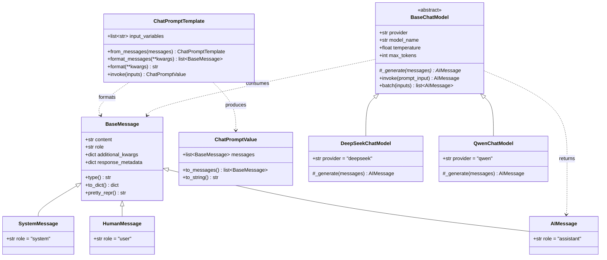

# Day 25 需求文档（PRD）、架构设计与 GitLab 协作记录

## 1. 旁白：第三阶段开篇——为什么我们需要 LangChain 统一抽象？

> **🎙️ 讲师旁白**：欢迎来到星辰数科《智枢企业级智能体平台》第三阶段第一天（Day 25）！在第二阶段，我们用原生 `requests` / `httpx` 与 FastAPI 跑通了全栈 Web 对话。但随着公司业务扩张，老板要求同时接入 **DeepSeek**（高性价比推理）与 **通义千问 Qwen**（阿里云生态稳定底座），甚至未来还要支持私有化 vLLM。如果业务代码里到处写死各家不同的 JSON 请求体与响应解析，每次换模型都要全局重构。今天，Tech Lead 张工正式下发 **Issue #025**：引入 **LangChain 核心抽象思想（`BaseMessage`、`ChatPromptTemplate`、`BaseChatModel`）**，为智枢平台打造统一多模型网关（`v0.3.0-day25`）！

---

## 2. GitLab Issue #025：基于 LangChain 架构的统一多模型网关

- **提出人**：产品经理 林晓 / Tech Lead 张工
- **指派给**：AI 应用开发工程师 陈默
- **关联分支**：`feature/day-25-langchain-unified-gateway`
- **目标版本**：`v0.3.0-day25`

### 2.1 业务与技术需求描述
1. **标准化消息协议体系（`BaseMessage` 家族）**：
   - 定义 `BaseMessage` 基类以及 `SystemMessage`（`system`）、`HumanMessage`（`user`）、`AIMessage`（`assistant`）三大核心子类。
   - 统一提供 `.type` 属性、`.to_dict()`（转换为大模型标准 JSON 字典）和 `.pretty_repr()` 调试方法。
2. **声明式提示词模板（`ChatPromptTemplate`）**：
   - 实现 `ChatPromptTemplate.from_messages(...)` 工厂方法，支持 `("system", "...")`、`("human", "...")`、`("ai", "...")` 元组简写以及直接混入 `BaseMessage` 实例。
   - 自动解析模板中的 `{variable}` 占位符存入 `input_variables`；在 `format_messages(**kwargs)` 和 `invoke(inputs)` 时进行严格缺失变量校验。
3. **统一模型基类与多厂商适配器（`BaseChatModel` + `get_chat_model`）**：
   - 定义抽象基类 `BaseChatModel`，暴露统一的 `.invoke(prompt_input)` 和 `.batch(inputs)` 接口，兼容 `str`、`list[BaseMessage]` 与 `ChatPromptValue` 三种输入形态。
   - 提供 `DeepSeekChatModel` 与 `QwenChatModel` 离线确定性实现（携带完整 `response_metadata` 与 token 用量统计），并通过 `get_chat_model(provider)` 实现零业务代码侵入的模型热切换。

---

### 2.2 核心类图（Mermaid `classDiagram`）

---

## 3. GitLab Merge Request !025 评审记录

- **提交说明**：`feat(day-25): 实现 LangChain 核心消息体系、ChatPromptTemplate 与统一多模型网关 (v0.3.0-day25)`
- **Tech Lead 张工 Review 意见**：
  - `[通过]` `BaseMessage` 与 `ChatPromptTemplate` 完全遵循 LangChain `langchain_core` 的命名与契约，学员后续无缝迁移到官方 `langchain-openai` / `langchain-community` 零学习成本。
  - `[通过]` `BaseChatModel` 使用 `ABC` + `@abstractmethod` 强制子类实现 `_generate`，而将输入归一化（`str` / `list[BaseMessage]` / `ChatPromptValue`）收口在基类 `invoke()` 中，是标准的**模板方法模式（Template Method）**。
  - `[通过]` `DeepSeekChatModel` 与 `QwenChatModel` 在离线环境下输出完全确定性，且返回标准 `response_metadata`（包含 `provider`、`model_name`、`usage`），非常适合 CI/CD 自动化回归测试。
- **QA 李婷 测试结果**：
  - `pytest project_iterations/day_25/tests -v` 全部核心测试（消息继承与序列化、模板占位符提取与缺失变量校验、抽象基类约束、DeepSeek/Qwen 无缝切换、批量推理与异常厂商拦截）100% PASS。
  - `verify_day.py` 端到端校验通过，准予合并至 `main` 并打标 `v0.3.0-day25`。
