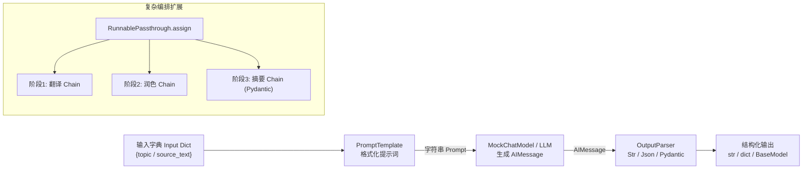

# Day 26 需求文档（PRD）、架构设计与 GitLab 协作记录

## 1. 旁白：第三阶段开启——用 LCEL 声明式管道重塑智能体工作流

> **🎙️ 讲师旁白**：欢迎来到星辰数科《智枢企业级智能体平台》第三阶段（LangChain & RAG 核心工程）！在第二阶段我们完成了 Web ChatGPT 全栈闭环（`v0.2.0-day24`）。进入第三阶段，业务场景变得越来越复杂——不再是“一问一答”，而是“翻译 → 润色 → 结构化摘要”、“多路并行检索 → 融合重排”这样的多阶段流水线。如果继续用嵌套函数硬编码，代码很快就会变成难以维护的“面条”。今天，Tech Lead 张工下发 **Issue #026**：我们要从底层原理出发，亲手实现 **LCEL（LangChain Expression Language）表达式语言与链式编排引擎（`v0.3.0-day26`）**，让智能体组件像 Linux 管道一样用 `|` 符号优雅串联！

---

## 2. GitLab Issue #026：LCEL 可组合管道引擎（LCEL Composable Pipeline）

- **提出人**：产品经理 林晓 / Tech Lead 张工
- **指派给**：AI 应用开发工程师 陈默
- **关联分支**：`feature/day-26-lcel-composable-pipeline`
- **目标版本**：`v0.3.0-day26`

### 2.1 业务与技术需求描述
1. **统一抽象基类 `Runnable` 与 `|` 运算符重载（`zhishu_agent/lcel.py`）**：
   - 定义 `Runnable[InputT, OutputT]` 抽象基类，统一 `invoke()`、`batch()`、`stream()` 三大调用协议。
   - 重载 `__or__` 与 `__ror__` 魔术方法，使得任意 `Runnable`、普通函数/lambda、字典之间均可通过 `|` 组合生成 `RunnableSequence`。
2. **核心组合器（Combinators）**：
   - `RunnableSequence`：顺序执行 `A | B | C`，并自动展平嵌套序列，支持将前序步骤输出送入末级节点的 `stream()`。
   - `RunnableLambda`：将普通 Python 可调用对象包装为标准 `Runnable`。
   - `RunnablePassthrough`：原样透传输入，并提供 `.assign(**kwargs)` 在保留原始字典字段的同时动态计算并追加新字段。
   - `RunnableParallel`：基于 `ThreadPoolExecutor` 并行执行多个分支映射 `{key: Runnable}`，聚合各分支结果返回字典。
3. **标准化输出解析器（OutputParsers）**：
   - `StrOutputParser`：从 `AIMessage` / `dict` / `str` 中提取纯文本。
   - `JsonOutputParser`：自动剥离大模型常见的 ` ```json ... ``` ` 代码块包裹并反序列化为 Python 对象，非法 JSON 抛出明确 `ValueError`。
   - `PydanticOutputParser`：绑定 `pydantic.BaseModel` 子类，提供 `get_format_instructions()` 生成 JSON Schema 约束指令，并在解析时完成强类型校验。
4. **3 阶段企业级流水线（翻译 → 润色 → 摘要）**：
   - 基于 `build_translate_polish_summary_chain()` 将英文技术文档依次经过「翻译（`StrOutputParser`）→ 润色（`StrOutputParser`）→ 结构化摘要（`PydanticOutputParser[ArticleSummary]`）」，并通过 `RunnablePassthrough.assign` 保留各阶段中间产物以便审计。

---

### 2.2 LCEL 核心管道架构图（`Prompt | Model | Parser`）



---

## 3. GitLab Merge Request !026 评审记录

- **提交说明**：`feat(day-26): 实现 LCEL Runnable、| 管道运算符、OutputParsers 与 3 阶段翻译润色摘要链 (v0.3.0-day26)`
- **Tech Lead 张工 Review 意见**：
  - `[通过]` `coerce_to_runnable()` 同时处理了 `Runnable`、`Mapping`（自动转 `RunnableParallel`）和 `callable`（自动转 `RunnableLambda`），配合 `__or__` / `__ror__` 完美还原了 LangChain LCEL 的零样板语法体验。
  - `[通过]` `PydanticOutputParser` 在 `build_translate_polish_summary_chain()` 中通过 `{format_instructions}` 占位符注入 Schema，避免了 JSON Schema 大括号与 `str.format()` 冲突的经典坑点，工程意识非常敏锐。
  - `[通过]` `RunnableSequence` 构造时自动展平嵌套序列，避免长链路调用栈过深，且 `stream()` 正确将中间态 `invoke` 后交由末级节点流式输出。
- **QA 李婷 测试结果**：
  - `pytest project_iterations/day_26/tests -v` 全部 5 项核心测试（`|` 运算符与 `RunnableSequence`、`RunnablePassthrough.assign`、`RunnableParallel` 字典强制转换、三大 `OutputParser` 及其异常校验、3 阶段「翻译 -> 润色 -> 摘要」端到端闭环）100% PASS。
  - `verify_day.py` 自动化校验通过，准予合并至 `main` 并打标 `v0.3.0-day26`。
