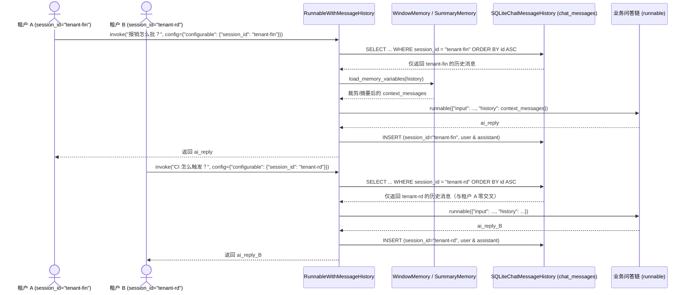

# Day 27 需求文档（PRD）、架构设计与 GitLab 协作记录

## 1. 旁白：第三阶段企业级记忆工程——告别“金鱼脑”与“串台事故”

> **🎙️ 讲师旁白**：欢迎来到星辰数科《智枢企业级智能体平台》第三阶段 Day 27！在昨天的 LCEL 流水线基础上，我们的智能体已经能优雅地串联 Prompt 与模型了，但业务团队很快反馈了两个致命问题：第一，**“金鱼脑”与 Token 爆炸**——聊了 20 轮后上下文塞满直接报错，或是一刀切清空导致忘记前文；第二，**“多租户串台事故”**——财务部和研发部同时使用同一个服务实例时，如果把所有对话都放在一个全局列表里，张经理竟然看到了李总监的薪资查询记录！今天，产品经理林晓和 Tech Lead 张工正式下发 **Issue #027（多会话记忆隔离与记忆策略引擎 `v0.3.0-day27`）**，我们要用企业级工程标准彻底解决这一痛点！

---

## 2. GitLab Issue #027：多会话记忆隔离（Multi-Session Memory Isolation）

- **提出人**：产品经理 林晓 / Tech Lead 张工
- **指派给**：AI 应用开发工程师 陈默
- **关联分支**：`feature/day-27-memory-isolation`
- **目标版本**：`v0.3.0-day27`

### 2.1 业务与技术需求描述
1. **统一历史抽象与内存/SQLite 双引擎（`zhishu_agent/memory.py`）**：
   - 定义 `BaseChatMessageHistory` 抽象基类及不可变消息模型 `ChatMessage`（严格校验 `role in {"system", "user", "assistant"}`）。
   - 提供 `InMemoryChatMessageHistory`（用于快速原型与单测）与 `SQLiteChatMessageHistory`（基于 `sqlite3` 持久化落盘，通过 `session_id` + 复合索引 `(session_id, id)` 实现多租户物理隔离）。
2. **双模上下文压缩策略**：
   - `WindowMemory(k, keep_system=True)`：滑动窗口记忆，保留系统提示词与最近 `k` 轮（`2 * k` 条）对话，防止上下文窗口溢出。
   - `SummaryMemory(max_recent_messages, summarizer)`：摘要记忆，将超出近期窗口的早期历史压缩为一条系统摘要消息，兼顾长程记忆与 Token 成本。
3. **可执行链包装器（`RunnableWithMessageHistory`）**：
   - 对标 LangChain `RunnableWithMessageHistory`，支持通过 `config={"configurable": {"session_id": ...}}` 或显式 `session_id` 参数动态路由会话仓储。
   - 自动完成“读取并裁剪历史 -> 注入 `payload["history"]` -> 执行业务链 -> 双向落库 user/assistant 消息”的闭环。

---

### 2.2 多会话记忆隔离与策略路由时序图

---

## 3. GitLab Merge Request !027 评审记录

- **提交说明**：`feat(day-27): 实现 WindowMemory、SummaryMemory、SQLiteChatMessageHistory 与 RunnableWithMessageHistory (v0.3.0-day27)`
- **Tech Lead 张工 Review 意见**：
  - `[通过]` `SQLiteChatMessageHistory` 对空 `session_id` 做了前置拦截，并建立了 `idx_chat_messages_session_id(session_id, id)` 索引，多租户高并发查询与 `clear()` 删除均严格限定 `WHERE session_id = ?`，彻底杜绝串台与误删。
  - `[通过]` `WindowMemory` 在裁剪时显式区分 `system` 消息与对话消息，避免滑动窗口把系统角色设定（System Prompt）误裁掉，这是生产环境极易踩坑的细节。
  - `[通过]` `SummaryMemory` 内置确定性摘要器 `_default_summarizer`，同时保留 `summarizer` 注入点，既能离线零成本跑通自动化测试，又能无缝接入真实 LLM 做语义摘要。
- **QA 李婷 测试结果**：
  - `pytest project_iterations/day_27/tests -v` 全部 5 项测试（内存历史 CRUD、滑动窗口截断、摘要压缩、SQLite 持久化与多租户隔离、端到端 `RunnableWithMessageHistory`）100% PASS。
  - `verify_day.py` Notebook 执行与单元测试双重校验通过，准予合并至 `main` 并打标 `v0.3.0-day27`。
