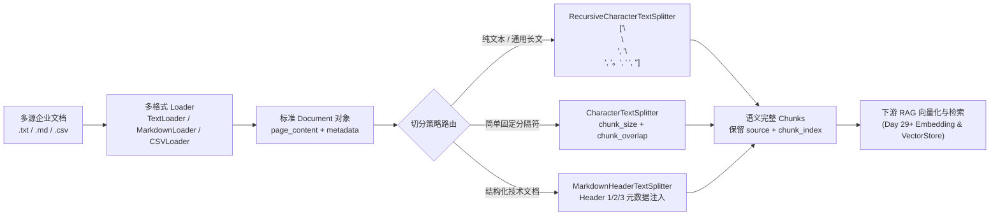

# Day 28 需求文档（PRD）、架构设计与 GitLab 协作记录

## 1. 旁白：第三阶段启航——打造企业私域知识库的第一公里

> **🎙️ 讲师旁白**：欢迎来到星辰数科《智枢企业级智能体平台》第三阶段（LangChain 与 RAG 实战）的 Day 28！在第二阶段，我们让智枢拥有了全栈 Web 界面与多轮对话记忆；但企业客户很快提出新痛点：“大模型不懂我们内部的报销规范、研发手册和客服 FAQ！”今天，产品经理林晓和 Tech Lead 张工正式下发 **Issue #028**：我们要从零构建 RAG（检索增强生成）流水线的第一步——**企业级文档加载与智能文本切分引擎（`v0.3.0-day28`）**！

---

## 2. GitLab Issue #028：企业文档接入与智能切分（Enterprise Document Ingestion & Chunking）

- **提出人**：产品经理 林晓 / Tech Lead 张工
- **指派给**：AI 应用开发工程师 陈默
- **关联分支**：`feature/day-28-document-loader-splitter`
- **目标版本**：`v0.3.0-day28`

### 2.1 业务与技术需求描述
1. **统一文档抽象（`Document`）**：
   - 定义 `Document(page_content, metadata)` 数据结构，确保任何异构文件加载后都能标准化为正文 + 元数据字典，且不同实例的 `metadata` 严格隔离，支持 `to_dict()` 序列化。
2. **多格式文档加载器（`zhishu_agent/document_loader.py`）**：
   - `TextLoader`：读取 `.txt` / `.log` 纯文本文件，注入 `source`、`file_name`、`file_type`、`loader` 元数据。
   - `MarkdownLoader`：读取 `.md` 文档，自动提取首个一级标题 `# ` 作为 `title` 元数据。
   - `CSVLoader`：基于 `csv.DictReader` 将结构化表格按行转为独立 `Document`，记录 `row` 行号并支持 `source_column` 自定义溯源字段。
3. **三类文本切分器（Text Splitters）**：
   - `CharacterTextSplitter`：按单一分隔符定长切分，支持 `chunk_size` 与 `chunk_overlap` 滑动窗口重叠，并做参数边界校验。
   - `RecursiveCharacterTextSplitter`：默认按层级分隔符 `["\n\n", "\n", "。", " ", ""]` 递归切分，优先保证段落、换行与中文句子完整性，超长无标点文本自动降级到字符级切分。
   - `MarkdownHeaderTextSplitter`：按 `#` / `##` / `###` 标题层级切分，自动将上下文标题注入 `metadata`，切换同级或高级标题时自动清理过期低级标题，同时正确忽略围栏代码块（` ``` ` / `~~~`）中的 `#` 注释。

---

### 2.2 企业文档接入与切分流水线架构图



---

## 3. GitLab Merge Request !028 评审记录

- **提交说明**：`feat(day-28): 实现 Document、多格式 Loader 与三类 TextSplitter (v0.3.0-day28)`
- **Tech Lead 张工 Review 意见**：
  - `[通过]` `Document.__post_init__` 对 `metadata` 做了浅拷贝隔离，且 `split_documents()` 不会反向污染原文档的 `metadata`，工程细节严谨。
  - `[通过]` `RecursiveCharacterTextSplitter` 针对中文语料将 `"。"` 纳入默认分隔符序列，实测能显著减少中文长句被腰斩的概率；`chunk_overlap >= chunk_size` 时的 `ValueError` 防御也避免了死循环风险。
  - `[通过]` `MarkdownHeaderTextSplitter` 正确处理了代码块状态机（`in_code_block`），防止 Python/Shell 代码块中的 `# 注释` 被误判为一级标题。
- **QA 李婷 测试结果**：
  - `pytest project_iterations/day_28/tests -v` 全部 6 项核心测试（`Document` 隔离性、`TextLoader/MarkdownLoader`、`CSVLoader`、`CharacterTextSplitter`、`RecursiveCharacterTextSplitter`、`MarkdownHeaderTextSplitter`）100% PASS。
  - `verify_day.py` 端到端校验通过，准予合并至 `main` 并打标 `v0.3.0-day28`！
