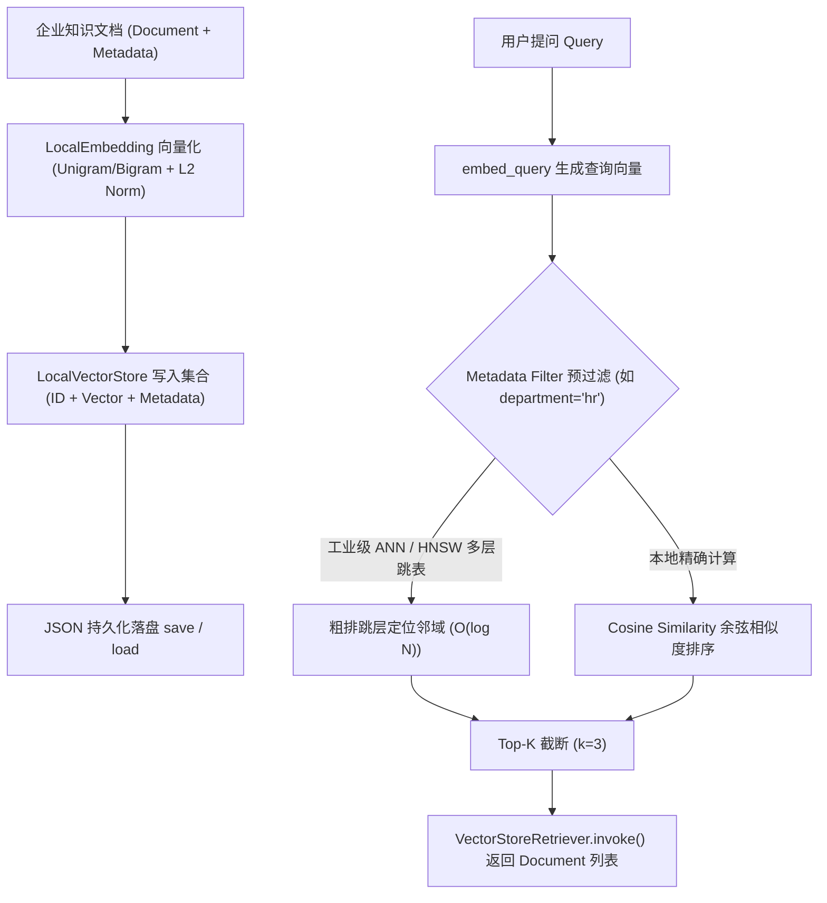

# Day 29 需求文档（PRD）、架构设计与 GitLab 协作记录

## 1. 旁白：告别暴力全表扫描，为企业知识库装上“向量引擎”

> **🎙️ 讲师旁白**：欢迎来到星辰数科《智枢企业级智能体平台》第三阶段第 29 天（Day 29）！在前几天的课程中，我们已经学会了把 PDF、Markdown 切分成文档切片（Chunks）并理解了文本向量化（Embedding）。但问题来了：当企业知识库累积到 10 万甚至 100 万个切片时，每次提问都把所有向量读进内存算一遍余弦相似度，延迟会瞬间飙升。今天，产品经理林晓与 Tech Lead 张工正式下发 **Issue #029**：我们要构建 **Chroma 兼容的本地向量数据库与标准 Retriever 检索接口（`v0.3.0-day29`）**，支持**元数据过滤（Metadata Filtering）**、**Top-K 召回**、**JSON 落盘持久化**，并深入理解工业级向量库背后的 **ANN / HNSW** 近似最近邻索引直觉！

---

## 2. GitLab Issue #029：向量库入库、元数据过滤与 Retriever 接口研发

- **提出人**：产品经理 林晓 / Tech Lead 张工
- **指派给**：AI 应用开发工程师 陈默
- **关联分支**：`feature/day-29-vector-store-retriever`
- **目标版本**：`v0.3.0-day29`

### 2.1 业务与技术需求描述
1. **确定性本地向量化器（`LocalEmbedding`）**：
   - 基于 Python 标准库实现零外部依赖的确定性文本向量化（Feature Hashing + L2 归一化），同时支持英文词元与中文单字/双字（Unigram + Bigram）切分。
   - 提供 `embed_query(text)` 与 `embed_documents(texts)` 接口，兼容 LangChain Embeddings 协议。
2. **Chroma 兼容本地向量库（`LocalVectorStore`）**：
   - 支持 `add_documents(documents, ids=...)` 与 `add_texts(texts, metadatas=..., ids=...)`，按 ID 幂等写入并存储文档内容、元数据与向量。
   - 实现 `similarity_search(query, k=3, filter_metadata=...)` 与 `similarity_search_with_score(...)`，支持精确键值对及常用比较操作符（`$eq`、`$ne`、`$gt`、`$gte`、`$lt`、`$lte`、`$in`）进行元数据预过滤。
   - 实现 `save(path)` 与 `load(path)` JSON 持久化，确保服务重启后无需重新计算 Embedding 即可秒级恢复索引。
3. **标准检索器封装（`VectorStoreRetriever`）**：
   - 通过 `store.as_retriever(search_kwargs={"k": 3})` 返回统一检索器对象，提供 `invoke(query)` 与 `get_relevant_documents(query)` 方法，为后续接入 RAG 链路（RetrievalQA / LCEL）做好接口解耦。

---

### 2.2 ANN/HNSW 索引直觉与 Retriever 检索流水线

> **💡 架构师笔记（为什么需要 ANN / HNSW？）**：
> 在本地教学版 `LocalVectorStore` 中，千级文档可直接用精确余弦相似度扫描；而在生产级 Chroma / Milvus / Qdrant 中，面对百万级 1536 维向量，系统会使用 **HNSW（Hierarchical Navigable Small World）** 分层图索引——就像给城市建“高速公路网（高层稀疏长跳）+ 街道小巷（底层稠密精搜）”，牺牲极微小的召回率换取 $O(\log N)$ 的毫秒级检索速度。

---

## 3. GitLab Merge Request !029 评审记录

- **提交说明**：`feat(day-29): 实现 Chroma 兼容 LocalVectorStore、元数据过滤、JSON 持久化与 VectorStoreRetriever (v0.3.0-day29)`
- **Tech Lead 张工 Review 意见**：
  - `[通过]` `LocalEmbedding` 放弃了受 `PYTHONHASHSEED` 影响的内置 `hash()`，改用 `hashlib.sha256` 做确定性特征哈希，保证跨进程和持久化重加载后向量空间完全一致。
  - `[通过]` `similarity_search_with_score` 先执行 `_match_metadata` 再计算相似度与 Top-K 截断，避免了“先取 Top-K 再过滤导致返回不足 K 条”的常见工程坑（Pre-filtering vs Post-filtering）。
  - `[通过]` `as_retriever(search_kwargs=...)` 与 `invoke()` 设计完全对齐 LangChain Runnable 规范，后续 Day 30 串联 RAG 问答链时可无缝替换。
- **QA 李婷 测试结果**：
  - `pytest project_iterations/day_29/tests -v` 全部 5 项核心测试（向量确定性与归一化、文档入库与相似度检索、元数据过滤与 K 值边界、JSON `save/load` 持久化、`as_retriever` 封装）100% PASS。
  - `verify_day.py` Notebook 与单元测试双校验通过，准予合并至 `main` 并打标 `v0.3.0-day29`。
