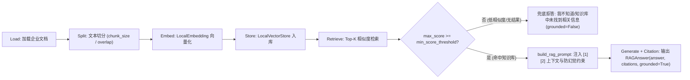

# Day 30 需求文档（PRD）、架构设计与 GitLab 协作记录

## 1. 旁白：第三阶段收官之战，组装端到端企业级 RAG 问答引擎

> **🎙️ 讲师旁白**：欢迎来到星辰数科《智枢企业级智能体平台》第三阶段第 30 天（Day 30 · 核心日）！在 Day 28 与 Day 29 中，我们已经打磨好了文档加载切分、向量化编码（`LocalEmbedding`）与 Chroma 兼容向量库（`LocalVectorStore`）。今天，产品经理林晓与 Tech Lead 张工正式下发 **Issue #030**：我们要把所有模块串联成一条完整的 **端到端 RAG 问答流水线（`v0.3.0-day30`）**——不仅要能精准召回并回答问题，更要具备**严格引用溯源（Citation Grounding）**与**低相似度安全拒答（“我不知道/知识库中未找到相关信息”）**能力，彻底杜绝企业知识问答中的模型幻觉！

---

## 2. GitLab Issue #030：端到端 RAG 问答流水线与引用溯源研发

- **提出人**：产品经理 林晓 / Tech Lead 张工
- **指派给**：AI 应用开发工程师 陈默
- **关联分支**：`feature/day-30-end-to-end-rag`
- **目标版本**：`v0.3.0-day30`

### 2.1 业务与技术需求描述
1. **完整数据入库链路（`ingest_documents`）**：
   - 支持接收 `Document`、纯文本 `str` 或 `dict`，通过 `split_text` 按 `chunk_size` 与 `chunk_overlap` 切分长文档并保留 `source`、`parent_id`、`chunk_index` 元数据，向量化后写入 `LocalVectorStore`。
2. **检索与防幻觉 Prompt 构造（`retrieve` & `build_rag_prompt`）**：
   - 基于 `similarity_search_with_score` 召回 Top-K 文档切片及余弦相似度分数，支持 `filter_metadata` 权限隔离。
   - 在 `build_rag_prompt` 中为每个片段标注 `[1]`、`[2]` 编号与来源，并注入“仅基于参考上下文回答、必须标注引用编号、不足时回复兜底文案”的系统约束。
3. **带引用的结构化生成与低分拒答（`answer_with_citations`）**：
   - 返回结构化 `RAGAnswer(answer, citations, grounded, query, max_score, prompt)`，其中 `citations` 为 `Citation` 列表。
   - 当检索结果为空或最高相似度分数 `max_score < min_score_threshold` 时，强制触发兜底拒答：`“我不知道/知识库中未找到相关信息”`，设置 `grounded=False` 且 `citations=[]`。
   - 支持注入自定义 `llm_fn(prompt)` 对接任意大模型，同时提供零依赖离线确定性合成器，确保本地教学与 CI 100% 可复现。

---

### 2.2 端到端 RAG 架构流水线（Load -> Split -> Embed -> Store -> Retrieve -> Generate + Citation）

> **💡 架构师笔记（为什么必须设置 `min_score_threshold` 拒答阈值？）**：
> 向量数据库的 Top-K 检索永远会返回“相对最相似”的 K 条文档——哪怕用户问的是“火星班车几点发车”，而库里只有“年假制度”和“Redis 规范”。如果不加阈值卡控直接喂给 LLM，模型极易强行牵强附会甚至编造答案。通过 `min_score_threshold` 拦截低分召回，是企业级 RAG 守住“可信底线”的第一道防线。

---

## 3. GitLab Merge Request !030 评审记录

- **提交说明**：`feat(day-30): 实现端到端 RAG 问答流水线、Citation 溯源与低相似度安全拒答 (v0.3.0-day30)`
- **Tech Lead 张工 Review 意见**：
  - `[通过]` `RAGAnswer(answer, citations, grounded)` 结构清晰，将“是否基于知识库依据（`grounded`）”显式建模，方便上游 Agent 或前端 UI 渲染引用角标与拒答提示。
  - `[通过]` `ingest_documents` 对超长文档自动切分并生成 `#chunk-0`、`#chunk-1` 确定性 ID，同时保留 `source` 与 `parent_id`，确保引用溯源能准确回指原始文档。
  - `[通过]` 同时提供面向对象 `RAGPipeline` 与函数式接口（`ingest_documents`、`retrieve`、`build_rag_prompt`、`answer_with_citations`），兼顾业务编排与单元测试解耦。
- **QA 李婷 测试结果**：
  - `pytest project_iterations/day_30/tests -v` 全部 5 项核心测试（长文档切分入库、Top-K 检索与 Prompt 构造、带引用回答 `grounded=True`、超域低分兜底拒答 `grounded=False`、空库与自定义 `llm_fn` 注入）100% PASS。
  - `verify_day.py` Notebook 与单元测试双校验通过，准予合并至 `main` 并打标 `v0.3.0-day30`。
