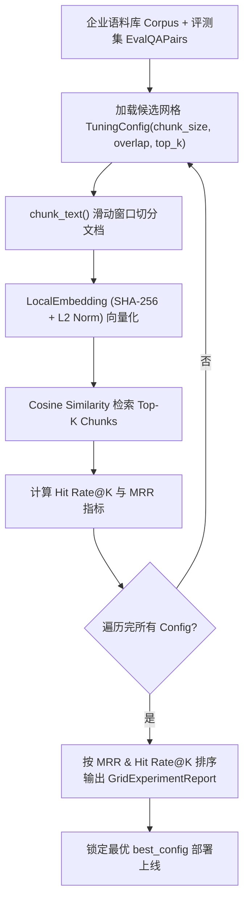

# Day 31 需求文档（PRD）、架构设计与 GitLab 协作记录

## 1. 旁白：第五周复盘与 RAG 调优——用量化指标告别“盲人摸象”

> **🎙️ 讲师旁白**：欢迎来到星辰数科《智枢企业级智能体平台》第三阶段第 31 天（Day 31），也是第五周的 **Week 5 周测与 RAG 调优实验台**！在过去一周里，我们从零构建了 LangChain 多模型网关（Day 25）、LCEL 管道引擎（Day 26）、多会话记忆隔离（Day 27）、文档加载与文本切分（Day 28）、Chroma 兼容向量库（Day 29）以及完整的 RAG 链路。但上线前，产品经理林晓提出了一个尖锐的问题：“`chunk_size` 设 30 还是 120？`overlap` 设 0 还是 20？`top_k` 取 1 还是 3？不能拍脑袋决定！”今天，Tech Lead 张工正式下发 **Issue #031**：我们要构建 **RAG 超参数网格调优实验台（`v0.3.0-day31`）**，用 **Hit Rate@K** 与 **MRR（平均倒数排名）** 两个黄金检索指标驱动科学调参，并完成第五周综合能力测评！

---

## 2. GitLab Issue #031：Week 5 RAG 超参数网格实验台与周测评估

- **提出人**：产品经理 林晓 / Tech Lead 张工
- **指派给**：AI 应用开发工程师 陈默
- **关联分支**：`feature/day-31-rag-tuning-lab`
- **目标版本**：`v0.3.0-day31`

### 2.1 业务与技术需求描述
1. **超参数配置模型（`TuningConfig`）**：
   - 封装 `chunk_size`、`chunk_overlap`、`top_k` 三大核心 RAG 检索超参数。
   - 在 `__post_init__` 中执行严格边界校验（`chunk_size > 0`、`0 <= chunk_overlap < chunk_size`、`top_k > 0`），防止非法配置污染实验。
2. **网格搜索实验引擎（`run_grid_experiment`）**：
   - 接收企业语料库 `corpus`、标准问答评测集 `eval_qa_pairs`（支持 `expected_answer`、`expected_keywords`、`relevant_doc_ids` 多种相关度判定）以及候选 `configs` 列表。
   - 对每组配置自动完成“文本切分 → 确定性向量化 → Top-K 余弦检索 → 指标计算”，输出 **Hit Rate@K**（命中率）与 **MRR**（Mean Reciprocal Rank，首条相关结果排名的倒数均值）。
   - 按 `MRR` 降序、`Hit Rate@K` 降序及 `top_k` 升序选出最优配置 `best_config`，并生成可视化排行榜 `summary_table()`。
3. **Week 5 知识巩固与综合评估（`weekly_quiz_and_answers.md`）**：
   - 覆盖 LangChain 抽象、LCEL 管道、多会话记忆隔离、文档切分、向量数据库与 RAG 评估指标，包含 10 道选择题与 2 道实战编程题。

---

### 2.2 RAG 网格调优实验流水线

> **💡 架构师笔记（为什么同时看 Hit Rate@K 与 MRR？）**：
> - **Hit Rate@K** 回答“前 K 个切片里有没有正确答案”（召回覆盖面），只要第 1 名或第 3 名命中都算 1 分；
> - **MRR（Mean Reciprocal Rank）** 回答“正确答案排在多靠前的位置”：第 1 名命中得 `1.0`，第 2 名得 `0.5`，第 3 名得 `0.333`。当两组配置的 Hit Rate@K 相同时，MRR 更高的配置能把最相关的上下文放在 Prompt 最前面，有效缓解大模型的 **Lost in the Middle（中间迷失）** 现象！

---

## 3. GitLab Merge Request !031 评审记录

- **提交说明**：`feat(day-31): 实现 RAG 超参数网格实验台 TuningConfig/run_grid_experiment 与 Week 5 周测题库 (v0.3.0-day31)`
- **Tech Lead 张工 Review 意见**：
  - `[通过]` `TuningConfig` 使用 `@dataclass(frozen=True)` 并在 `__post_init__` 拦截 `chunk_overlap >= chunk_size` 等危险参数，避免切分死循环。
  - `[通过]` `run_grid_experiment` 在每轮实验中仅计算一次 Query 向量并复用，切分后通过 `_is_chunk_relevant` 同时校验 `relevant_doc_ids` 与 `expected_keywords`，能真实反映“切片过碎导致跨块丢失关键词”的工程现象。
  - `[通过]` 排序规则优先 `MRR`、其次 `Hit Rate@K`、再次较小的 `top_k`，兼顾检索精度与大模型 Token 成本。
- **QA 李婷 测试结果**：
  - `pytest project_iterations/day_31/tests -v` 全部 5 项单元测试（配置合法性校验、重叠窗口切分、网格实验指标与最优配置选择、多格式语料/QA 兼容、空输入异常处理）100% PASS。
  - `verify_day.py` Notebook 执行与单元测试双校验通过，准予合并至 `main` 并打标 `v0.3.0-day31`。
