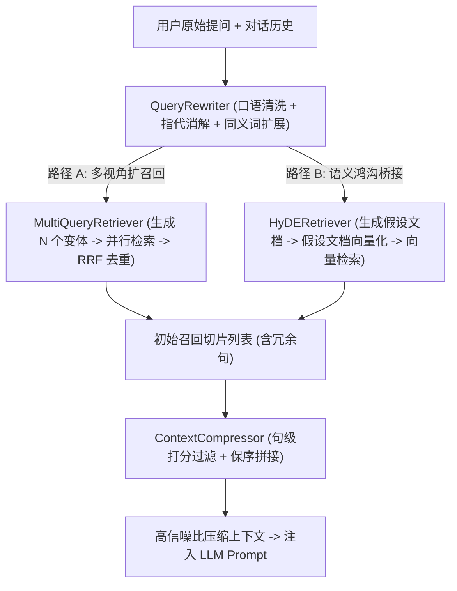

# Day 32 需求文档（PRD）、架构设计与 GitLab 协作记录

## 1. 旁白：告别“一问一搜”的朴素 RAG，打通查询变换与上下文压缩

> **🎙️ 讲师旁白**：欢迎来到星辰数科《智枢企业级智能体平台》第三阶段第 32 天（Day 32）！在上一阶段我们已经搭建了基础向量检索与 RAG 问答链，但在真实企业场景下，用户提问往往充满陷阱：要么是多轮对话里的指代词（“那它一般有几天？”），要么是过于口语化的短句（“Pod 老是 OOM 怎么办”），要么一个切片里夹杂着 80% 的废话把大模型“Lost in the Middle”带偏。今天，产品经理林晓与 Tech Lead 张工正式下发 **Issue #032**：为智枢平台构建 **Advanced RAG Part 1 查询变换与上下文压缩引擎（`v0.3.0-day32`）**，通过 **Query Rewriting、Multi-Query、HyDE 与 Context Compression** 四大核心武器，全面拉升召回率与信噪比！

---

## 2. GitLab Issue #032：高级 RAG 查询变换与上下文压缩研发

- **提出人**：产品经理 林晓 / Tech Lead 张工
- **指派给**：AI 应用开发工程师 陈默
- **关联分支**：`feature/day-32-advanced-rag-query-transform`
- **目标版本**：`v0.3.0-day32`

### 2.1 业务与技术需求描述
1. **查询改写器（`QueryRewriter`）**：
   - 自动清洗口语前后缀（如“请问一下”“呀”“呢”），支持结合 `chat_history` 消解“它 / 这个 / 该制度”等多轮指代。
   - 支持本地同义词扩展与外接 `llm_fn` 回调，兼容 `invoke()` 接口。
2. **多路查询检索器（`MultiQueryRetriever`）**：
   - 针对单条原始 Query 自动生成 `num_queries` 个不同视角的查询变体，分别调用底层 Retriever 召回。
   - 使用 **RRF（Reciprocal Rank Fusion）** 对多路召回结果进行融合去重，兼顾召回覆盖面与多路共现排序。
3. **假设文档向量检索（`HyDERetriever`）**：
   - 先基于 Query 生成一段信息密度较高的“假设答案文档（Hypothetical Document）”，再用假设文档的 Embedding 去向量库检索真实文档，弥合“短问句 vs 长文档”的语义鸿沟。
4. **上下文压缩器（`ContextCompressor`）**：
   - 对召回的长切片按中英文句界切分，计算句子与 Query 的向量相似度及词法重合度，仅保留高相关句子并保持原文语序。
   - 在 `Document.metadata` 中记录 `original_chars`、`compressed_chars` 与 `compression_ratio`，降低下游 LLM Token 消耗与噪音干扰。

---

### 2.2 Advanced RAG Part 1 流水线架构图

> **💡 架构师笔记（为什么先扩召回、再做压缩？）**：
> 在企业级 RAG 中，“召回（Recall）”与“精准（Precision）”是一对天然矛盾：
> - **QueryRewriting / Multi-Query / HyDE** 解决的是**“找得到”**（Recall），通过扩写视角与语义对齐，防止漏掉关键制度或运维手册；
> - **ContextCompression** 解决的是**“喂得精”**（Precision & Token Cost），在把上下文交给大模型生成之前剔除无关段落，既省钱又避免“Lost in the Middle”注意力稀释。

---

## 3. GitLab Merge Request !032 评审记录

- **提交说明**：`feat(day-32): 实现 QueryRewriter、MultiQueryRetriever、HyDERetriever 与 ContextCompressor (v0.3.0-day32)`
- **Tech Lead 张工 Review 意见**：
  - `[通过]` 四个核心组件均采用“零外部依赖默认实现 + 可插拔 `llm_fn` / `query_generator` 钩子”设计，既能在离线单元测试与教学环境 100% 确定性运行，也能在生产环境无缝接入大模型。
  - `[通过]` `MultiQueryRetriever` 采用 `1 / (rrf_k + rank)` 的 RRF 融合去重策略，避免了不同检索路之间分数尺度不一致的问题，多路共同命中的核心文档会自然排在最前。
  - `[通过]` `ContextCompressor` 先按得分筛选 Top-N 句子，再按原文索引 `idx` 恢复语序拼接，有效防止了语义碎片化和逻辑倒置。
- **QA 李婷 测试结果**：
  - `pytest project_iterations/day_32/tests -v` 4 项核心测试（QueryRewriter 历史消解与回调、MultiQuery 去重与 RRF、HyDE 假设文档检索与元数据过滤、ContextCompressor 句级提炼与边界模式）100% PASS。
  - `verify_day.py` Notebook 与单元测试双校验通过，准予合并至 `main` 并打标 `v0.3.0-day32`。
