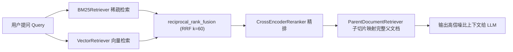

# Day 33 需求文档（PRD）、架构设计与 GitLab 协作记录

## 1. 旁白：单一向量检索的“盲区”与混合检索的破局

> **🎙️ 讲师旁白**：欢迎来到星辰数科《智枢企业级智能体平台》第三阶段第 33 天（Day 33）！在前面的课程中，我们已经搭建了基于向量相似度的 RAG 检索底座。但在企业真实生产环境中，单一向量检索常常会遇到两个痛点：第一，遇到精确错误码（如 `ERR_NGX_502`）、专有名词或工单编号时，稠密向量容易“语义泛化”而漏掉精确匹配；第二，如果文档切片太小，语义聚焦但缺少上下文；切片太大，向量表征被稀释。今天，产品经理林晓与 Tech Lead 张工正式下发 **Issue #033**：我们要为智枢平台升级 **高级 RAG Part 2（`v0.3.0-day33`）**，构建 **BM25 + 向量双路混合检索、RRF 倒数排名融合、Cross-Encoder 精排以及 ParentDocumentRetriever 父文档检索器**！

---

## 2. GitLab Issue #033：高级 RAG 混合检索、RRF、精排与父文档检索研发

- **提出人**：产品经理 林晓 / Tech Lead 张工
- **指派给**：AI 应用开发工程师 陈默
- **关联分支**：`feature/day-33-hybrid-rag-rerank-parent`
- **目标版本**：`v0.3.0-day33`

### 2.1 业务与技术需求描述
1. **稀疏关键词检索器（`BM25Retriever`）**：
   - 基于纯 Python 标准库实现 Okapi BM25 算法（支持 `k1=1.5`、`b=0.75` 及文档长度归一化），结合中英文混合分词（英文/数字词元 + 中文 Unigram/Bigram）。
   - 对稀有错误码、专业术语赋予高 IDF 权重，弥补向量检索的精确词法盲区。
2. **倒数排名融合（`reciprocal_rank_fusion(ranked_lists, k=60)`）**：
   - 实现无量纲的 RRF 算法：$\text{RRF}(d) = \sum_{r} \frac{1}{k + \text{rank}_r(d)}$，解决 BM25 无界得分与余弦相似度 `[-1, 1]` 无法直接相加的难题。
   - 按文档 ID 自动去重，同时提升在多路召回中同时出现的“共识文档”排名。
3. **精排器（`CrossEncoderReranker`）**：
   - 联合建模 Query 与候选 Document 的词法覆盖度、语义余弦相似度与连续短语匹配奖励，对 RRF 粗排候选集进行精细重排并截断 Top-K。
4. **父文档检索器（`ParentDocumentRetriever`）**：
   - 采用 **Small-to-Big（以小搜大）** 策略：将长父文档切分为细粒度子切片建立混合索引，检索命中子切片后自动映射并去重返回完整的父文档上下文。

---

### 2.2 混合检索与父文档召回流水线架构图

> **💡 架构师笔记（为什么采用“双路召回 + RRF + 精排 + 父文档”四段式？）**：
> 1. **召回层（BM25 + Vector）** 追求“高召回率（Recall）”，双路互补不漏掉任何潜在相关片段；
> 2. **融合层（RRF）** 不依赖分数标度，稳健合并异构检索器排名；
> 3. **精排层（Cross-Encoder）** 只对 Top-N 候选做细粒度交叉打分，兼顾准确率（Precision）与延迟；
> 4. **上下文层（Parent Document）** 用小切片保证检索精度，用大父文档保证 LLM 推理时的上下文完整性。

---

## 3. GitLab Merge Request !033 评审记录

- **提交说明**：`feat(day-33): 实现 BM25Retriever、RRF 融合、CrossEncoderReranker 与 ParentDocumentRetriever (v0.3.0-day33)`
- **Tech Lead 张工 Review 意见**：
  - `[通过]` `BM25Retriever` 使用非负平滑 Robertson-Sparck Jones IDF，避免了小语料库下 `df > N/2` 时出现负 IDF 的异常行为。
  - `[通过]` `reciprocal_rank_fusion` 同时兼容 `list[Document]` 与 `list[tuple[Document, float]]` 输入，并按 `doc.id` 去重，接口健壮性良好。
  - `[通过]` `ParentDocumentRetriever` 在映射回父文档时使用 `seen_parents` 集合去重，防止同一篇长文档因多个子切片同时命中而在最终上下文中重复占用 Token 预算。
- **QA 李婷 测试结果**：
  - `pytest project_iterations/day_33/tests -v` 全部 5 项核心测试（BM25 精确关键词与 IDF、RRF 共识加权与去重、CrossEncoder 精排、ParentDocumentRetriever Small-to-Big、端到端混合流水线）100% PASS。
  - `verify_day.py` Notebook 与单元测试双校验通过，准予合并至 `main` 并打标 `v0.3.0-day33`。
