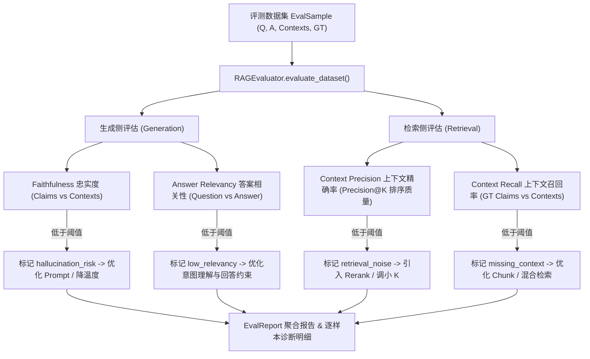

# Day 34 需求文档（PRD）、架构设计与 GitLab 协作记录

## 1. 旁白：告别“盲人摸象”，为智枢 RAG 装上可量化的“质检仪表盘”

> **🎙️ 讲师旁白**：欢迎来到星辰数科《智枢企业级智能体平台》第三阶段第 34 天（Day 34）！在前面的课程中，我们已经把向量库、混合检索、重排序（Rerank）以及 RAG 问答链全部跑通了。但在企业上线前，产品经理林晓和 QA 李婷一定会灵魂发问：“你改了切分大小或换了重排模型，RAG 效果到底是变好了还是变差了？有没有出现幻觉？”今天，Tech Lead 张工正式下发 **Issue #034**：我们要引入业界标准的 **Ragas（Retrieval Augmented Generation Assessment）四维评估体系（`v0.3.0-day34`）**，从**忠实度（Faithfulness）**、**答案相关性（Answer Relevancy）**、**上下文精确率（Context Precision）**、**上下文召回率（Context Recall）**四个维度对检索与生成链路进行自动化体检！

---

## 2. GitLab Issue #034：RAG 自动化评估体系（Ragas 四大核心指标）研发

- **提出人**：产品经理 林晓 / Tech Lead 张工
- **指派给**：AI 应用开发工程师 陈默
- **关联分支**：`feature/day-34-rag-eval-ragas`
- **目标版本**：`v0.3.0-day34`

### 2.1 业务与技术需求描述
1. **标准评测样本建模（`EvalSample`）**：
   - 统一封装单条评测所需四要素：`question`（用户提问）、`answer`（RAG 生成回答）、`contexts`（检索器召回的文档片段列表）、`ground_truth`（人工标注标准答案），以及可选 `sample_id`。
2. **Ragas 四大核心指标函数**：
   - **`compute_faithfulness(answer, contexts)`**：将回答切分为独立陈述（Claims），校验每条陈述是否被检索上下文支撑（含关键词覆盖与数值一致性校验），精准拦截模型幻觉（Hallucination）。
   - **`compute_answer_relevancy(question, answer)`**：结合特征哈希余弦相似度与提问核心词覆盖率，衡量回答是否直接切中问题要害，拦截答非所问。
   - **`compute_context_precision(question, contexts, ground_truth)`**：基于 `Precision@K` 计算相关上下文在召回列表中的排序质量，相关文档越靠前分数越高。
   - **`compute_context_recall(ground_truth, contexts)`**：切分标准答案中的关键事实，统计被检索上下文覆盖的比例，定位“漏检”短板。
3. **自动化评测器与诊断报告（`RAGEvaluator` & `EvalReport`）**：
   - 提供 `RAGEvaluator.evaluate_dataset(samples) -> EvalReport`，输出数据集聚合均分、达标率（`pass_rate`）以及逐样本诊断标签（`healthy`、`hallucination_risk`、`low_relevancy`、`retrieval_noise`、`missing_context`）。

---

### 2.2 Ragas 四维评估架构与诊断闭环流水线

> **💡 架构师笔记（为什么 Ragas 要把“检索”和“生成”拆开评估？）**：
> 当用户反馈“智枢回答错了”时，如果不拆解指标，工程师往往会盲目更换大模型。通过 Ragas 四维诊断：如果 **Context Recall 低**，说明根本没检索到答案（应调优切分策略、Embedding 或混合检索）；如果 **Context Precision 低**，说明噪音文档排在前面（应上 Rerank 重排序）；如果检索指标都高但 **Faithfulness 低**，才是 LLM 自身在“一本正经地胡说八道”（幻觉），需要收紧 System Prompt 约束。

---

## 3. GitLab Merge Request !034 评审记录

- **提交说明**：`feat(day-34): 实现 Ragas 四维 RAG 评估指标与 RAGEvaluator 诊断报告 (v0.3.0-day34)`
- **Tech Lead 张工 Review 意见**：
  - `[通过]` `_is_claim_supported` 加入了数值一致性校验（`_extract_numbers`），能准确捕获“上下文写 5 天年假，模型篡改为 15 天”的隐蔽数值幻觉。
  - `[通过]` `compute_context_precision` 严格遵循 Ragas `Precision@K` 加权公式，排序位置敏感性测试符合预期。
  - `[通过]` 零外部 API 依赖、100% 确定性计算，适合直接集成进 CI/CD 回归测试流水线，防止知识库或 Prompt 迭代导致线上质量退化。
- **QA 李婷 测试结果**：
  - `pytest project_iterations/day_34/tests -v` 全部 5 项核心测试（忠实度与幻觉检测、答案相关性排序、上下文精确率位置敏感性、上下文召回率覆盖、数据集聚合报告与诊断）100% PASS。
  - `verify_day.py` Notebook 与单元测试双校验通过，准予合并至 `main` 并打标 `v0.3.0-day34`。
