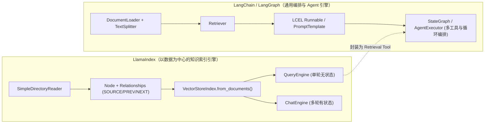

# Day 35 需求文档（PRD）、架构设计与 GitLab 协作记录

## 1. 旁白：从“万能编排”到“数据为王”，引入 LlamaIndex 知识索引引擎

> **🎙️ 讲师旁白**：欢迎来到星辰数科《智枢企业级智能体平台》第三阶段第 35 天（Day 35），这也是第三阶段的收官与升华之战！过去几周我们用 LangChain 搭建了检索链、混合检索、Rerank 以及 Ragas 评估体系。但在企业知识库越来越庞大、文档格式越来越复杂时，团队发现“自己手动拼接 Loader + Splitter + VectorStore + Prompt”代码冗长且难维护。今天，Tech Lead 张工正式下发 **Issue #035**：引入 **LlamaIndex 核心架构抽象（`v0.3.0-day35`）**，通过 `SimpleDirectoryReader`、`Node`、`VectorStoreIndex`、`QueryEngine` 与 `ChatEngine` 实现以数据为中心的 RAG 流水线，并输出 **LangChain vs LlamaIndex 选型与融合架构矩阵**！

---

## 2. GitLab Issue #035：LlamaIndex 框架核心抽象与 LangChain 对比选型

- **提出人**：Tech Lead 张工 / 产品经理 林晓
- **指派给**：AI 应用开发工程师 陈默
- **关联分支**：`feature/day-35-llamaindex-vs-langchain`
- **目标版本**：`v0.3.0-day35`

### 2.1 业务与技术需求描述
1. **数据接入与原子节点建模（`SimpleDirectoryReader` & `Node`）**：
   - `SimpleDirectoryReader(input_dir, required_exts, recursive)`：一键扫描企业知识库目录并封装为 `Document`（含 `file_name`、`file_path`、`doc_id` 等元数据）。
   - `Node`（原子切片单元）：除文本和向量外，显式维护 `relationships`（`SOURCE`、`PREVIOUS`、`NEXT`），支撑上下文窗口前后扩展。
2. **声明式索引构建（`VectorStoreIndex.from_documents()`）**：
   - 封装“切分 -> 向量化 -> 入库”全流程，提供 `retrieve(query, similarity_top_k)`、`as_query_engine()` 与 `as_chat_engine()` 统一入口。
3. **双引擎分离（`QueryEngine` vs `ChatEngine`）**：
   - **`QueryEngine`**：无状态单轮精准问答，支持 `compact`、`refine`、`tree_summarize` 三种响应合成策略（Response Synthesis）。
   - **`ChatEngine`**：有状态多轮对话，内置 `chat_history` 记忆与指代追问改写（`condense_question`），支持 `reset()` 清空会话。
4. **框架对比与选型决策函数（`compare_frameworks()`）**：
   - 结构化输出 LangChain 与 LlamaIndex 在核心定位、核心抽象、数据索引、响应合成与 Agent 编排五大维度的差异，并针对 `enterprise_rag`、`multi_agent_workflow`、`hybrid` 三类场景给出推荐。

---

### 2.2 LangChain vs LlamaIndex 架构对比图

> **💡 架构师笔记（为什么生产环境常采用“LlamaIndex + LangChain/LangGraph”双剑合璧？）**：
> LangChain 的强项在于 **控制流编排**（LCEL 管道、Tool Calling、LangGraph 状态机与人工介入），而 LlamaIndex 的强项在于 **数据流索引**（`Node` 关系图、层次化索引、开箱即用的 `QueryEngine` 响应合成）。在星辰数科智枢平台中，最佳实践是：**用 LlamaIndex 管好企业文档索引并暴露为 `QueryEngineTool`，由 LangChain/LangGraph 智能体在复杂任务中按需调用！**

---

## 3. GitLab Merge Request !035 评审记录

- **提交说明**：`feat(day-35): 实现 LlamaIndex 核心抽象 (Reader/Node/Index/QueryEngine/ChatEngine) 与 LangChain 对比工具 (v0.3.0-day35)`
- **Tech Lead 张工 Review 意见**：
  - `[通过]` `VectorStoreIndex.from_documents()` 自动构建了 `Node` 之间的 `SOURCE`、`PREVIOUS`、`NEXT` 关系链，高度还原了 LlamaIndex 的核心数据模型设计哲学。
  - `[通过]` `QueryEngine` 与 `ChatEngine` 职责边界清晰：`QueryEngine` 专注无状态检索合成并支持三种 `response_mode`，`ChatEngine` 专注多轮追问改写与历史管理。
  - `[通过]` `compare_frameworks()` 清晰阐明了“Data Framework vs Orchestration Framework”的本质差异，避免了团队在技术选型上陷入非此即彼的误区。
- **QA 李婷 测试结果**：
  - `pytest project_iterations/day_35/tests -v` 基于 `tmp_path` 临时目录的 5 项核心单元测试（目录读取与递归过滤、Node 关系链与 Top-K 检索、QueryEngine 三模式校验、ChatEngine 多轮改写与重置、框架对比矩阵）100% PASS。
  - `verify_day.py` Notebook 与单元测试双校验通过，准予合并至 `main` 并打标 `v0.3.0-day35`。
