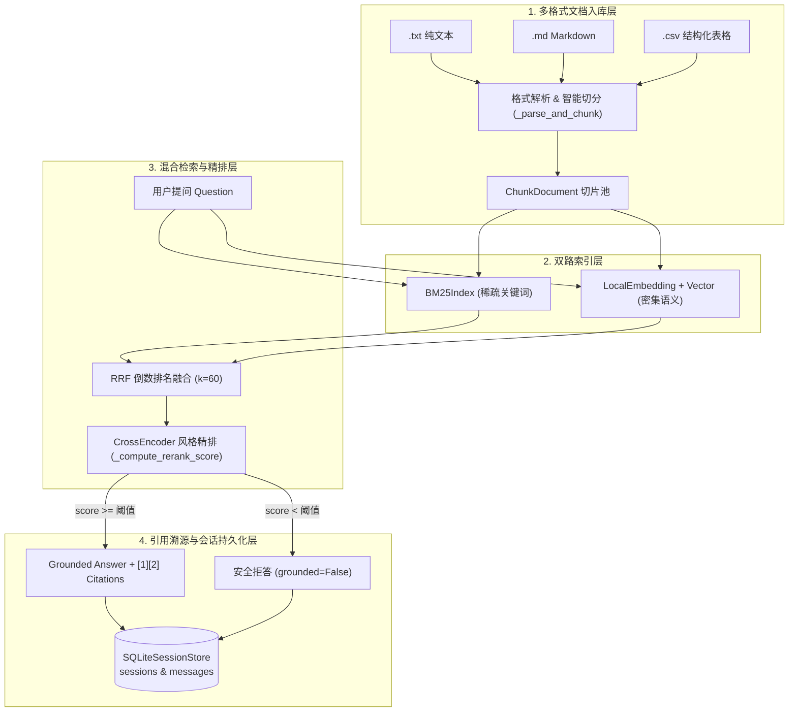

# Day 36 需求文档（PRD）、架构设计与 GitLab 协作记录

## 1. 旁白：里程碑项目 2 启动——把 Stage 3 全部 RAG 黑科技收口为企业级知识库后端

> **🎙️ 讲师旁白**：欢迎来到星辰数科《智枢企业级智能体平台》第三阶段第 36 天（Day 36）——**里程碑项目 2 Part 1：企业知识库问答系统后端（`v0.3.0-day36`）**！在过去的十天里，我们逐一攻克了文本切分、向量检索、Query 改写、BM25+向量混合检索、RRF 融合、Rerank 重排以及 Ragas 评估。今天，产品经理林晓和 Tech Lead 张工正式下发 **Issue #036**：我们要把这些零散的技术积木，工程化封装为一个高内聚、可持久化、支持多格式文档上传与引用溯源的企业级后端服务 `EnterpriseKBService`，为明天（Day 37）的前端交互与全链路集成打下坚实底座！

---

## 2. GitLab Issue #036：里程碑项目 2（企业知识库问答系统后端）研发

- **提出人**：产品经理 林晓 / Tech Lead 张工
- **指派给**：AI 应用开发工程师 陈默
- **关联分支**：`feature/day-36-milestone2-kb-backend`
- **目标版本**：`v0.3.0-day36`

### 2.1 业务与技术需求描述
1. **多格式文档解析与智能切分（Multi-format Ingestion & Chunking）**：
   - 支持 `.txt`（纯文本滑动窗口切分）、`.md`（按 `#`/`##` 标题结构分段并保留标题上下文）、`.csv`（结构化表格逐行转为可读键值对文本）三种企业高频文档格式。
   - 对不支持的格式（如 `.zip`）和不存在的路径显式抛出 `ValueError` / `FileNotFoundError`，杜绝静默失败。
2. **混合检索 + RRF 融合 + 重排序（Hybrid Retrieval + RRF + Rerank）**：
   - 同时维护 `BM25Index`（Okapi BM25 稀疏关键词检索，精准命中 `ERR_502`、`KEYS *` 等专有代码/术语）与 `LocalEmbedding` 向量余弦检索（捕捉语义相似）。
   - 使用 RRF（Reciprocal Rank Fusion, `k=60`）融合双路排名，再通过 CrossEncoder 风格精排器（`rerank_score`）输出最终 Top-K `RetrievedChunk`。
3. **严谨引用溯源回答与安全拒答（Grounded Answer & Citations）**：
   - 基于重排后的高相关性切片提取最匹配句，生成带内联引用编号 `[1]`、`[2]` 的回答，并附带结构化 `Citation`（含 `source`、`chunk_index`、`snippet`、`score`）。
   - 当最高 `rerank_score` 低于 `min_relevance_score` 阈值时，触发安全拒答（`grounded=False`），严禁无依据编造。
4. **SQLite 多轮会话持久化（SQLite Session History）**：
   - 通过 `SQLiteSessionStore` 建表 `sessions` 与 `messages`，将每轮提问、回答与 `citations_json` 持久化到 SQLite，支持跨进程/跨实例恢复历史、查询会话列表与清空会话。

---

### 2.2 企业知识库后端架构图

> **💡 架构师笔记（为什么必须设置 `min_relevance_score` 拒答阈值？）**：
> 在企业知识库场景下，“不知道就说不知道”远比“强行编造”更重要。如果直接把 Top-K 结果无条件塞给生成阶段，当用户问到“食堂今天吃什么”这种库外问题时，BM25/向量检索依然会硬凑出几个分数极低的片段，导致模型产生严重幻觉。通过 `min_relevance_score` 门禁 + 双字词重叠抑制单字噪音，系统能干净地拦截离题问题。

---

## 3. GitLab Merge Request !036 评审记录

- **提交说明**：`feat(day-36): 实现企业知识库问答系统后端 EnterpriseKBService (v0.3.0-day36)`
- **Tech Lead 张工 Review 意见**：
  - `[通过]` `.md` 解析保留了父级标题前缀，避免了子切片丢失章节语境；`.csv` 解析将列名与单元格绑定，显著提升了表格类数据的可检索性。
  - `[通过]` `_split_sentences` 使用正则负向环视避免将 `travel_budget.csv` 中的点号误切为句号，引用片段完整度良好。
  - `[通过]` `SQLiteSessionStore` 支持 `:memory:` 与磁盘文件双模式，且 `citations_json` 完整落库，满足审计与前端回显需求。
- **QA 李婷 测试结果**：
  - `pytest project_iterations/day_36/tests -v` 全部 4 项核心集成测试（多格式入库与异常拦截、混合检索+RRF+重排、引用溯源与拒答、SQLite 跨实例持久化与文档删除）100% PASS。
  - `verify_day.py` Notebook 与单元测试双校验通过，准予合并至 `main` 并打标 `v0.3.0-day36`。
