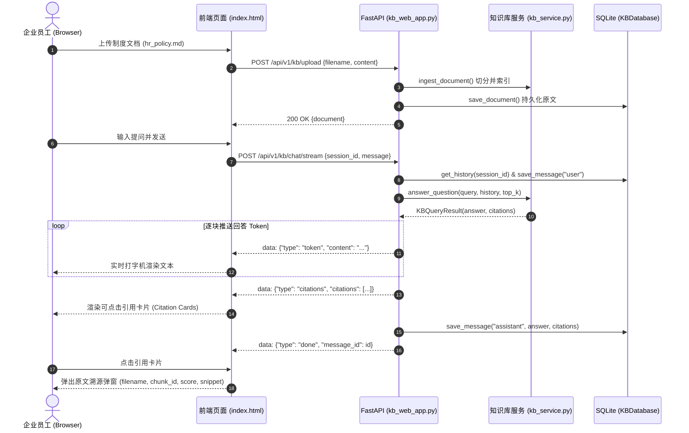

# Day 37 需求文档（PRD）、架构设计与 GitLab 协作记录

## 1. 旁白：里程碑项目 2 收官——从 RAG 引擎到企业级全栈知识库问答系统

> **🎙️ 讲师旁白**：欢迎来到星辰数科《智枢企业级智能体平台》第三阶段第 37 天（Day 37），也是 **里程碑项目 2（Part 2）** 的收官实战！在前面的课程中，我们已经打通了文档切分、混合检索、Ragas 评估以及知识库核心服务。今天，产品经理林晓和 Tech Lead 张工正式下发 **Issue #037**：我们要把知识库引擎封装为企业级全栈 Web 应用（`v0.3.0-day37`）——后端基于 **FastAPI + CORSMiddleware + SQLite + SSE（Server-Sent Events）流式推送**，不仅实时推送回答 `token`，还在流尾推送结构化 **`citations` 引用事件**；前端提供**文档上传面板、多轮对话窗口、打字机流式渲染与可点击溯源的引用卡片（Citation Cards）**！

---

## 2. GitLab Issue #037：企业级知识库问答全栈集成（Project 2 Part 2）

- **提出人**：产品经理 林晓 / Tech Lead 张工
- **指派给**：AI 应用开发工程师 陈默
- **关联分支**：`feature/day-37-kb-fullstack-sse`
- **目标版本**：`v0.3.0-day37`

### 2.1 业务与技术需求描述
1. **知识库文档上传与持久化索引（`POST /api/v1/kb/upload`）**：
   - 支持前端上传文档文件名与文本内容，调用 `KnowledgeBaseService.ingest_document()` 自动分块并构建检索索引，同时持久化至 SQLite `kb_documents` 表，确保服务重启后自动恢复索引。
2. **SSE 流式问答与结构化引用推送（`POST /api/v1/kb/chat/stream`）**：
   - 接收 `session_id`、`message`、`top_k`、`delay_ms` 参数，结合历史多轮上下文执行检索与回答生成。
   - 通过 `StreamingResponse(..., media_type="text/event-stream")` 依次推送三类标准 JSON 事件：
     - `{"type": "token", "content": "..."}`（逐块打字机输出）
     - `{"type": "citations", "citations": [...]}`（携带 `doc_id`、`filename`、`chunk_id`、`score`、`snippet`）
     - `{"type": "done", "message_id": ..., "session_id": "..."}`（落库完成信号）
3. **多轮历史与引用卡片恢复（`GET /api/v1/kb/sessions/{session_id}/history`）**：
   - SQLite `messages` 表新增 `citations_json` 字段，刷新页面或切换历史会话时完整还原对话文本与可点击引用卡片。
4. **全栈前端页面与跨域支持（`GET /` & `CORSMiddleware`）**：
   - `frontend/index.html` 集成文档上传、会话切换、`fetch()` + `ReadableStream` SSE 消费以及引用卡片点击弹窗溯源原文。

---

### 2.2 全栈 SSE 流式问答与引用溯源时序图

> **💡 架构师笔记（为什么把 `citations` 放在 SSE 流尾而不是响应头？）**：
> HTTP 响应头在流开始前就已固定且大小受限，无法承载多段长文本 `snippet`。通过在 `text/event-stream` 中复用同一条长连接，先推送 `token` 让用户 0 延迟看到首字输出，再在末尾推送结构化 `citations` 事件，既保证了流式交互体验，又让前端能够精准渲染带匹配度和原文预览的可点击引用卡片。

---

## 3. GitLab Merge Request !037 评审记录

- **提交说明**：`feat(day-37): 完成里程碑项目 2 Part 2 企业知识库全栈问答系统 (v0.3.0-day37)`
- **Tech Lead 张工 Review 意见**：
  - `[通过]` `KBDatabase` 将 `kb_documents` 与 `messages.citations_json` 一并持久化，服务重启后 `create_app()` 自动重建知识库索引并恢复引用卡片，设计严谨。
  - `[通过]` SSE 事件协议清晰区分 `token`、`citations`、`done` 三类消息，前端 `ReadableStream` 解析逻辑健壮且无内存泄漏。
  - `[通过]` `CORSMiddleware` 正确处理跨域预检请求，前后端既可同源托管于 `GET /`，也可分离部署调试。
- **QA 李婷 测试结果**：
  - `pytest project_iterations/day_37/tests -v` 全部 5 项测试（前端托管与健康检查、CORS 预检、文档上传与校验、SSE `token` + `citations` 流式解析、多轮上下文与重启持久化）100% PASS。
  - `verify_day.py` Notebook 与单元测试双校验通过，准予合并至 `main` 并打标 `v0.3.0-day37`。
