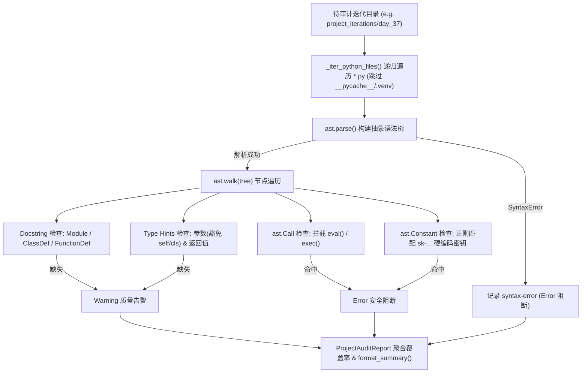

# Day 38 需求文档（PRD）、架构设计与 GitLab 协作记录

## 1. 旁白：第三阶段收官答辩与工程代码审计——为“智枢 RAG 2.0”筑牢质量防线

> **🎙️ 讲师旁白**：欢迎来到星辰数科《智枢企业级智能体平台》第三阶段最后一天（Day 38）！在过去的十余天里，我们从 LangChain LCEL 编排、文档切片与向量检索、混合检索（BM25 + Dense）与 Rerank 重排序，一路迭代到 Ragas 四维评估体系以及企业知识库问答服务（`day_37`）。今天是 **Project 2（企业级 RAG 知识库问答系统）项目答辩与工程化代码审计日**！Tech Lead 张工下发 **Issue #038（`v0.3.0-day38`）**：在正式向业务部门交付之前，我们必须研发一套零外部依赖的 **Python AST 静态代码质量审计器（`code_review_audit.py`）**，对核心代码库进行 Docstring、Type Hints、危险动态执行（`eval`/`exec`）与硬编码密钥（`sk-...`）自动化扫描，并完成 10 分钟项目答辩、QA 验收与架构重构清单评审！

---

## 2. GitLab Issue #038：Project 2 答辩与工程代码静态审计系统研发

- **提出人**：产品经理 林晓 / Tech Lead 张工 / QA 李婷
- **指派给**：AI 应用开发工程师 陈默
- **关联分支**：`feature/day-38-project2-defense-audit`
- **目标版本**：`v0.3.0-day38`

### 2.1 业务与技术需求描述
1. **Python AST 静态质量审计引擎（`zhishu_agent/code_review_audit.py`）**：
   - **`audit_python_file(file_path)`**：基于 Python 标准库 `ast` 解析目标 `.py` 文件，输出 `FileAuditReport`：
     - **Docstring 覆盖率**：统计模块（Module）、类（ClassDef）、函数/异步函数（FunctionDef / AsyncFunctionDef）的文档字符串覆盖比例；缺失时产生 `warning` 告警。
     - **Type Hints 覆盖率**：校验函数/方法的所有参数（自动豁免实例/类方法首参 `self`/`cls`）与返回值注解完整性；缺失时产生 `warning` 告警。
     - **高危动态执行拦截**：扫描 `ast.Call` 节点，严禁调用 `eval()` 与 `exec()`，一旦检出立即触发 `error` 阻断门禁。
     - **硬编码密钥泄漏扫描**：扫描字符串常量中的 `sk-[A-Za-z0-9_-]{10,}` 模式，防止 OpenAI / 兼容模型 API Key 明文提交至 Git 仓库，检出即触发 `error` 阻断门禁。
     - **语法容错**：遇到 `SyntaxError` 文件时优雅捕获并记录 `syntax-error`，不中断批量扫描流程。
   - **`audit_project_dir(project_dir)`**：递归扫描指定迭代目录（自动跳过 `__pycache__`、`.git`、`.venv` 等目录），聚合生成 `ProjectAuditReport`，支持 `format_summary()` 输出结构化审计报告。
2. **Project 2 答辩与验收交付物（`docs/defense_and_code_review.md`）**：
   - 10 分钟 Stage 3 项目答辩逐字稿（覆盖 RAG 架构演进、关键指标与现场 Q&A 应答）。
   - QA 李婷的阶段验收报告（功能、安全、确定性与测试覆盖率）。
   - Tech Lead 张工的工程重构清单（为 Stage 4 多智能体编排与生产部署铺路）。

---

### 2.2 AST 静态代码审计与门禁流水线架构

> **💡 架构师笔记（为什么用 `ast` 而不是单纯的正则匹配做 Code Review？）**：
> 正则表达式无法理解 Python 语法上下文，极易把注释或字符串里的 `"eval("` 误报为危险调用，也难以精确区分函数参数（尤其是 `*args`、`**kwargs` 与 `self`/`cls`）。通过 `ast.parse()` 将源码转化为抽象语法树，我们能以 **100% 确定性** 区分“真正的函数调用节点 `ast.Call`”与“普通字符串/注释”，这正是工业级静态分析工具（如 Ruff、Flake8、Bandit）的核心底层原理。

---

## 3. GitLab Merge Request !038 评审记录

- **提交说明**：`feat(day-38): 完成 Project 2 答辩材料与 AST 静态代码质量审计器 (v0.3.0-day38)`
- **Tech Lead 张工 Review 意见**：
  - `[通过]` `code_review_audit.py` 纯标准库实现（`ast` + `re` + `dataclasses` + `pathlib`），零第三方依赖，可直接作为 Git Pre-commit Hook 或 CI/CD 质量门禁脚本运行。
  - `[通过]` `_has_complete_type_hints` 完整覆盖了 `posonlyargs`、`args`、`kwonlyargs`、`vararg`、`kwarg` 与 `returns`，并合理豁免了首参 `self`/`cls`。
  - `[通过]` 审计结果区分 `warning`（文档/注解缺失）与 `error`（`eval`/`exec`/硬编码密钥/语法错误），门禁策略清晰。
- **QA 李婷 测试结果**：
  - `pytest project_iterations/day_38/tests -v` 全部 6 项核心测试（合规文件通过、Docstring/Type Hint 缺失检测、`eval`/`exec` 与 `sk-` 密钥拦截、语法错误容错、目录聚合与 `__pycache__` 过滤、异常路径处理）100% PASS。
  - `verify_day.py` Notebook 与单元测试双校验通过，准予合并至 `main` 并打标 `v0.3.0-day38`，第三阶段（Stage 3）圆满收官！
