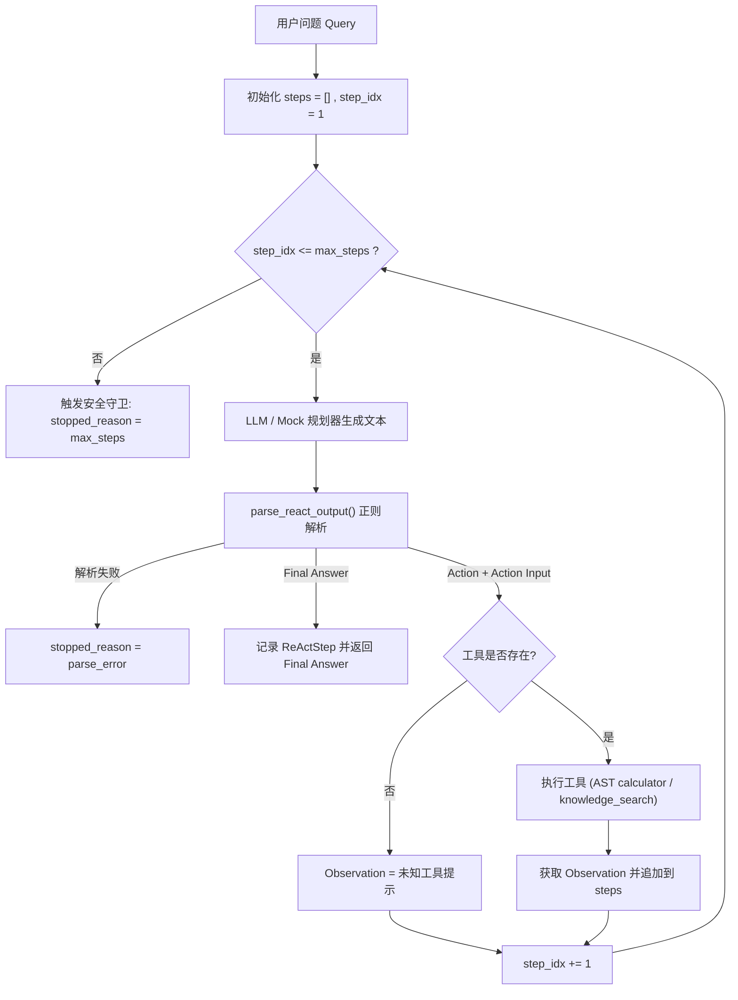

# Day 39 需求文档（PRD）、架构设计与 GitLab 协作记录

## 1. 旁白：第四阶段启航——从“固定流水线”迈向“自主推理智能体”

> **🎙️ 讲师旁白**：欢迎来到星辰数科《智枢企业级智能体平台》第四阶段：**Agent 智能体开发实战**！在第三阶段，我们打造了高精度企业级 RAG 知识库，但业务部门很快提出了更复杂的诉求：“员工不仅想问‘差旅住宿标准是多少’，还想直接问‘我作为高级工程师出差 4 晚，住宿预算上限是多少？’”。传统的固定流水线（Chain）只能按预设步骤执行，无法根据检索结果动态决定“下一步是否要调用计算器”。今天（Day 39，`v0.4.0-day39`），我们将**不借助任何第三方 Agent 框架**，用纯 Python 从零手写 **ReAct（Reasoning + Acting）智能体引擎**，彻底看透 `Thought -> Action -> Action Input -> Observation -> Final Answer` 循环的底层本质！

---

## 2. GitLab Issue #039：纯 Python ReAct 智能体核心引擎研发

- **提出人**：产品经理 林晓
- **协同评审**：Tech Lead 张工 / QA 李婷
- **指派给**：AI 应用开发工程师 陈默
- **关联分支**：`feature/day-39-pure-python-react`
- **目标版本**：`v0.4.0-day39`

### 2.1 业务与技术需求描述
1. **无框架依赖的 ReAct 主循环引擎（`zhishu_agent/react_agent.py`）**：
   - 定义标准轨迹数据结构 `ReActStep`（记录每步 `step_number`、`thought`、`action`、`action_input`、`observation`、`final_answer`）与 `ReActTrace`（汇总完整执行轨迹与 `stopped_reason`，支持 `format_trace()`）。
   - 实现 `ReActAgent` 核心类，支持动态注册工具（`ToolSpec`）并生成标准化 ReAct System Prompt。
2. **正则协议解析器（`parse_react_output`）**：
   - 基于正则表达式精确提取 `Thought:`、`Action:`、`Action Input:` 与 `Final Answer:`，支持多行输入解析并在协议缺失时抛出明确的 `ValueError`。
3. **双内置确定性安全工具**：
   - **`calculator_tool`**：基于 Python `ast.parse(..., mode="eval")` 实现受限算术求值，严禁使用 `eval()`/`exec()`，防止代码注入攻击，同时优雅处理除零与语法错误。
   - **`knowledge_search_tool`**：内置星辰数科差旅、年假、GPU 配额、设备审批离线知识库，支持中英文双字切片匹配召回。
4. **安全与工程护栏**：
   - **`max_steps` 死循环守卫**：当规划器持续输出工具调用而不收敛时，达到 `max_steps` 后强制安全中止并返回 `stopped_reason="max_steps"`。
   - **未知工具与异常隔离**：调用不存在的工具或工具内部报错时，将错误信息包装为 `Observation` 回传给智能体，不导致主循环崩溃。
   - **确定性 Mock LLM 规划器（`default_mock_planner`）**：无需外部 API Key 即可稳定复现单步工具调用与多跳推理（查制度 -> 算预算 -> 总结输出）。

---

### 2.2 ReAct 状态机与多跳推理循环架构

> **💡 架构师笔记（为什么先手写纯 Python ReAct，再学 LangGraph / 框架？）**：
> 很多初学者一上来就调 `AgentExecutor` 或 `create_react_agent`，一旦遇到模型输出格式错乱、工具死循环或 `eval` 安全漏洞便束手无策。通过亲手编写 200 行纯 Python 代码，你会发现 ReAct 的本质并不神秘——它就是一个 **`for step in range(max_steps)` 的 `while` 状态机 + 正则解析器 + 工具分发字典**。掌握了这层内核，后续无论是迁移到 LangGraph 还是自研企业级多智能体编排框架，你都能游刃有余。

---

## 3. GitLab Merge Request !039 评审记录

- **提交说明**：`feat(day-39): 实现纯 Python ReAct 智能体引擎与安全工具集 (v0.4.0-day39)`
- **Tech Lead 张工 Review 意见**：
  - `[通过]` `react_agent.py` 全量采用 Python 标准库（`ast`、`re`、`operator`、`dataclasses`），零外部框架耦合，结构清晰，Docstring 与 Type Hints 覆盖率 100%。
  - `[通过]` `calculator_tool` 严格采用 AST 白名单节点求值，彻底杜绝了 `__import__('os').system(...)` 类 RCE 注入风险。
  - `[通过]` `ReActAgent.run()` 将 `planner` 抽象为可注入函数签名 `(query, steps) -> str`，既支持离线确定性演示，也为后续接入真实大模型（OpenAI / DeepSeek / Qwen）预留了无痛扩展点。
- **QA 李婷 测试结果**：
  - `pytest project_iterations/day_39/tests -v` 全部 6 项核心测试（AST 安全计算与注入拦截、离线知识检索、ReAct 正则解析、多跳推理闭环、`max_steps` 死循环守卫、未知工具容错与 `get_date` 自定义工具注册）100% PASS。
  - `scripts/verify_day.py` Notebook 执行与单元测试双校验通过，准予合并至 `main` 并打标 `v0.4.0-day39`。
