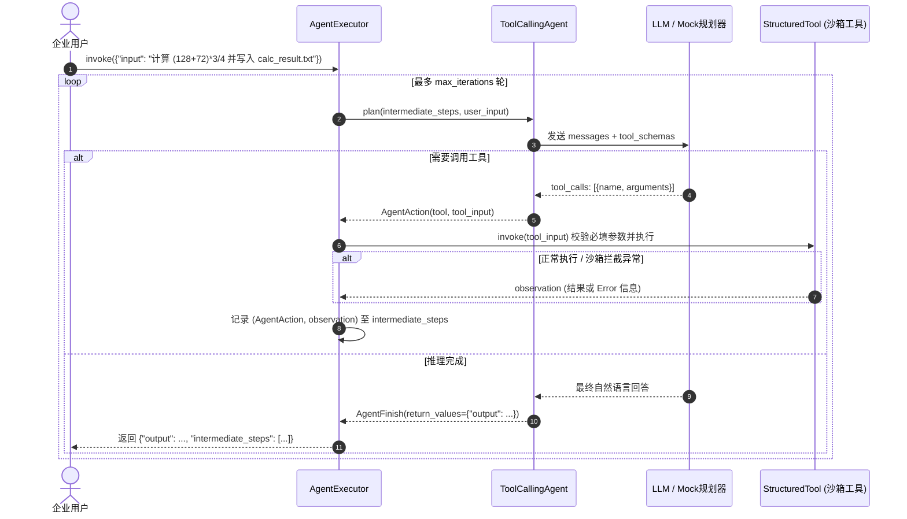

# Day 40 需求文档（PRD）、架构设计与 GitLab 协作记录

## 1. 旁白：迈入第四阶段——从“能聊天的 RAG”进化为“能安全干活的 Tool-Calling Agent”

> **🎙️ 讲师旁白**：欢迎来到星辰数科《智枢企业级智能体平台》第四阶段（Stage 4：Agent 智能体开发）！在第三阶段我们攻克了企业级 RAG 知识库与静态代码审计；从今天（Day 40）开始，我们要让智枢智能体长出“双手”——能够主动调用外部搜索、精确数学计算与本地文件读写工具。但能力越大、风险越大：如果 Agent 直接执行 `eval()` 或被提示词注入诱导读取 `../../etc/passwd`，就会酿成严重生产事故。今天，产品经理林晓与 Tech Lead 张工下发 **Issue #040（`v0.4.0-day40`）**：研发一套兼容 LangChain 设计范式的 `@tool` 装饰器、`StructuredTool`、`ToolCallingAgent` 与 `AgentExecutor`，并内置三重安全沙箱工具集！

---

## 2. GitLab Issue #040：LangChain `@tool` 生态与安全沙箱 AgentExecutor 研发

- **提出人**：产品经理 林晓 / Tech Lead 张工
- **指派给**：AI 应用开发工程师 陈默
- **关联分支**：`feature/day-40-langchain-tool-agent`
- **目标版本**：`v0.4.0-day40`

### 2.1 业务与技术需求描述
1. **`@tool` 装饰器与 `StructuredTool`（`zhishu_agent/tool_agent.py`）**：
   - 自动解析被装饰函数的 `__name__`、Docstring（含 Google 风格 `Args:` 参数说明）与 `typing` 类型注解，生成标准 JSON Schema（`type`、`properties`、`required`、`default`）。
   - 支持 `@tool` 无参装饰与 `@tool("custom_name", return_direct=True)` 带参装饰；强制校验 Docstring 非空，避免模型“盲调用”。
   - 提供 `to_openai_tool()` 方法导出标准 Function Calling Schema，并保留 `__call__()` 使原函数仍可直接调用。
2. **`ToolCallingAgent` 与 `AgentExecutor`**：
   - `ToolCallingAgent.plan()` 根据用户输入与历史 `intermediate_steps` 决策返回 `AgentAction` 或 `AgentFinish`，内置确定性 Mock 规划器（支持离线零密钥演示）并支持注入自定义 `llm` 回调。
   - `AgentExecutor.invoke({"input": ...})` 驱动 `Plan -> Act -> Observe` 循环，遵守 `max_iterations` 上限与 `return_direct` 短路策略，统一返回 `{"output": ..., "intermediate_steps": [...]}`。
3. **企业级安全沙箱工具集**：
   - `tavily_search(query, max_results)`：Mock Tavily 联网检索，返回结构化 `title`、`url`、`content` 摘要。
   - `safe_math_eval(expression)`：基于 Python `ast.parse(..., mode="eval")` 的白名单数学求值器，彻底封堵 `eval()` / `__import__()` / `open()` 等代码注入。
   - `create_sandbox_file_tools(sandbox_root)`：生成绑定工作区的 `read_file` 与 `write_file`，通过 `Path.resolve()` 与 `is_relative_to()` 阻断 `../` 路径穿越与绝对路径越权访问。

---

### 2.2 Tool-Calling AgentExecutor 核心时序架构

> **💡 架构师笔记（为什么 `AgentExecutor` 要保留完整的 `intermediate_steps`？）**：
> 在企业级智能体可观测性（Observability）与审计中，用户看到的 `output` 只是冰山一角。`intermediate_steps` 完整记录了每一次 `AgentAction`（模型想调什么工具、传了什么参数）以及对应的 `Observation`（工具真实返回了什么、是否触发了沙箱拦截）。这不仅是线上排查“幻觉调用”和“死循环”的核心依据，也是自动化评测 Agent 规划准确率的黄金标准。

---

## 3. GitLab Merge Request !040 评审记录

- **提交说明**：`feat(day-40): 实现 @tool 装饰器、ToolCallingAgent、AgentExecutor 与三重安全沙箱工具 (v0.4.0-day40)`
- **Tech Lead 张工 Review 意见**：
  - `[通过]` `StructuredTool.from_function()` 完整处理了 `Optional`、`Literal`、`list`、`dict` 与默认值，缺失 Docstring 时立即抛出 `ValueError`，符合“显式契约”原则。
  - `[通过]` `safe_math_eval` 使用受限 AST 节点白名单并限制幂指数上限（`abs(right) > 1000`），有效防御代码注入与算力 DoS。
  - `[通过]` `create_sandbox_file_tools(sandbox_root)` 在路径解析后使用 `target.is_relative_to(root_resolved)` 校验，能可靠拦截 `../../etc/passwd` 与绝对路径越权。
- **QA 李婷 测试结果**：
  - `pytest project_iterations/day_40/tests -v`（含 `tmp_path` 沙箱隔离测试）7 项核心用例 100% PASS。
  - `verify_day.py` Notebook 与单元测试双校验通过，准予合并至 `main` 并打标 `v0.4.0-day40`。
