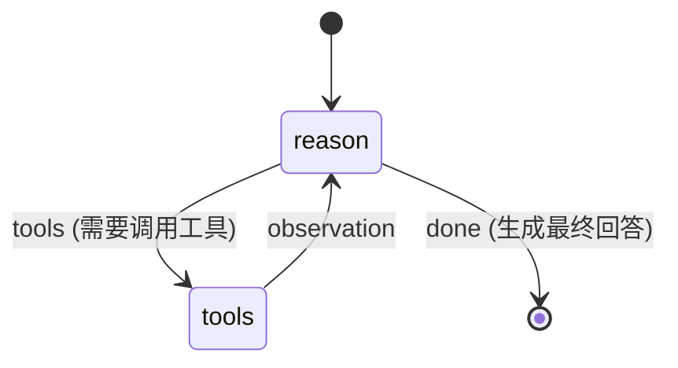
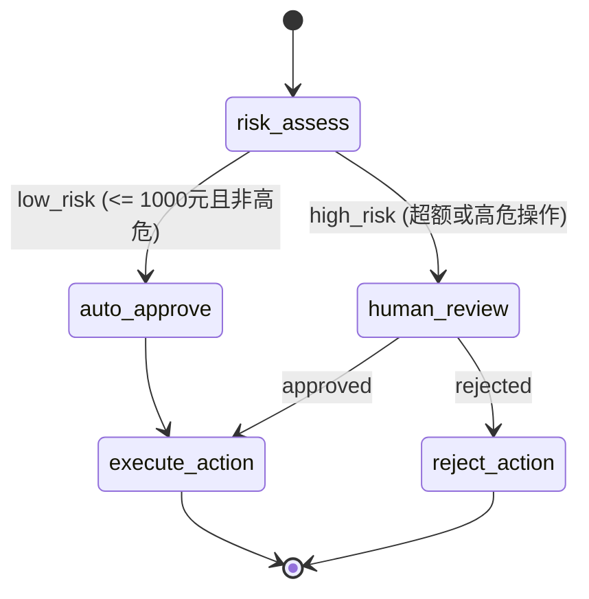

# Day 41 需求文档（PRD）、架构设计与 GitLab 协作记录

## 1. 旁白：迈入 Stage 4 智能体编排——为什么我们需要 LangGraph 状态机？

> **🎙️ 讲师旁白**：欢迎来到星辰数科《智枢企业级智能体平台》第四阶段（Stage 4：多智能体与复杂工作流编排）的第一天（Day 41）！在第三阶段，我们用 LangChain LCEL 构建了非常优雅的 RAG 流水线（检索 → 重排序 → 生成）。但当业务需求升级为“**智能体自主调用工具、失败后自动重试、高风险操作暂停等待人工审批**”时，单向无环的 DAG（有向无环图）就捉襟见肘了。今天 Tech Lead 张工下发 **Issue #041（`v0.4.0-day41`）**：正式引入 **LangGraph 状态图（StateGraph）架构**，用“全局共享状态 + 节点函数 + 条件边 + 有界循环”重构智能体编排内核，并落地 **ReAct 工具循环图** 与 **费用/高风险操作人工审批流**！

---

## 2. GitLab Issue #041：LangGraph 状态机编排引擎与审批流研发

- **提出人**：产品经理 林晓 / Tech Lead 张工
- **指派给**：AI 应用开发工程师 陈默
- **关联分支**：`feature/day-41-langgraph-state-machine`
- **目标版本**：`v0.4.0-day41`

### 2.1 为什么选择 LangGraph 状态机（对比传统 LCEL 线性链）
| 维度 | 传统 LCEL 线性链（DAG） | LangGraph 状态图（StateGraph） |
| :--- | :--- | :--- |
| **拓扑结构** | 单向无环图，步骤固定从头走到尾 | 支持**有向有环图（Cyclic Graph）**，允许反思、重试与多轮工具调用 |
| **状态管理** | 依赖上一步输出传给下一步，长链路传参繁琐 | 显式定义全局 `State`（支持 `Annotated` 归约器如 `operator.add`），所有节点读写同一份状态 |
| **分支路由** | 需手写 `RunnableBranch`，可视化与调试困难 | 原生 `add_conditional_edges()` + `path_map`，路由逻辑与拓扑结构解耦 |
| **人工介入（HITL）** | 难以在执行中途挂起并恢复 | 原生支持审批节点分支与 `interrupt_before` 断点挂起 |
| **防死循环保障** | 无内置循环概念 | 内置 `recursion_limit`（默认 25 步），超限抛出 `GraphRecursionError` |

### 2.2 业务与技术需求描述
1. **核心状态图引擎（`zhishu_agent/langgraph_core.py`）**：
   - 提供 LangGraph 兼容 API：`StateGraph`、`START`、`END`、`CompiledGraph`。
   - 支持 `add_node`、`add_edge`、`add_conditional_edges`、`set_entry_point`、`set_finish_point`、`compile(interrupt_before=...)`。
   - `CompiledGraph` 支持 `invoke()`、`stream(stream_mode="updates" | "values")` 以及 `to_mermaid()` 拓扑导出。
   - 支持 `TypedDict` + `Annotated[T, reducer]` 状态归约（如 `operator.add`、`add_messages`），防止历史消息被覆盖。
2. **ReAct 工具调用循环图（`build_react_graph`）**：
   - 实现 `reason`（推理决策）与 `tools`（工具执行）之间的有界循环，内置 `calculator` 与 `kb_search` 离线确定性工具，支持 `max_iterations` 守卫。
3. **费用/高风险操作人工审批流（`build_approval_graph`）**：
   - `risk_assess` 节点评估金额是否超出 `auto_approve_limit` 或属于高危操作（如 `delete_prod_db`、`prod_deploy`）。
   - 低风险走 `auto_approve` → `execute_action`；高风险走 `human_review` → 根据审批结果路由至 `execute_action` 或 `reject_action`。

---

### 2.3 核心状态图架构（Mermaid `stateDiagram-v2`）

#### A. ReAct 工具调用循环图

#### B. 费用报销与高风险操作人工审批流

> **💡 架构师笔记（为什么必须设置 `recursion_limit`？）**：
> 允许“环（Cycle）”是智能体具备自主纠错能力的前提，但同时也带来了生产环境中最危险的故障模式——**无限死循环（Infinite Loop）**（例如模型反复调用同一个失败的工具并不断消耗 Token）。通过在 `CompiledGraph.stream()` 中强制校验 `steps >= recursion_limit` 并抛出 `GraphRecursionError`，我们为每一个循环体加上了确定性的“熔断保险丝”。

---

## 3. GitLab Merge Request !041 评审记录

- **提交说明**：`feat(day-41): 实现 LangGraph 兼容 StateGraph 引擎、ReAct 循环图与人工审批流 (v0.4.0-day41)`
- **Tech Lead 张工 Review 意见**：
  - `[通过]` `StateGraph` 与 `CompiledGraph` 接口设计贴合官方 LangGraph 规范（`START`/`END`/`add_conditional_edges`/`stream`/`invoke`），同时零外部依赖，可在离线环境与 CI 中毫秒级运行。
  - `[通过]` `_extract_reducers` 基于 `typing.get_type_hints(..., include_extras=True)` 自动识别 `Annotated` 归约器，节点只需返回增量字典即可安全追加 `messages` 与 `audit_log`。
  - `[通过]` `human_review` 默认采用“无人工明确授权即拒绝（Fail-Closed）”策略，符合企业安全合规要求。
- **QA 李婷 测试结果**：
  - `pytest project_iterations/day_41/tests -v` 全部 8 项单元测试（线性图与归约器、条件边路由、循环与 `GraphRecursionError` 守卫、`stream` 与 `interrupt_before`、`to_mermaid` 导出、非法图校验、ReAct 循环、人工审批三路径）100% PASS。
  - `verify_day.py` Notebook 与单元测试双校验通过，准予合并至 `main` 并打标 `v0.4.0-day41`。
