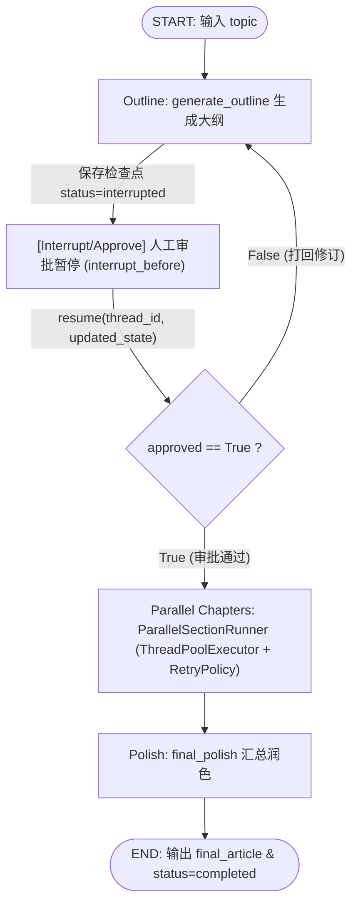

# Day 42 需求文档（PRD）、架构设计与 GitLab 协作记录

## 1. 旁白：高级 LangGraph 编排——从“能跑通”到“可暂停、可并发、可自愈”的生产级智能体

> **🎙️ 讲师旁白**：欢迎来到星辰数科《智枢企业级智能体平台》第四阶段（Agent Development）Day 42！在上一节中，我们掌握了基础的状态图（StateGraph）流转，但真实企业场景远比单向流水线复杂：长耗时写作任务如果在半路崩溃，难道要从头再来？大纲生成偏离预期，业务专家能否在写正文前“按下暂停键”并直接修改大纲？十几个章节串行生成耗时太长，如何并发提速？某个章节调用模型 API 偶发超时，如何仅重试该节点而不拖垮整张图？今天，Tech Lead 张工下发 **Issue #042（`v0.4.0-day42`）**，带我们亲手构建 **SQLiteCheckpointer 持久化检查点、Human-in-the-loop（`interrupt_before` / `resume`）、`ParallelSectionRunner` 并发节点与 `RetryPolicy` 节点级重试**，并落地企业级 **Writing Agent（长文写作智能体）**！

---

## 2. GitLab Issue #042：高级 LangGraph 状态图引擎与写作智能体研发

- **提出人**：产品经理 林晓 / Tech Lead 张工
- **指派给**：AI 应用开发工程师 陈默
- **关联分支**：`feature/day-42-langgraph-advanced`
- **目标版本**：`v0.4.0-day42`

### 2.1 业务与技术需求描述
1. **`SQLiteCheckpointer` 状态持久化与线程隔离**：
   - 基于 SQLite 持久化图每一步执行后的 `state`、`next_node`、`step` 与 `status`（`running` / `interrupted` / `completed`）。
   - 严格按 `thread_id` 隔离不同用户/任务的执行上下文，支持 `get_latest(thread_id)`、`get_history(thread_id)` 与跨进程重启恢复。
2. **Human-in-the-loop（`interrupt_before` & `resume`）**：
   - 支持在 `compile(checkpointer=..., interrupt_before=[...])` 中声明人工审批拦截点。
   - 命中拦截点时立即保存 `"interrupted"` 检查点并挂起；人工审核后通过 `resume(thread_id, updated_state)` 注入修改后的状态（如修订大纲、`approved=True/False`）并从断点精确继续。
3. **`ParallelSectionRunner` 并发章节撰写器**：
   - 基于 `ThreadPoolExecutor` 对大纲中的多个章节进行并发撰写，并在汇总时严格保持原始大纲索引顺序。
4. **节点级重试策略（`RetryPolicy`）**：
   - 支持在 `add_node(..., retry_policy=...)` 与 `ParallelSectionRunner` 中配置 `max_retries`、`initial_delay_s`、`backoff_factor` 与 `retry_on` 异常白名单，实现指数退避自愈。
5. **端到端 Writing Agent 工作流**：
   - 串联 `generate_outline` -> `human_approval`（前驱拦截）-> `parallel_chapters` -> `final_polish`，支持审批不通过时打回重生成大纲。

---

### 2.2 高级 LangGraph 写作智能体架构

> **💡 架构师笔记（为什么并发结果必须按索引重排？）**：
> `ThreadPoolExecutor` 结合 `as_completed()` 可以第一时间回收先完成的章节并捕获异常，但各章节完成时间并不固定（例如第 3 章可能比第 1 章更快返回）。如果直接按完成顺序拼接，整篇文章的逻辑顺序就会错乱。`ParallelSectionRunner` 通过维护 `results[res.index] = res` 并在最后按 `[results[i] for i in range(len(sections))]` 输出，兼顾了多线程并发吞吐与章节顺序的 100% 确定性。

---

## 3. GitLab Merge Request !042 评审记录

- **提交说明**：`feat(day-42): 实现 SQLiteCheckpointer、Interrupt/Resume、并发节点、重试策略与 Writing Agent (v0.4.0-day42)`
- **Tech Lead 张工 Review 意见**：
  - `[通过]` `SQLiteCheckpointer` 使用 `(thread_id, id DESC)` 索引并支持 `get_history()` 时间旅行审计，多线程/多任务隔离清晰。
  - `[通过]` `CompiledAdvancedGraph.resume()` 校验仅允许 `"interrupted"` 状态的线程恢复，避免误恢复已完成或不存在的任务；且通过 `skip_interrupt_on_first=True` 保证恢复后不会在同一节点再次死锁拦截。
  - `[通过]` `RetryPolicy` 校验了 `max_retries >= 0`、`backoff_factor >= 1.0` 等边界条件，异常白名单设计符合生产规范。
- **QA 李婷 测试结果**：
  - `pytest project_iterations/day_42/tests -v` 全部 5 项核心测试（SQLite 持久化与线程隔离、Interrupt/Resume 状态注入、ParallelSectionRunner 并发与保序、RetryPolicy 瞬时恢复与耗尽抛出、Writing Agent 驳回重写与跨重启端到端验收）100% PASS。
  - `verify_day.py` Notebook 与单元测试双校验通过，准予合并至 `main` 并打标 `v0.4.0-day42`。
