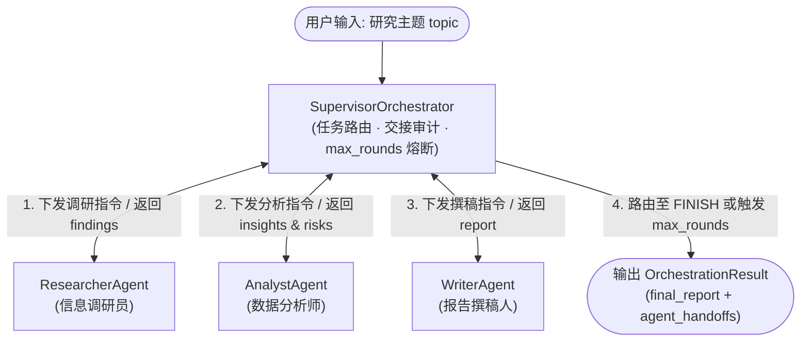

# Day 43 需求文档（PRD）、架构设计与 GitLab 协作记录

## 1. 旁白：多智能体协作系统——从“单兵全能”走向“Supervisor 专职分工”

> **🎙️ 讲师旁白**：欢迎来到星辰数科《智枢企业级智能体平台》第四阶段（Agent Development）Day 43！随着企业任务越来越复杂，我们很快会发现单个大语言模型 Agent 在同时承担“信息检索 + 数据分析 + 报告撰写”时，往往会出现系统提示词臃肿、工具误触发以及注意力分散的问题。真正成熟的工程解法是**多智能体协作（Multi-Agent Systems）**：让 **ResearcherAgent** 专注检索事实，让 **AnalystAgent** 专注提炼洞察与风险，让 **WriterAgent** 专注结构化撰稿，并由 **SupervisorOrchestrator** 作为“项目经理”统一调度、追踪 `agent_handoffs` 交接轨迹，并通过 `max_rounds` 防止无限循环。今天，Tech Lead 张工正式下发 **Issue #043（`v0.4.0-day43`）**，带我们落地智枢平台首个生产级 Supervisor 多智能体研究团队！

---

## 2. GitLab Issue #043：Supervisor 多智能体协作系统研发

- **提出人**：产品经理 林晓 / Tech Lead 张工
- **指派给**：AI 应用开发工程师 陈默
- **关联分支**：`feature/day-43-multi-agent-supervisor`
- **目标版本**：`v0.4.0-day43`

### 2.1 业务与技术需求描述
1. **标准化专职智能体抽象（`AgentWorker`）**：
   - 定义统一的 `AgentWorker` 抽象基类，规范 `name`、`role`、`description` 与 `execute(task, context) -> WorkerResult` 接口契约。
2. **三大核心专职角色落地**：
   - `ResearcherAgent`：负责围绕目标主题检索背景事实与行业动态，产出 `findings` 写入共享上下文。
   - `AnalystAgent`：基于 `findings` 进行结构化对比、量化指标汇总与风险识别，产出 `insights`、`risks` 与 `metrics`。
   - `WriterAgent`：综合调研事实与分析洞察，撰写结构化 Markdown 研究报告，产出 `report`。
3. **`SupervisorOrchestrator` 中央调度器**：
   - 支持默认确定性路由（`researcher -> analyst -> writer -> FINISH`）以及自定义 `router_fn` 策略。
   - 全程记录 `agent_handoffs: list[HandoffRecord]`（含轮次、源/目标智能体、任务指令与执行摘要），满足企业审计与可观测性要求。
   - 强制执行 `max_rounds` 轮次熔断机制：当路由发生异常循环时，到达上限立即终止并返回 `status="max_rounds_reached"` 与阶段性汇总报告。

---

### 2.2 Supervisor 多智能体协作架构

> **💡 架构师笔记（为什么选择 Supervisor 模式而非网状 Peer-to-Peer？）**：
> 在网状 Peer-to-Peer（点对点）架构中，每个 Agent 都需要感知其他所有 Agent 的能力并在提示词中决定“下一步交给谁”，一旦团队成员从 3 个扩展到 8 个，交接边数会呈 $O(N^2)$ 爆炸，极易出现互相推诿或死循环。而 **Supervisor 模式** 将路由决策收口到唯一的中央协调器，各 Worker 只需专注自身专业领域，不仅提示词更短、更稳定，还能在 Supervisor 层统一实现 `agent_handoffs` 全链路审计与 `max_rounds` 全局熔断。

---

## 3. GitLab Merge Request !043 评审记录

- **提交说明**：`feat(day-43): 实现 Supervisor 模式多智能体协作系统 (v0.4.0-day43)`
- **Tech Lead 张工 Review 意见**：
  - `[通过]` `AgentWorker` 抽象清晰，`ResearcherAgent` / `AnalystAgent` / `WriterAgent` 均支持注入自定义回调函数（`search_fn` / `analyze_fn` / `write_fn`），既方便离线单元测试，也能无缝对接真实 LLM 与向量检索工具。
  - `[通过]` `SupervisorOrchestrator` 在 `max_rounds` 边界处理严谨：当用满最后一轮恰好达成 `FINISH` 条件时仍能正确判定为 `completed`，未达成时则降级输出阶段性汇总并标记 `max_rounds_reached`。
  - `[通过]` `register_worker()` 与 `router_fn` 的扩展设计使得后续接入 `ReviewerAgent`、`FactCheckerAgent` 等新角色无需修改核心调度循环。
- **QA 李婷 测试结果**：
  - `pytest project_iterations/day_43/tests -v` 全部 5 项核心测试（默认 Supervisor 路由与交接追踪、自定义回调上下文透传、`max_rounds` 死循环熔断、非法参数与未注册角色边界校验、扩展 `ReviewerAgent` 四阶段评审流）100% PASS。
  - `verify_day.py` Notebook 与单元测试双校验通过，准予合并至 `main` 并打标 `v0.4.0-day43`。
