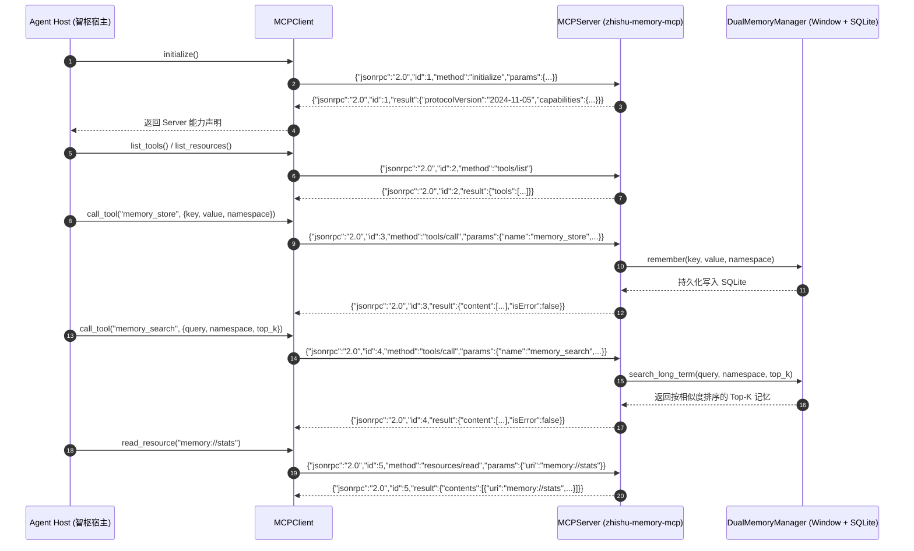

# Day 44 需求文档（PRD）、架构设计与 GitLab 协作记录

## 1. 旁白：MCP 标准化协议与双层记忆架构——打通智能体的“外接总线”与“海马体”

> **🎙️ 讲师旁白**：欢迎来到星辰数科《智枢企业级智能体平台》第四阶段（Agent Development）Day 44！在之前的课程中，智能体的工具都是硬编码在本地函数里的——每接入一个新数据源（如数据库、GitLab、企业知识库），都要重新写一遍胶水代码，形成了严重的 $M \times N$ 集成碎片化问题。同时，随着对话轮次增加，大模型上下文窗口不仅昂贵而且容易遗忘早期核心偏好。今天，Tech Lead 张工下发 **Issue #044（`v0.4.0-day44`）**，带我们亲手实现基于 **JSON-RPC 2.0 的 MCP（Model Context Protocol）Server 与 Client**，并构建 **DualMemoryManager 双层记忆架构（短期滑动窗口 + SQLite 长期键值/语义记忆）**！

---

## 2. GitLab Issue #044：MCP 协议栈与双层记忆系统研发

- **提出人**：产品经理 林晓 / Tech Lead 张工
- **指派给**：AI 应用开发工程师 陈默
- **关联分支**：`feature/day-44-mcp-memory`
- **目标版本**：`v0.4.0-day44`

### 2.1 业务与技术需求描述
1. **JSON-RPC 2.0 `MCPServer` 与 `MCPClient`**：
   - 严格遵循 JSON-RPC 2.0 报文规范（`jsonrpc: "2.0"`, `id`, `method`, `params` / `result` / `error`），内置标准错误码（`-32700` Parse Error、`-32600` Invalid Request、`-32601` Method Not Found、`-32602` Invalid Params、`-32603` Internal Error）。
   - 支持核心 MCP 生命周期方法：`initialize`（协议版本与能力协商）、`tools/list`、`tools/call`（含 `inputSchema.required` 校验与 `isError` 异常隔离）、`resources/list`、`resources/read`。
2. **`DualMemoryManager` 双层记忆管理器**：
   - **短期记忆（Short-Term Memory）**：按 `session_id` 隔离的 `deque(maxlen=window_size)` 滑动窗口，控制单次 Prompt 注入的最近对话轮次上限。
   - **长期记忆（Long-Term Memory）**：基于 SQLite 持久化存储，支持 `(namespace, mem_key)` 唯一约束的 `remember()` 写入/更新、`recall_key()` 精确键值检索、`search_long_term()` 词法/二元组余弦相似度检索与 `forget()` 删除。
   - **混合上下文构建**：通过 `build_context(session_id, query, namespace, top_k)` 将短期窗口对话与长期相关记忆融合输出。
3. **记忆赋能的 MCP 服务装配（`create_memory_enabled_mcp_server`）**：
   - 将 `memory_store`、`memory_recall`、`memory_search` 注册为标准 MCP Tools，将 `memory://stats` 与 `config://zhishu/agent` 注册为标准 MCP Resources。

---

### 2.2 MCP 协议交互时序图（JSON-RPC 2.0）

> **💡 架构师笔记（为什么采用“短期滑动窗口 + 长期 SQLite 记忆”双层架构？）**：
> 1. **成本与注意力控制**：如果把全量历史对话塞进上下文窗口，不仅 Token 费用呈线性增长，还会引发大模型的“Lost in the Middle”注意力退化。短期滑动窗口只保留最近 $W$ 轮对话，确保近期指代消解准确。
> 2. **跨会话事实沉淀**：用户偏好、业务规范、SLA 指标等关键事实通过 `remember()` 落盘到 SQLite 长期记忆库，即使进程重启或开启全新 `session_id`，依然可以通过 `recall_key()` 或 `search_long_term()` 毫秒级召回。

---

## 3. GitLab Merge Request !044 评审记录

- **提交说明**：`feat(day-44): 实现 JSON-RPC 2.0 MCPServer/MCPClient 与 DualMemoryManager 双层记忆架构 (v0.4.0-day44)`
- **Tech Lead 张工 Review 意见**：
  - `[通过]` `MCPServer.handle_message()` 严格区分协议级错误（如 `-32602` 缺少必填参数，返回 JSON-RPC `error` 对象）与业务执行异常（返回 `result.isError = True`），符合 MCP 官方规范。
  - `[通过]` `DualMemoryManager` 通过 `namespace` 隔离多租户长期记忆，通过 `session_id` 隔离短期滑动窗口，数据结构清晰且支持跨实例持久化恢复。
  - `[通过]` 离线词法/二元组余弦相似度检索无需外部 Embedding 服务即可在单元测试与教学环境中确定性运行，后续可无缝替换为向量数据库后端。
- **QA 李婷 测试结果**：
  - `pytest project_iterations/day_44/tests -v` 全部 5 项核心测试（JSON-RPC 2.0 错误码校验、MCPClient/Server 全生命周期、短期滑动窗口淘汰、SQLite 长期记忆持久化与检索、记忆赋能 MCP 端到端闭环）100% PASS。
  - `verify_day.py` Notebook 与单元测试双校验通过，准予合并至 `main` 并打标 `v0.4.0-day44`。
