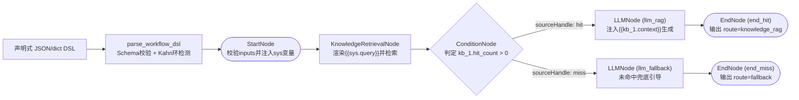

# Day 45 需求文档（PRD）、架构设计与 GitLab 协作记录

## 1. 旁白：第七周收官——低代码与高代码的架构边界及声明式 Workflow DSL 引擎

> **🎙️ 讲师旁白**：欢迎来到星辰数科《智枢企业级智能体平台》第四阶段（Agent Development）Day 45，也是第七周的收官之战！过去两周我们从 ReAct 循环、LangGraph 状态图、SQLiteCheckpointer 持久化、Multi-Agent 多智能体编排一路走到 MCP 工具生态。但企业落地时总会遇到一个灵魂拷问：**“既然 Dify / Coze 拖拉拽就能搭出工作流，为什么我们还要写高代码（Pro-Code）？两者的边界到底在哪里？”** 今天，Tech Lead 张工下发 **Issue #045（`v0.4.0-day45`）**，一方面在架构上划清 **低代码（Low-Code）与高代码（Pro-Code）** 的工程边界，另一方面带大家从零手写一个 **Dify/Coze 风格的 JSON/dict Workflow DSL 解析与 DAG 执行引擎**，彻底看透可视化画布背后的声明式执行原理！

---

## 2. GitLab Issue #045：低代码与高代码边界治理及 Workflow DSL 引擎研发

- **提出人**：产品经理 林晓 / Tech Lead 张工
- **指派给**：AI 应用开发工程师 陈默
- **关联分支**：`feature/day-45-workflow-dsl-engine`
- **目标版本**：`v0.4.0-day45`

### 2.1 低代码（Dify/Coze）vs 高代码（LangGraph/ZhiShu）架构边界

| 评估维度 | 低代码编排平台（Dify / Coze） | 高代码编排引擎（LangGraph / 智枢 Pro-Code） |
| :--- | :--- | :--- |
| **适用场景** | 标准 RAG 问答、轻量表单审批、运营活动 Bot、快速 MVP 验证 | 复杂循环状态机、长耗时 Human-in-the-loop、高并发风控、深度业务耦合 |
| **控制流表达** | 声明式 DAG（JSON/YAML DSL），节点类型有限且固定 | 图灵完备 Python 代码，支持任意条件边、动态子图与自定义 RetryPolicy |
| **状态持久化** | 平台内置对话历史与有限变量池（Variable Pool） | 精细化 Checkpointer（SQLite/Postgres），支持时间旅行与断点精确恢复 |
| **研发与运维** | 产品/运营可自助配置、秒级发布；但复杂逻辑调试与 Git 版本 Diff 困难 | 需研发介入，但具备完整的 pytest 单测、CI/CD 门禁、类型检查与可观测性 |
| **智枢平台定位** | 对外提供可视化 Workflow 画布，底层编译导出为标准 DSL JSON | 作为核心运行时内核，既可执行高代码图，也可解析执行低代码导出的 DSL |

### 2.2 业务与技术需求描述
1. **声明式 DSL 解析与 DAG 校验（`parse_workflow_dsl`）**：
   - 支持 JSON 字符串或 Python `dict` 格式的 Workflow DSL（包含 `nodes` 与 `edges`）。
   - 校验有且仅有一个 `StartNode`、至少一个 `EndNode`，检查重复节点 ID、悬空边与自环边，并通过 **Kahn 拓扑排序算法** 执行 DAG 环检测（禁止循环依赖）。
2. **五大核心节点实现**：
   - `StartNode`：校验必填输入变量（`required`）与默认值，注入 `sys` 命名空间与 `start` 节点输出。
   - `KnowledgeRetrievalNode`：渲染 `{{sys.query}}` 查询模板，调用可插拔 `retriever_fn`（内置离线 Mock 知识库）返回 `documents`、`hit_count` 与 `context`。
   - `ConditionNode`：支持多 `cases` 规则与 `and` / `or` 逻辑组合（`equals` / `contains` / `gt` / `lt` / `is_empty` 等算子），输出 `selected_branch` 驱动下游 `sourceHandle` 路由。
   - `LLMNode`：渲染 `system_prompt` 与 `prompt` 模板，调用可插拔 `llm_fn` 生成推理文本。
   - `EndNode`：按 `outputs` 映射规则提取并渲染最终输出字段。
3. **变量插值引擎（`render_template` / `resolve_variable`）**：
   - 支持 `{{sys.query}}`、`{{kb_1.hit_count}}` 及多层嵌套点分路径解析，严格模式下对未定义变量抛出 `WorkflowExecutionError`。

---

### 2.3 Workflow DSL 引擎执行架构图

> **💡 架构师笔记（为什么低代码画布的底层一定是 DAG + 变量池？）**：
> 在 Dify 或 Coze 的可视化编辑器中，用户在前端连线本质上是在构建一张有向无环图（DAG）的邻接表；而节点之间“引用上一节点的输出”则对应后端维护的全局分层变量池（`variables[node_id][field]`）。通过将执行逻辑抽象为 `WorkflowEngine.run(dsl, inputs)`，智枢平台实现了“配置即服务”：业务方改流程无需重启后端服务，只需更新 DSL JSON 即可热生效。

---

## 3. GitLab Merge Request !045 评审记录

- **提交说明**：`feat(day-45): 实现 Dify/Coze 风格 Workflow DSL 解析与 DAG 执行引擎 (v0.4.0-day45)`
- **Tech Lead 张工 Review 意见**：
  - `[通过]` `parse_workflow_dsl()` 使用 Kahn 算法做拓扑环检测并拦截自环边与孤立边，保证运行期不会陷入死循环。
  - `[通过]` `resolve_value()` 对单一占位符（如 `{{kb_1.hit_count}}`）保留原始数值/对象类型，而在复合模板中自动序列化为字符串，兼顾了 `ConditionNode` 数值比较与 `LLMNode` 文本拼接需求。
  - `[通过]` `KnowledgeRetrievalNode` 与 `LLMNode` 均支持依赖注入（`retriever_fn` / `llm_fn`），同时自带确定性离线 Mock，完美契合单元测试与课程实验环境。
- **QA 李婷 测试结果**：
  - `pytest project_iterations/day_45/tests -v` 全部 5 项核心测试（变量插值与严格模式、DSL 解析与环检测、RAG 命中/兜底双分支路由、自定义检索/LLM 注入与必填校验、ConditionNode 多逻辑算子组合）100% PASS。
  - 第七周综合测验（`weekly_quiz_and_answers.md`）与 `verify_day.py` 校验全部通过，准予合并至 `main` 并打标 `v0.4.0-day45`。
