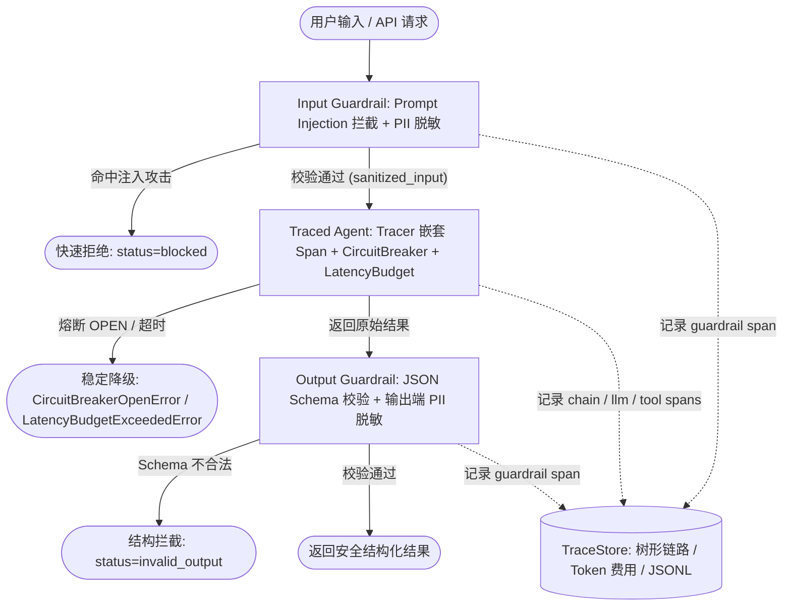

# Day 46 需求文档（PRD）、架构设计与 GitLab 协作记录

## 1. 旁白：Agent 稳定性、LangSmith 风格链路追踪与安全护栏

> **🎙️ 讲师旁白**：欢迎来到星辰数科《智枢企业级智能体平台》第四阶段（Agent Development）Day 46！当智能体从 Demo 走向生产环境，最让技术团队夜不能寐的往往不是“模型不够聪明”，而是三个工程难题：**黑盒难排障**（多步工具调用失败时不知道卡在哪一层、花了多少 Token 和美金）、**输入输出失控**（用户隐私 PII 泄露进模型日志、Prompt Injection 越狱攻击、JSON 结构输出畸形导致下游崩溃），以及**级联雪崩**（上游模型超时拖垮整个微服务线程池）。今天，Tech Lead 张工下发 **Issue #046（`v0.4.0-day46`）**，带我们亲手构建 **LangSmith 风格嵌套链路追踪器（`TraceSpan` / `Tracer` / `TraceStore`）**、**安全护栏引擎（`GuardrailsEngine`）** 与 **熔断器/延迟预算守卫（`CircuitBreaker` / `LatencyBudget`）**！

---

## 2. GitLab Issue #046：Agent 可观测性、安全护栏与稳定性防护研发

- **提出人**：产品经理 林晓 / Tech Lead 张工
- **指派给**：AI 应用开发工程师 陈默
- **关联分支**：`feature/day-46-observability-guardrails`
- **目标版本**：`v0.4.0-day46`

### 2.1 业务与技术需求描述
1. **LangSmith 风格嵌套链路追踪（`TraceSpan`、`Tracer`、`TraceStore`）**：
   - 基于 Python `contextvars` 自动维护 `trace_id` 与 `parent_run_id` 父子上下文，无需显式传参即可构建多层级嵌套 Span 树（`chain` / `llm` / `tool` / `guardrail`）。
   - 精确记录每个 Span 的 `latency_ms`（毫秒级耗时）、`TokenUsage`（`prompt_tokens`、`completion_tokens`、`total_tokens`、`cost_usd`）以及异常状态与错误堆栈，并支持树形重建与 JSONL 导出。
2. **安全护栏引擎（`GuardrailsEngine`）**：
   - **PII 脱敏**：在请求进入模型前及输出返回前，自动识别并脱敏中国大陆 11 位手机号、18 位身份证号与电子邮箱。
   - **Prompt Injection 拦截**：识别常见中英文提示词注入/越狱攻击模式，支持拦截或抛出 `GuardrailViolation`。
   - **JSON Schema 输出校验**：校验结构化输出是否合法 JSON 并满足 `type`、`required`、`enum`、`minLength`、`minimum`/`maximum` 约束。
3. **稳定性与延迟预算防护（`CircuitBreaker`、`LatencyBudget`）**：
   - 实现 `CLOSED` -> `OPEN` -> `HALF_OPEN` 三态熔断器，连续失败达到 `failure_threshold` 后快速失败，冷却 `recovery_timeout_s` 后自动半开探测恢复。
   - 提供 `LatencyBudget` 守卫，超时时抛出 `LatencyBudgetExceededError` 或返回超限告警。
4. **端到端受护栏保护的管道（`GuardedAgentRunner`）**：
   - 串联 `Input Guardrail -> Traced Agent -> Output Guardrail -> Trace Store`，提供开箱即用的生产级执行入口。

---

### 2.2 全链路可观测性与护栏架构

> **💡 架构师笔记（为什么必须用 `contextvars` 而不是全局变量记录 `parent_run_id`？）**：
> 在并发或异步智能体服务中，多个请求可能在同一进程内交替执行。如果使用普通全局变量保存当前活跃的 `run_id`，不同请求的 Span 就会互相串台。`contextvars.ContextVar` 为每个执行上下文提供天然隔离，配合 `with tracer.start_span(...)` 的 `try ... finally: reset(token)` 机制，既能实现“零侵入”自动嵌套父子 Span，又能保证异常发生时上下文栈不会泄漏。

---

## 3. GitLab Merge Request !046 评审记录

- **提交说明**：`feat(day-46): 实现 TraceSpan/Tracer 嵌套追踪、GuardrailsEngine 安全护栏与 CircuitBreaker 熔断器 (v0.4.0-day46)`
- **Tech Lead 张工 Review 意见**：
  - `[通过]` `GuardrailsEngine.redact_pii()` 先匹配 18 位身份证号、再匹配 11 位手机号，避免了身份证号中间连续 11 位数字被误拆脱敏的边界 Bug。
  - `[通过]` `GuardedAgentRunner.run()` 在退出 `root_span` 上下文后再聚合 `trace_summary`，确保根节点的 `total_latency_ms` 统计准确无误。
  - `[通过]` `CircuitBreaker` 严格校验 `failure_threshold >= 1`、`recovery_timeout_s >= 0`，且 `HALF_OPEN` 探测失败会立即重新跳闸至 `OPEN`。
- **QA 李婷 测试结果**：
  - `pytest project_iterations/day_46/tests -v` 全部 6 项核心测试（嵌套 Tracer 与费用统计、异常捕获与重抛、PII 脱敏与注入拦截、JSON Schema 校验、熔断器三态流转与延迟预算、端到端 `GuardedAgentRunner`）100% PASS。
  - `verify_day.py` Notebook 与单元测试双校验通过，准予合并至 `main` 并打标 `v0.4.0-day46`。
