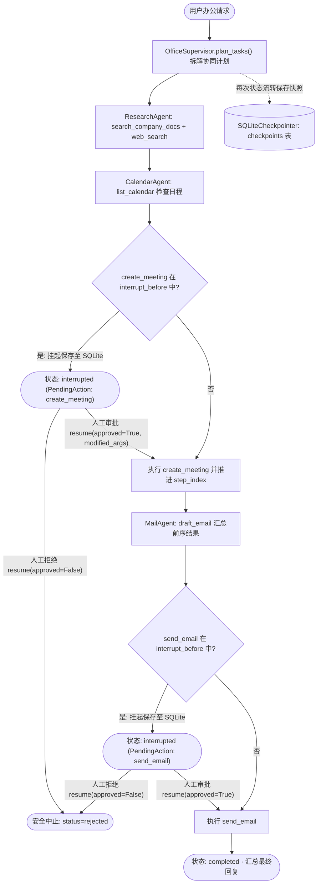

# Day 48 需求文档（PRD）、架构设计与 GitLab 协作记录

## 1. 旁白：里程碑项目 3（Part 1）——多 Agent 智能办公助手核心编排与工具集

> **🎙️ 讲师旁白**：欢迎来到星辰数科《智枢企业级智能体平台》第四阶段（Agent Development）Day 48！从今天起，我们正式开启**里程碑项目 3：多 Agent 智能办公助手（Part 1：核心编排与工具集）**。在真实的企业办公场景中，单打独斗的“全能型单体 Agent”往往因为提示词过长、工具列表膨胀而出现幻觉与误操作。更致命的是，一旦涉及**对外发送邮件（`send_email`）**或**创建正式会议（`create_meeting`）**等不可逆高危写操作，任何自动化误触发都可能酿成严重事故。今天，产品经理林晓与 Tech Lead 张工联合下发 **Issue #048（`v0.4.0-day48`）**，要求我们构建基于 **Supervisor 协同编排 + 6 大企业办公工具 + SQLite 断点持久化审批（HITL）** 的多 Agent 智能办公底座！

---

## 2. GitLab Issue #048：多 Agent 智能办公助手核心编排研发

- **提出人**：产品经理 林晓 / Tech Lead 张工
- **指派给**：AI 应用开发工程师 陈默
- **关联分支**：`feature/day-48-multi-agent-office`
- **目标版本**：`v0.4.0-day48`

### 2.1 业务与技术需求描述
1. **三专职协同子 Agent + 主管调度器（`OfficeSupervisor`）**：
   - **`ResearchAgent`**：专注资料调研，集成企业知识库检索与联网检索能力，为后续决策与邮件编写提供事实依据。
   - **`CalendarAgent`**：专注日程协调，先查询日历冲突，再决定是否创建正式会议。
   - **`MailAgent`**：专注邮件沟通，自动汇总前序 Agent 产出生成邮件草稿，并支持正式发送。
   - **`OfficeSupervisor`**：负责意图拆解与多步路由规划（`plan_tasks`），按序调度子 Agent 并维护全局共享状态 `OfficeState`。
2. **6 大标准企业办公工具（`create_default_tools`）**：
   - 低危只读/草稿工具：`list_calendar`、`draft_email`、`search_company_docs`、`web_search`。
   - 高危写/通信工具：`create_meeting`、`send_email`。
3. **SQLite 断点持久化与人工审批恢复（`SQLiteCheckpointer` + `interrupt_before`）**：
   - 支持配置 `interrupt_before={"create_meeting", "send_email"}`。
   - 当子 Agent 准备执行高危工具时，立即挂起执行并保存 `PendingAction` 与完整 `OfficeState` 至 SQLite（按 `thread_id` 隔离）。
   - 支持跨进程/跨实例调用 `supervisor.resume(thread_id, approved=..., modified_args=...)`，实现“审批通过继续”、“参数微调后执行”以及“人工拒绝安全中止”。

---

### 2.2 多 Agent 协同与 HITL 断点恢复架构

> **💡 架构师笔记（为什么必须将 `OfficeState` 落盘 SQLite 而不是只存在内存字典？）**：
> 真实办公审批往往跨越数分钟甚至数小时，期间后端服务可能发生滚动发布或容器重启。通过 `SQLiteCheckpointer` 将 `plan`、`current_step_index`、`agent_outputs` 与 `pending_action` 序列化存储，即使 `OfficeSupervisor` 实例销毁重建，只要传入相同的 `thread_id` 即可精准断点续跑。

---

## 3. GitLab Merge Request !048 评审记录

- **提交说明**：`feat(day-48): 实现多 Agent 智能办公助手核心编排、6 大工具与 SQLite 断点恢复 (v0.4.0-day48)`
- **Tech Lead 张工 Review 意见**：
  - `[通过]` 每个子 Agent 通过 `allowed_tools` 严格限制工具权限边界（如 `MailAgent` 无法越权调用 `create_meeting`），符合最小权限原则。
  - `[通过]` `OfficeSupervisor.resume()` 支持 `modified_args` 参数覆盖，满足业务上“审批人微调会议时间或邮件收件人后再放行”的高频需求。
  - `[通过]` `SQLiteCheckpointer` 支持 `:memory:` 与文件路径双模式，单元测试使用 `pytest` `tmp_path` 隔离，无污染。
- **QA 李婷 测试结果**：
  - `pytest project_iterations/day_48/tests -v` 全部 4 项核心测试（6 大办公工具、无中断协同流程、跨实例 SQLite 断点恢复与参数微调、人工拒绝与非法恢复校验）100% PASS。
  - `verify_day.py` Notebook 与单元测试双校验通过，准予合并至 `main` 并打标 `v0.4.0-day48`。
