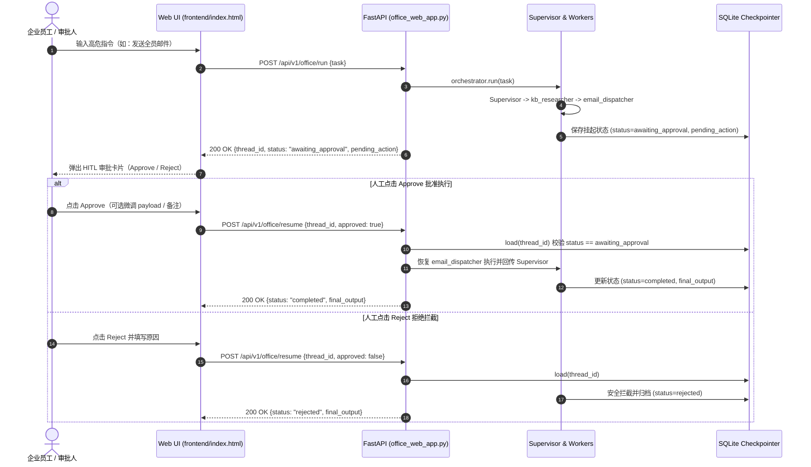

# Day 49 需求文档（PRD）、架构设计与 GitLab 协作记录

## 1. 旁白：里程碑项目 3（Part 2）—— 多 Agent 智能办公助手全栈交付

> **🎙️ 讲师旁白**：欢迎来到星辰数科《智枢企业级智能体平台》第四阶段（Agent Development）Day 49！在完成多 Agent 编排与安全护栏底座后，今天我们将迎来 **里程碑项目 3 的全栈交付（`v0.4.0-day49`）**。在真实企业办公场景中，员工希望用一句话让智能体“查制度、发全员邮件、批报销、订会议室”。但“发全员邮件”和“财务审批”属于不可逆的高危外部副作用操作，绝不能让模型擅自执行！今天，Tech Lead 张工下发 **Issue #049**，要求我们基于 **FastAPI + SQLite 检查点持久化 + Human-in-the-Loop（HITL）人工审批前端**，交付端到端可运行、可中断、可恢复的“多 Agent 智能办公助手”。

---

## 2. GitLab Issue #049：多 Agent 智能办公助手全栈版（Project 3 Full-Stack Delivery）

- **提出人**：产品经理 林晓 / Tech Lead 张工
- **指派给**：AI 应用开发工程师 陈默
- **关联分支**：`feature/day-49-office-hitl-fullstack`
- **目标版本**：`v0.4.0-day49`

### 2.1 业务与技术需求描述
1. **多 Agent 协作与风险分级路由（`OfficeOrchestrator`）**：
   - `Supervisor` 接收自然语言办公指令，根据风险语义路由至专职 Worker：
     - **只读检索类**（`kb_researcher`）：查询制度、汇总纪要等低风险任务，直接返回 `status="completed"`。
     - **高危副作用类**（`email_dispatcher`、`finance_approver`、`meeting_scheduler`）：在 `kb_researcher` 收集上下文并生成待执行 `pending_action` 后，主动触发 **HITL 中断**，挂起线程并返回 `status="awaiting_approval"` 与 `thread_id`。
2. **SQLite 检查点持久化（`OfficeCheckpointer`）**：
   - 将每个 `thread_id` 的完整 `ThreadState`（含 `handoff_trace`、`pending_action`、`resolved_action`、`final_output`）持久化至 SQLite `office_threads` 表，确保跨请求与服务重启后仍可精确恢复。
3. **FastAPI 全栈接口与 CORS 支持（`office_web_app.py`）**：
   - 配置 `CORSMiddleware`，支持前后端分离联调。
   - `GET /`：托管 `frontend/index.html` 多 Agent 智能办公工作台。
   - `POST /api/v1/office/run`：启动任务，返回 `completed` 或 `awaiting_approval`。
   - `POST /api/v1/office/resume`：接收人工审批决策（`approved: bool`、`comment`、可选 `edited_payload`），从检查点恢复执行或安全拦截；对非 `awaiting_approval` 状态的线程返回 `409 Conflict`。
   - `GET /api/v1/office/threads/{thread_id}` & `GET /api/v1/office/threads`：查询线程状态与历史列表。
4. **Human-in-the-Loop 审批前端（`frontend/index.html`）**：
   - 展示实时 Agent 流转轨迹（Handoff Trace）、待审批高危动作卡片（含 JSON 载荷与 **Approve / Reject** 按钮），以及最终执行回执。

---

### 2.2 HITL 全链路时序架构（Sequence Diagram）

> **💡 架构师笔记（为什么 `resume` 必须校验状态机幂等性？）**：
> 在真实 Web 场景中，审批人可能双击按钮或同时打开两个浏览器标签页对同一 `thread_id` 提交审批。`OfficeOrchestrator.resume()` 严格校验 `state.status == "awaiting_approval"`，一旦已进入 `completed` 或 `rejected` 终态，重复调用将触发 `InvalidThreadStateError` 并由 FastAPI 返回 `409 Conflict`，从根本上杜绝重复发邮件或重复扣款。

---

## 3. GitLab Merge Request !049 评审记录

- **提交说明**：`feat(day-49): 交付多 Agent 智能办公助手全栈版 (FastAPI + SQLite HITL Checkpointer + Web UI) (v0.4.0-day49)`
- **Tech Lead 张工 Review 意见**：
  - `[通过]` `create_app(db_path=..., frontend_dir=...)` 工厂函数支持依赖注入，`pytest` 可通过 `tmp_path` 实现 100% 隔离测试。
  - `[通过]` `_classify_task()` 对“查询公司差旅报销制度”等只读检索请求做了语义豁免，避免误触发财务审批中断。
  - `[通过]` `resume()` 支持 `edited_payload`，允许人类审批人在放行前微调邮件主题或会议室参数，符合企业级 HITL 最佳实践。
- **QA 李婷 测试结果**：
  - `pytest project_iterations/day_49/tests -v` 全部 5 项测试（前端页面与健康检查、CORS 预检、低风险直通、HITL 中断与批准恢复 + 409 防重入、HITL 拒绝拦截与 404 校验）100% PASS。
  - `verify_day.py` Notebook 与单元测试双校验通过，准予合并至 `main` 并打标 `v0.4.0-day49`。
