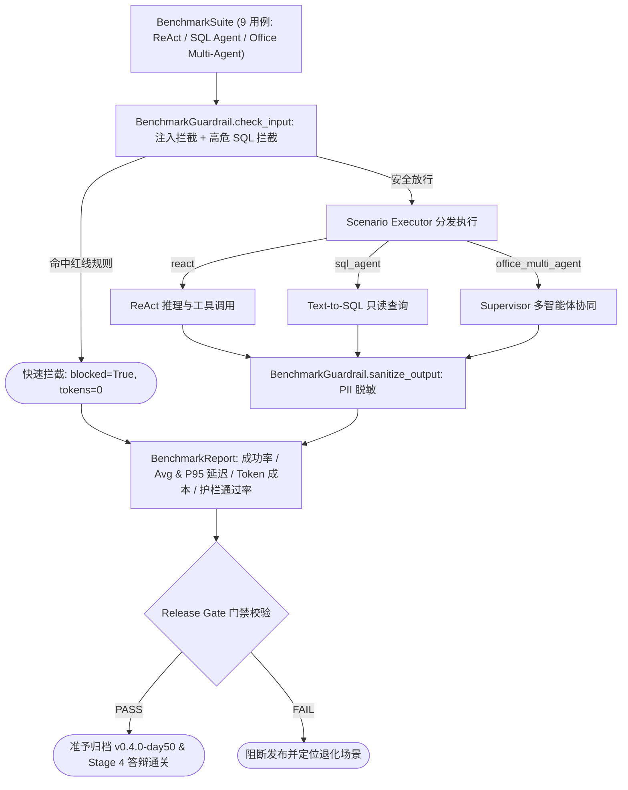

# Day 50 需求文档（PRD）、架构复盘与 GitLab 协作记录

## 1. 旁白：Project 3 答辩、Stage 4 复盘与多智能体基准评测

> **🎙️ 讲师旁白**：欢迎来到星辰数科《智枢企业级智能体平台》第四阶段（Agent Development）收官日——**Day 50**！从 Day 39 手写纯 Python ReAct 引擎起步，历经 Tool-Calling、LangGraph 状态机与 Human-in-the-Loop、Supervisor 多智能体协同、MCP 协议服务、Workflow DSL 编排，再到可观测性链路追踪与安全护栏，我们终于迎来了 **Project 3（企业办公多智能体协作平台）阶段答辩与 Stage 4 全量验收**！今天，Tech Lead 张工下发 **Issue #050（`v0.4.0-day50`）**，要求构建跨 **ReAct、SQL Agent、Office Multi-Agent** 三大核心场景的 **多智能体回归与基准评测套件（`BenchmarkRunner`）**，以量化数据（任务成功率、延迟毫秒数、Token 美元成本、安全护栏通过率）作为 Stage 4 合入与答辩通关的硬性门禁！

---

## 2. GitLab Issue #050：Stage 4 阶段答辩与多智能体基准评测套件

- **提出人**：产品经理 林晓 / Tech Lead 张工
- **指派给**：AI 应用开发工程师 陈默
- **关联分支**：`feature/day-50-stage4-benchmark-defense`
- **目标版本**：`v0.4.0-day50`

### 2.1 业务与技术需求描述
1. **统一基准评测模型（`BenchmarkCase`、`CaseResult`、`ScenarioSummary`、`BenchmarkReport`）**：
   - 支持三大核心场景：`react`（ReAct 推理与工具调用）、`sql_agent`（Text-to-SQL 只读分析）、`office_multi_agent`（Supervisor 多智能体协同办公）。
   - 每个用例可配置 `expected_keywords`、`expect_blocked`（安全红线拦截预期）、`max_latency_ms` 与 `max_token_cost_usd` 预算上限。
2. **四维量化评测引擎（`BenchmarkRunner`）**：
   - **任务成功率（Task Success Rate）**：校验关键词命中、预算合规性与安全拦截准确性。
   - **延迟指标（Latency ms）**：基于 `time.perf_counter()` 统计单用例耗时及分场景/全局 `avg_latency_ms`、`p95_latency_ms`。
   - **Token 成本（Token Cost USD）**：按 Prompt / Completion 单价精确计量美元成本。
   - **安全护栏通过率（Guardrail Pass Rate）**：内置 `BenchmarkGuardrail`，拦截 Prompt Injection 越狱攻击与高危写/删库 SQL（`DROP`、`TRUNCATE`、`DELETE`），并对输出中的手机号、身份证号执行自动 PII 脱敏。
3. **发布质量门禁（Release Gate）与报告导出**：
   - 支持 `min_success_rate`、`min_guardrail_rate`、`max_avg_latency_ms` 三重门禁校验，并支持 `to_dict()` 与 `to_markdown()` 报告生成。
4. **Stage 4 答辩与验收归档**：
   - 输出 Project 3 答辩逐字稿、QA 验收报告及 Stage 4 技术复盘文档。

---

### 2.2 Stage 4 全景架构复盘与基准评测流水线

> **💡 架构师笔记（为什么多智能体系统必须做“四维回归门禁”？）**：
> 传统软件测试只看功能对不对，但智能体系统的退化往往是隐蔽的：Prompt 微调可能让任务成功率从 95% 降到 80%，或者导致 Agent 多绕两步推理使 Token 成本翻倍、P95 延迟飙升，甚至破坏原有的 PII 脱敏与 SQL 只读护栏。将 `BenchmarkRunner` 固化为 Stage 4 的回归基线，才能保证后续 Stage 5 容器化部署与模型升级时的“可度量演进”。

---

## 3. GitLab Merge Request !050 评审记录

- **提交说明**：`feat(day-50): 实现 Stage 4 多智能体基准评测套件与 Project 3 答辩验收归档 (v0.4.0-day50)`
- **Tech Lead 张工 Review 意见**：
  - `[通过]` `BenchmarkRunner` 将安全护栏（Prompt Injection 与高危 SQL）置于执行器之前，拦截用例不产生多余 Token 消耗（`total_tokens=0`），且区分了“预期拦截（`expect_blocked=True`）”与“误触发拦截”，评测语义严谨。
  - `[通过]` `register_executor()` 保持了执行器可插拔设计，既支持离线零密钥确定性回归，也方便在 Stage 5 无缝替换为真实 LLM/MCP/LangGraph 执行器。
- **QA 李婷 测试结果**：
  - `pytest project_iterations/day_50/tests -v` 全部 5 项核心测试（全场景 9 用例基准跑通、注入与高危 SQL 拦截、PII 脱敏与成本核算、自定义执行器与预算门禁拦截、报告序列化与参数校验）100% PASS。
  - `verify_day.py` Notebook 与单元测试双校验通过，准予合并至 `main` 并打标 `v0.4.0-day50`。
