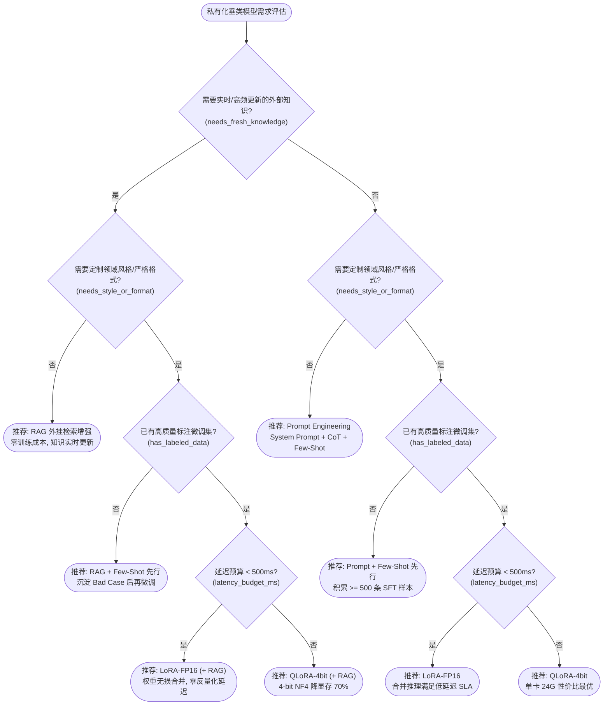

# Day 51 需求文档（PRD）、架构设计与 GitLab 协作记录

## 1. 旁白：迈入 Stage 5——大模型微调理论、决策树与算力预算评估

> **🎙️ 讲师旁白**：欢迎来到星辰数科《智枢企业级智能体平台》第五阶段（Model Fine-Tuning & Production Deployment）开篇第一课——**Day 51**！在 Stage 4 我们完成了多智能体编排与基准评测，但当智枢平台深入金融、法务、医疗等垂直行业私有化交付时，客户往往会问：“为什么不直接微调一个私有大模型？微调到底要买几张什么显卡？”今天，产品经理林晓正式下发 **Issue #051（`v0.5.0-day51`）**，要求我们先从**工程经济学与显存物理学**出发，构建一套**模型适配决策树（Prompt vs RAG vs LoRA vs QLoRA）**与 **GPU 训练显存预算计算器（`vram_calculator.py`）**，避免团队盲目上马高成本微调项目！

---

## 2. GitLab Issue #051：私有化垂类模型微调可行性与算力预算评估

- **提出人**：产品经理 林晓 / Tech Lead 张工
- **指派给**：AI 应用开发工程师 陈默
- **关联分支**：`feature/day-51-finetuning-vram-calculator`
- **目标版本**：`v0.5.0-day51`

### 2.1 业务与技术需求描述
1. **模型适配策略决策树（`recommend_adaptation_strategy`）**：
   - 接收四个核心工程约束：`needs_fresh_knowledge`（是否需实时/动态知识）、`needs_style_or_format`（是否需固定风格或结构化格式）、`has_labeled_data`（是否已具备高质量标注集）、`latency_budget_ms`（端到端延迟预算）。
   - 自动决策推荐 `Prompt`、`RAG`、`LoRA` 或 `QLoRA`，并明确标注是否需要 `hybrid_with_rag`（RAG + 微调混合架构）。
2. **训练显存分项计算器（`estimate_training_vram_gb`）**：
   - 支持 `Full-FP16`、`LoRA-FP16`、`QLoRA-4bit` 三种训练范式。
   - 精确拆解五大显存组成部分：**模型权重（Weights）**、**梯度（Gradients）**、**AdamW 优化器状态（Optimizer States）**、**前向激活值（Activations，随 `batch_size` 与 `seq_len` 线性放缩）**以及 **CUDA 上下文开销（Overhead）**。
3. **GPU 硬件选型推荐（`recommend_gpu`）**：
   - 基于预估显存与安全余量阈值，自动映射至 `RTX 4090 24G`、`A100 40G`、`A100 80G` 或 `Multi-GPU`（ZeRO-3 / FSDP 分布式多卡），并给出单卡/多卡算力小时成本参考。

---

### 2.2 模型适配决策树（Mermaid `flowchart TD`）

> **💡 架构师笔记（为什么 Full-FP16 微调 7B 模型会瞬间爆显存？）**：
> 许多工程师误以为 7B 模型 FP16 权重只有 `14 GB`（$7 \times 10^9 \times 2\text{ B} \approx 13.04\text{ GiB}$），一张 24G 4090 就能全量微调。实际上，混合精度 AdamW 需要保存 FP32 主权重（4B/param）+ 一阶动量 $m$（4B/param）+ 二阶方差 $v$（4B/param），仅优化器状态就高达 `78.23 GiB`，加上权重 `13.04 GiB` 与梯度 `13.04 GiB`，总计超过 `108 GiB`！而 **QLoRA-4bit** 通过 NF4 量化基座 + 仅训练 ~0.8% 的 LoRA 参数 + Paged AdamW-8bit，可将 7B 模型训练显存压低至 `~7.55 GiB`，让消费级单卡成为现实。

---

## 3. GitLab Merge Request !051 评审记录

- **提交说明**：`feat(day-51): 实现微调策略决策树与 GPU 训练显存计算器 (v0.5.0-day51)`
- **Tech Lead 张工 Review 意见**：
  - `[通过]` `recommend_adaptation_strategy` 将“是否需要实时知识”与“是否具备标注数据”置于决策树上游，有效防止“用微调代替 RAG 灌输动态知识”或“无数据盲目微调”的常见架构误区。
  - `[通过]` `estimate_training_vram_gb` 对 `Full-FP16`、`LoRA-FP16`、`QLoRA-4bit` 的权重、梯度、AdamW 状态、激活值分项拆解清晰，且支持 `full`/`lora`/`qlora` 别名归一化与严格参数校验。
- **QA 李婷 测试结果**：
  - `pytest project_iterations/day_51/tests -v` 全部 5 项单元测试（Prompt/RAG 决策、LoRA/QLoRA 分支、Qwen2.5-7B 显存大小序验证、batch/seq_len 激活缩放、GPU 四档阈值与异常处理）100% PASS。
  - `verify_day.py` Notebook 与单元测试双校验通过，准予合并至 `main` 并打标 `v0.5.0-day51`。
