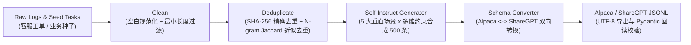

# Day 52 需求文档（PRD）、架构设计与 GitLab 协作记录

## 1. 旁白：从零构建高质量垂直领域指令微调数据集

> **🎙️ 讲师旁白**：欢迎来到星辰数科《智枢企业级智能体平台》第五阶段（Stage 5：大模型微调与私有化部署）**Day 52**！在 Stage 4 中我们完成了多智能体编排与基准评测，但通用基座模型在面对「企业级智能客服」的复杂退换货政策、数电专票红冲规则与 SLA 时效承诺时，往往会出现幻觉或答非所问。业界有句名言：**“Garbage in, garbage out.”（垃圾进，垃圾出）**——微调（SFT）成败的 80% 取决于**指令数据集的质量与多样性**。今天，Tech Lead 张工下发 **Issue #052（`v0.5.0-day52`）**，要求从零搭建标准化的指令数据集构建流水线，打通 **Alpaca / ShareGPT 双格式 Schema、文本清洗与去重（Exact Hash + N-gram Jaccard）、Self-Instruct 垂直数据合成与 JSONL 导出**全链路！

---

## 2. GitLab Issue #052：企业级客服指令微调数据集构建流水线

- **提出人**：产品经理 林晓 / Tech Lead 张工
- **指派给**：AI 应用开发工程师 陈默
- **关联分支**：`feature/day-52-instruction-dataset-builder`
- **目标版本**：`v0.5.0-day52`

### 2.1 业务与技术需求描述
1. **双格式强类型 Schema（`AlpacaSample` & `ShareGPTSample`）**：
   - 基于 Pydantic v2 实现 `AlpacaSample`（`instruction`、`input`、`output`、`system`、`category`）与 `ShareGPTSample`（`conversations` 列表，支持 `{"from": "human"|"gpt"|"system", "value": ...}` 标准别名序列化）。
   - 提供 `alpaca_to_sharegpt()` 与 `sharegpt_to_alpaca()` 双向转换器，确保单轮指令与系统提示词无损往返转换。
2. **数据清洗与两级去重引擎（`clean_and_deduplicate`）**：
   - **空白规范化**：剔除零宽字符（`\u200b`、`\ufeff`），折叠连续空格/制表符与多余空行。
   - **最小长度过滤**：过滤无效短指令（`len(instruction) < 4`）与过短回复（`len(output) < 8`）。
   - **精确 + 近似两级去重**：先执行 SHA-256 精确哈希去重，再基于字符 N-gram 倒排索引计算 Jaccard 相似度（默认阈值 `0.85`）拦截近似重复样本。
3. **Self-Instruct 垂直领域合成生成器（`generate_customer_service_dataset`）**：
   - 围绕智枢智能客服五大核心场景（`order_logistics`、`refund_aftersales`、`account_security`、`invoice_billing`、`vip_membership`），结合多维人设前缀、业务实体、时间窗口与附加约束，确定性合成 `count=500` 条高质量、低重复率指令样本。
4. **JSONL 持久化与统计分析**：
   - 实现 `export_jsonl()`、`load_jsonl()`（UTF-8 编码、自动建目录、逐行校验）与 `compute_dataset_stats()`。

---

### 2.2 指令数据集构建流水线架构

> **💡 架构师笔记（为什么必须做“精确哈希 + N-gram Jaccard”两级去重？）**：
> 仅靠 MD5/SHA-256 精确去重只能拦截一字不差的重复样本；但在真实客服日志和 Self-Instruct 合成中，大量样本仅仅是末尾多了“谢谢”、“请尽快处理”或一个标点符号。如果不做 N-gram Jaccard 近似去重，微调模型会在高频模板上严重过拟合（Loss 虚低、泛化崩塌）。同时，针对中文无空格分词的特点，采用**字符级 3-gram 倒排索引**既能保证中文语义片段的召回精度，又能将 500+ 样本的去重耗时控制在毫秒级。

---

## 3. GitLab Merge Request !052 评审记录

- **提交说明**：`feat(day-52): 实现 Alpaca/ShareGPT 指令数据集构建、清洗去重与 Self-Instruct 合成流水线 (v0.5.0-day52)`
- **Tech Lead 张工 Review 意见**：
  - `[通过]` `ShareGPTMessage` 使用 `ConfigDict(populate_by_name=True)` 与 `Field(..., alias="from")` 优雅解决了 Python 关键字 `from` 与 ShareGPT 标准 JSON 字段名冲突的问题，`export_jsonl` 时开启 `by_alias=True` 即可直接对接 LLaMA-Factory / Axolotl 训练框架。
  - `[通过]` `clean_and_deduplicate_with_stats()` 引入字符 N-gram 倒排索引加速候选集筛选，避免了对全量样本做 $O(N^2)$ 两两全量比对，500 条样本去重耗时仅数十毫秒。
  - `[建议]` 后续在 Day 53 接入 LoRA 微调时，可直接复用 `cs_sharegpt_500.jsonl` 作为 SFT 训练集。
- **QA 李婷 测试结果**：
  - `pytest project_iterations/day_52/tests -v` 全部 5 项核心测试（Pydantic 模型校验、Alpaca/ShareGPT 双向转换、空白清洗与两级去重、500 条合成数据集均衡性与零重复率、JSONL 导出回读）100% PASS。
  - `verify_day.py` Notebook 与单元测试双校验通过，准予合并至 `main` 并打标 `v0.5.0-day52`。
