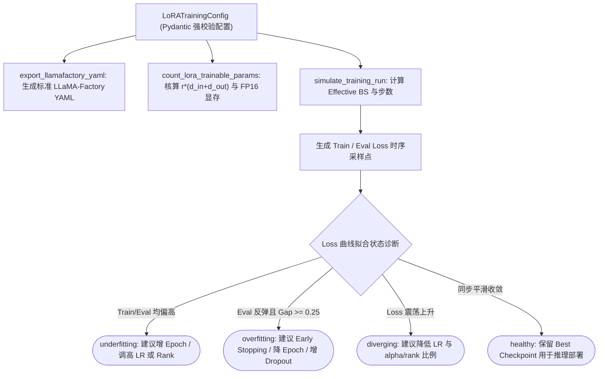

# Day 53 需求文档（PRD）、架构设计与 GitLab 协作记录

## 1. 旁白：从通用推理迈向领域定制——LLaMA-Factory LoRA 微调实战

> **🎙️ 讲师旁白**：欢迎来到星辰数科《智枢企业级智能体平台》第五阶段（微调与部署，Stage 5）的 **Day 53**！在前面的课程里，我们用 Prompt Engineering、RAG 与多智能体编排让大模型“学会调用工具”。但在企业真实业务中（如政务公文改写、金融 SQL 方言生成、垂直行业客服话术），仅靠 Prompt 往往面临 **上下文长度受限、格式稳定性不足、私有知识风格难以对齐** 的瓶颈。今天，Tech Lead 张工下发 **Issue #053（`v0.5.0-day53`）**，要求我们在智枢平台中落地 **LLaMA-Factory LoRA 微调配置生成、参数量精确核算与训练 Loss 曲线自动化诊断** 三大核心能力，让团队在提交 GPU 训练任务前，就能用工程化脚本算清显存账、生成零报错 YAML 配置并识别过拟合/欠拟合风险！

---

## 2. GitLab Issue #053：LLaMA-Factory LoRA 微调配置与诊断工具链

- **提出人**：产品经理 林晓 / Tech Lead 张工
- **指派给**：AI 应用开发工程师 陈默
- **关联分支**：`feature/day-53-llamafactory-lora-practice`
- **目标版本**：`v0.5.0-day53`

### 2.1 业务与技术需求描述
1. **标准化微调配置模型（`LoRATrainingConfig`）与 YAML 导出（`export_llamafactory_yaml`）**：
   - 使用 Pydantic 严格校验基座模型路径 `model_name_or_path`、`finetuning_type="lora"`、`lora_rank`、`lora_alpha`、`learning_rate`、`num_train_epochs`、`per_device_train_batch_size`、`gradient_accumulation_steps` 与对话模板 `template="qwen"`。
   - 一键导出符合 LLaMA-Factory `llamafactory-cli train <yaml>` 规范的训练配置文件，杜绝手写 YAML 缩进或字段拼写错误。
2. **LoRA 可训练参数数学与显存核算（`count_lora_trainable_params`）**：
   - 基于低秩分解公式 $\Delta W = B A$（其中 $A \in \mathbb{R}^{r \times d_{in}}$，$B \in \mathbb{R}^{d_{out} \times r}$），精确计算各目标模块（`q_proj` / `k_proj` / `v_proj` / `o_proj` 及 GQA/MLP 层）的可训练参数总量、占基座模型比例及 FP16 权重显存占用。
3. **训练仿真与 Loss 曲线诊断（`simulate_training_run`）**：
   - 根据有效批次大小（`Effective Batch Size = per_device_train_batch_size × gradient_accumulation_steps × num_gpus`）、总训练步数、学习率与 LoRA 缩放比例（`alpha / rank`），确定性模拟 `train_loss` 与 `eval_loss` 曲线。
   - 自动识别 `healthy`（健康收敛）、`underfitting`（欠拟合）、`overfitting`（过拟合）与 `diverging`（梯度发散）四种状态，并给出可执行超参调优建议。

---

### 2.2 LLaMA-Factory LoRA 微调与诊断流水线架构

> **💡 架构师笔记（为什么先算参数账与 Effective Batch Size 再上 GPU？）**：
> 很多初学者微调 7B/14B 模型时盲目把 `lora_rank` 设成 64、把 `num_train_epochs` 设成 10，结果不仅显存翻倍，还在 500 条小数据集上严重过拟合（模型把训练集“背下来”，一遇到新问题就胡言乱语）。通过 `LoRATrainingConfig` 与 `simulate_training_run` 在本地 CPU 上完成配置预检与超参直觉校准，可以把昂贵的 A100/H100 试错成本降到最低。

---

## 3. GitLab Merge Request !053 评审记录

- **提交说明**：`feat(day-53): 实现 LLaMA-Factory LoRA 配置生成器、参数量核算与 Loss 曲线诊断 (v0.5.0-day53)`
- **Tech Lead 张工 Review 意见**：
  - `[通过]` `LoRATrainingConfig` 通过 Pydantic 拦截了非法 `finetuning_type`、`lora_rank <= 0` 与负学习率，防止错误配置流入训练集群。
  - `[通过]` `count_lora_trainable_params` 同时支持标准方阵近似与 GQA/MLP 精确维度（`num_key_value_heads`、`intermediate_size`），兼顾教学直观性与工程精确度。
- **QA 李婷 测试结果**：
  - `pytest project_iterations/day_53/tests -v` 全部 4 项核心测试（配置默认值与校验、YAML 导出格式、LoRA 参数数学与 GQA 细分、四类 Loss 曲线诊断）100% PASS。
  - `verify_day.py` Notebook 与单元测试双校验通过，准予合并至 `main` 并打标 `v0.5.0-day53`。
