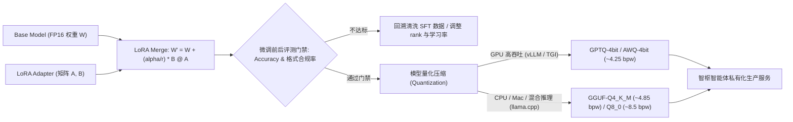

# Day 54 需求文档（PRD）、架构设计与 GitLab 协作记录

## 1. 旁白：微调效果评测、LoRA 权重合并与模型量化（GPTQ / AWQ / GGUF）

> **🎙️ 讲师旁白**：欢迎来到《智枢企业级智能体平台》第五阶段（微调与私有化部署）——**Day 54**！前两天我们完成了企业私域 SFT 数据集构建与 QLoRA 微调训练，但“训练 loss 下降”绝不等于“生产可用”：直接挂载 LoRA Adapter 推理会带来额外的旁路矩阵乘法开销；未经量化的大模型（如 14B FP16 约 28 GB）也难以塞进单张消费级或中端推理显卡。今天，Tech Lead 张工下发 **Issue #054（`v0.5.0-day54`）**，要求构建 **微调前后对比评测引擎、纯 Python LoRA 权重合并工具与 GPTQ / AWQ / GGUF 量化体积估算器**，打通“训练产出 -> 零开销合并 -> 量化压缩 -> 生产部署”的最后一公里！

---

## 2. GitLab Issue #054：微调效果回归评测、LoRA 合并与量化选型

- **提出人**：产品经理 林晓 / Tech Lead 张工
- **指派给**：AI 应用开发工程师 陈默
- **关联分支**：`feature/day-54-lora-merge-eval-quant`
- **目标版本**：`v0.5.0-day54`

### 2.1 业务与技术需求描述
1. **LoRA 权重合并（`merge_lora_weights`）**：
   - 基于纯 Python 实现矩阵乘法，严格遵循公式 $W' = W + \frac{\alpha}{r} \cdot (B @ A)$，将低秩旁路矩阵 $B \in \mathbb{R}^{m \times r}$ 与 $A \in \mathbb{R}^{r \times n}$ 合并回基座权重 $W \in \mathbb{R}^{m \times n}$。
   - 必须校验 `lora_rank > 0` 与矩阵维度兼容性，且保证不原地修改原始 `base_w`，消除推理期 Adapter 额外延迟。
2. **微调前后对比评测（`evaluate_before_after`）**：
   - 对比基座模型（Base）与微调后模型（Fine-tuned）在企业核心场景（JSON 字段抽取、Tool-Calling 工具调用、只读 SQL 生成）下的**任务准确率（Accuracy）**与**结构化格式合规率（Format Compliance）**。
   - 输出量化提升幅度（`accuracy_delta`、`format_compliance_delta`）及逐用例明细，作为微调模型准予合入的回归门禁。
3. **量化体积与显存估算（`estimate_quantized_size_gb` / `compare_quantization_formats`）**：
   - 支持对比 **FP16**、**GPTQ-4bit**、**AWQ-4bit**、**GGUF-Q4_K_M** 与 **GGUF-Q8_0（Q8_0）** 五种主流格式。
   - 精确计入 group-wise 量化 scale/zero-point 与 llama.cpp block 元数据开销，辅助架构师根据 GPU/CPU 硬件条件完成部署选型。

---

### 2.2 微调合并、量化与部署流水线

> **💡 架构师笔记（为什么必须先 Merge 再 Quantize？）**：
> 1. **零推理延迟**：未合并的 LoRA 在每次前向传播时都需要额外计算 $\frac{\alpha}{r} B(Ax)$，在长上下文高并发场景下会增加显存带宽压力与首字延迟（TTFT）。合并为单一矩阵 $W'$ 后，推理图与原生基座模型完全一致。
> 2. **量化友好性**：GPTQ 与 AWQ 依赖校准数据集统计激活值分布与 Hessian 敏感度；若在未合并的离散分支上直接量化，容易放大低秩分支的截断误差。先合并得到完整 $W'$ 再做 4-bit 校准量化，精度损失最小。

---

## 3. GitLab Merge Request !054 评审记录

- **提交说明**：`feat(day-54): 实现 LoRA 权重合并、微调前后对比评测与 GPTQ/AWQ/GGUF 量化体积估算 (v0.5.0-day54)`
- **Tech Lead 张工 Review 意见**：
  - `[通过]` `merge_lora_weights` 明确校验了 `lora_rank > 0` 与 $(m, r) \times (r, n) = (m, n)$ 维度约束，并做了非原地拷贝返回，避免污染基座权重引用。
  - `[通过]` `estimate_quantized_size_gb` 没有简单按 `4 / 16 = 0.25` 粗算，而是计入了 128-group scale/zero-point（~4.25 bpw）与 GGUF block 元数据开销（Q4_K_M ~4.85 bpw、Q8_0 ~8.5 bpw），更贴近工程实际磁盘与显存占用。
- **QA 李婷 测试结果**：
  - `pytest project_iterations/day_54/tests -v` 全部单元测试 100% PASS。
  - `verify_day.py` Notebook 执行与单元测试双校验通过，准予合并至 `main` 并打标 `v0.5.0-day54`。
